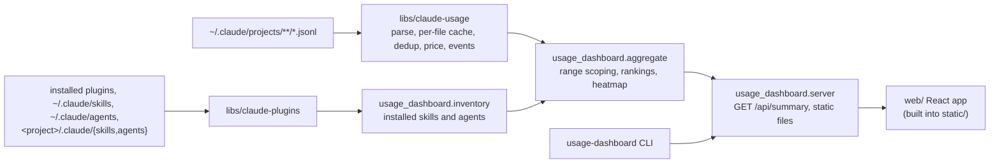

## Goal

Rebuild `apps/usage-dashboard` from scratch, inside the monorepo, as a dashboard an individual
Claude Code user installs from their local checkout (no registry publishing). The visuals must be
modern, clean, concise, and intuitive. The flow that matters most: run `usage-dashboard`, the
browser opens, and one page answers "what did I spend, on which models, in which sessions, with
which tools, skills, and subagents, and how active have I been over the year".

## Scope

**In:**

- Accurate token counts: each streamed assistant reply is counted once, every tool call in it is
  kept, and subagent transcripts are attributed to their parent session.
- Accurate cost: per-model-version prices, with unknown models flagged as unpriced instead of
  costed at $0.
- Fast refresh: only transcript files that changed are re-parsed.
- Total cost and total tokens (by token class) for the selected range.
- Cost per model, and models ranked by tokens used.
- Sessions ranked by tokens, each with a readable title, project, date, tokens, and cost.
- Tool calls ranked by count.
- Skills and subagents ranked by use count, with sessions and last-used date, plus the installed
  skills and subagents that have no uses in the range.
- A GitHub-style activity heatmap over the last 53 weeks, switchable between tokens and cost.
- Range selector: 7d, 30d (default), 90d, 1y, all.
- Loading, error, and empty states. The empty state lists the data directories searched.
- A `usage-dashboard` command that serves the page on 127.0.0.1 and opens the browser.
- Install from the local checkout with one script, plus a Windows logon autostart task that runs
  without a console window.

**Out:**

- Publishing to PyPI, npm, or any registry: the user wants local install only for now.
- Live rate-limit panel, and `C4_STATUSLINE_LIVE_TIMEOUT` with it: the user chose to drop it.
  `statusline-hook` shows limits in the terminal. The user confirmed removing the env var.
- Plan Value / ROI card, and `C4_PLAN_PRICE_USD` with it: not on the must-have list. The user
  confirmed removing the env var.
- Month-to-date projection, week-over-week deltas, hour-of-week grid, model-mix-over-time
  chart: not requested.
- CSV and Markdown export, and the project filter: not requested. The sessions table shows the
  project.
- Auto-updating prices from LiteLLM: it adds network access and upkeep. A version-keyed table is
  enough now.
- SQLite cache: the in-process per-file cache (Design / Library changes) answers the measured
  ~8 s full parse. Revisit only if a cold start becomes a complaint.
- Resume-from-sleep autostart trigger: logon autostart is enough, because the server keeps
  running through sleep.
- Expensive-prompts view, turn-by-turn timeline, waste tips: candidates for a later plan (see
  `.agents_workspace/competitor-analysis/token-dashboard.md`).
- Tokens or cost attributed to each skill or subagent: the request is for use counts.
  Attribution needs a per-turn model the library doesn't have.
- Hand-kept list of built-in skills: built-in skills used in transcripts (e.g. `claude-api`) show
  with source `unknown`, rather than keeping a second list that drifts.
- Dark-mode toggle: the theme follows the OS setting.
- VSCode extension: future TODO, per the user.
- Changes to `tools/usage-report` code: it picks up the library fixes automatically.

## Design

### Components



### Stack

- **Backend:** Python 3.11, stdlib `http.server.ThreadingHTTPServer`. A stdlib server is enough
  for one local user and one JSON endpoint. Package `usage_dashboard` lives in
  `apps/usage-dashboard/src/usage_dashboard/`, with `[tool.uv] package = true` and a hatchling
  build. Two entry points:
  - `[project.scripts] usage-dashboard = "usage_dashboard.cli:main"` for interactive use.
  - `[project.gui-scripts] usage-dashboard-bg = "usage_dashboard.cli:main"`, which runs under
    `pythonw`, so the autostart task opens no console window.
- **Dependencies:** `claude-usage` and `claude-plugins` via `[tool.uv.sources]` path entries.
  `claude-plugins` gains its third consumer. Dev dependencies: ruff, mypy (strict), pytest.
- **Frontend:** `apps/usage-dashboard/web/`, built with Bun, Vite, React 19, and TypeScript
  (strict). The user chose React. No router, since it's a single page, and no state library.
  - Test dependencies: `vitest`, `@testing-library/react`, `jsdom`.
  - `package.json` scripts: `typecheck` (`tsc --noEmit`), `test` (`vitest run`), `build`
    (`vite build`), `dev` (`vite`).
- **Charts:** no chart library. Every chart here is a ranked bar list (CSS-width bars) or the
  heatmap (CSS grid), so a library would be dead weight.
- **Theme:** Meridian (the user's choice), copied from
  `~/.claude/plugins/cache/ceh-claude-code-library/ceh-ui-design/1.0.5/skills/design-ui/references/meridian/brand.css`
  to `web/src/brand.css` and imported first. Only theme tokens are used.
- **Build output:** Vite builds into `src/usage_dashboard/static/`, which is git-ignored, and the
  server serves it.
- **Dev proxy:** Vite's dev server proxies `/api` to `127.0.0.1:8080` with `changeOrigin: true`,
  so the Host check (Design / Interface) accepts proxied requests.

### Library changes (`libs/claude-usage`)

**Compatibility:** `tools/usage-report` needs no code edits. Its `tests/smoke.sh` and `mypy` keep
passing. Existing public names keep their signatures. `model_family` is unchanged.

**Per-file parse and global merge.** Parsing is split in two:
- **Per file:** `_parse_file(path) -> FileParse` reads one transcript into records keyed for
  dedup.
- **Merge:** `load_usage` merges every `FileParse` into sessions and `Activity`. Dedup happens
  here, and is global across all files in one `load_usage` call, so resumed and forked sessions
  and folded subagent files count each reply once.

**Per-file cache:**
- A module-level dict `path -> (size, mtime_ns, FileParse)`. A file is re-parsed only when its
  size or mtime changes.
- A `threading.Lock` guards the parse-and-merge, so concurrent server requests never parse in
  parallel.
- Merging is cheap next to JSON parsing, so a refresh after one file changes costs one file's
  parse plus the merge.

**Dedup:**
- **Usage:** the key is `message.id` + `requestId` when `message.id` is present, otherwise
  `uuid`. For token usage, the last line seen for a key wins, because it carries the final usage.
- **Tool calls:** a streamed reply spreads its content blocks over several lines, so `tool_use`
  blocks are collected from every line of the message and deduped by the block's `id`. The events
  built from them (below) follow the same dedup.
- **Ordering:** token counts are added to `Activity` buckets only after dedup.

**Subagent and workflow files:**
- Every `.jsonl` anywhere under `projects/<proj>/<session-uuid>/` (including `subagents/` and
  `subagents/workflows/wf_*/`) folds into session `<session-uuid>`[:8] with project `<proj>`.
- If no `<session-uuid>.jsonl` parent file exists, the session is created from the folded files.
- `title` and `cwd` come from the parent file only.

**Pricing:**
- **`ModelPrice`:** a new frozen dataclass, `ModelPrice(input, output, cache_write, cache_read)`,
  in $ per million tokens.
- **`MODEL_PRICES`:** a new table keyed by model-id prefix. The longest matching prefix wins.
- **`MODEL_COSTS`:** stays family-keyed (`claude-opus`, `claude-sonnet`, `claude-haiku`) as the
  fallback table, with its values updated to the fallback rates below.
- **`price_for(model) -> ModelPrice | None`:** tries the prefix table, then the family fallback,
  and returns `None` for anything else. `estimated_cost` keeps its signature, prices through
  `price_for`, and adds $0 for `None` models, which the caller reports as unpriced.
- **Exports:** `ModelPrice`, `MODEL_PRICES`, and `price_for` join `__all__`.

Prefix rates come from the claude-api reference (cached 2026-10-06):

| Prefix | Input $/MTok | Output $/MTok |
| ------ | ------------ | ------------- |
| `claude-fable-5` | 10.00 | 50.00 |
| `claude-opus-5-5` | 4.00 | 20.00 |
| `claude-opus-5`, `claude-opus-4-8`, `-4-7`, `-4-6`, `-4-5` | 5.00 | 25.00 |
| `claude-opus-4` (4, 4.1) | 15.00 | 75.00 |
| `claude-sonnet-5` (5, 5.5) | 2.00 | 10.00 |
| `claude-sonnet-4` (4, 4.5, 4.6) | 3.00 | 15.00 |
| `claude-haiku-5-5` | 0.10 | 0.50 |
| `claude-haiku-4-5` | 1.00 | 5.00 |
| `claude-3-5-haiku` | 0.80 | 4.00 |

Family fallback rates in `MODEL_COSTS`: `claude-opus` 5.00 / 25.00, `claude-sonnet` 3.00 / 15.00,
`claude-haiku` 1.00 / 5.00.

Cache write = 1.25x input and cache read = 0.1x input, except where Phase 1 finds a published rate
that differs (the reference lists cache reads at $0.20 for Opus 5.5 and Sonnet 5.5, and $0.25 for
Fable 5.1).

Existing tests whose expected prices change, so Phase 1 updates them:
`test_model_costs_known_and_unknown` and `test_estimated_cost_sums_all_four_token_buckets`. Both
assert the old $15/$75 Opus rate.

**New `Session` fields:**
- **`title: str`:** the last `custom-title` record's `customTitle`. Otherwise the first
  `type: "user"` record whose content is plain text (one line, 80 characters), skipping
  `isMeta` records, `tool_result` blocks, and tag-wrapped records such as `<command-name>` and
  `<local-command-stdout>`. Otherwise the session id.
- **`cwd: str | None`:** the last `cwd` seen in the parent file.
- **`days: frozenset[date]`:** the local dates on which the session has a counted assistant
  message.

**`Activity` changes:**
- **`Activity.events: list[UsageEvent]`:** `UsageEvent(kind, name, day, session_id)`, where
  `kind` is one of:
  - `"tool"`: every deduped `tool_use` name.
  - `"skill"`: the `skill` input of a `Skill` call.
  - `"command"`: a slash command from `<command-name>/x</command-name>`, leading slash stripped.
  - `"agent"`: the `subagent_type` input of an `Agent` or `Task` call, defaulting to
    `general-purpose`.

  Events make any range summable without new per-kind rollups.
- **`ACTIVITY_DAYS`:** goes from 364 to 371, so `Activity.daily` covers the heatmap's 53 weeks.
  The existing padding test follows the constant.

### Inventory (`usage_dashboard.inventory`)

`load_inventory(claude_dirs, project_paths) -> Inventory(skills: list[Item], agents: list[Item])`,
where `Item(name, source)` and `source` is one of `user`, `plugin:<plugin>`, `project`,
`built-in`. It reads:

- **User items:** `<claude_dir>/skills/*/SKILL.md` (name = folder) and `<claude_dir>/agents/*.md`.
- **Plugin items:** `load_installed_plugins` keeps `local` and `project` entries only for the
  project root it is given. So it is called once per path in `project_paths` and once more for
  the `user` bucket, and the results are deduped by `installPath`. Each entry's skills and agents
  come from `load_plugin_skills` and `load_plugin_agents`, named `<plugin>:<member>`, where
  `<plugin>` is the registry key before `@`. No library change is needed.
- **Project items:** `<path>/.claude/skills` and `<path>/.claude/agents` for each path in
  `project_paths`.
- **Built-in agents:** a constant list: `general-purpose`, `Explore`, `Plan`, `statusline-setup`,
  `claude-code-guide`.

`project_paths` is the set of `Session.cwd` values that still exist on disk.

Rules for what shows:
- Disabled plugins are installed, so their unused members appear under "Unused".
- Used names missing from the inventory still show, with source `unknown`. Built-in skills land
  here.
- A `command` event counts as a skill use only when its name matches an inventory skill, so
  built-ins like `/clear` stay out.
- If Phase 2 finds that a slash-invoked skill also writes a `Skill` tool call, `command` events
  are not counted as skill uses at all, to avoid double counting.

### Interface

**CLI:** `usage-dashboard [--host 127.0.0.1] [--port 8080] [--claude-dir DIR ...] [--no-open]`.
`C4_CLAUDE_DIR` is still honoured through the library. The server sets
`allow_reuse_address = False`, because on Windows `SO_REUSEADDR` lets a second bind onto a busy
port succeed. On a failed bind:
- If a running dashboard answers `GET /api/health` on that port, the command opens the browser
  (unless `--no-open`) and exits 0.
- Otherwise it exits 1 with a message naming the port.

**HTTP**, bound to 127.0.0.1 by default:

- Host header check: any request whose `Host` is not `127.0.0.1:<port>` or `localhost:<port>`
  gets 403. The payload includes session titles taken from prompts, so this guards against DNS
  rebinding.
- `GET /api/health` returns `{"ok": true}`.
- `GET /api/summary?range=7d|30d|90d|1y|all` (default `30d`; anything else gets 400
  `{"error": "..."}`) returns:

  ```json
  {
    "range": "30d",
    "generated_at": "ISO-8601",
    "data_dirs": ["C:/Users/x/.claude"],
    "totals": {
      "cost_usd": 0.0,
      "tokens": {"input": 0, "output": 0, "cache_write": 0, "cache_read": 0, "total": 0},
      "sessions": 0,
      "active_days": 0,
      "unpriced_models": []
    },
    "models": [{"model": "", "tokens": 0, "cost_usd": 0.0, "sessions": 0}],
    "sessions": [{"id": "", "title": "", "project": "", "started": "", "ended": "",
                  "tokens": 0, "cost_usd": 0.0, "models": []}],
    "tools": [{"name": "", "calls": 0}],
    "skills": [{"name": "", "source": "", "uses": 0, "sessions": 0, "last_used": null}],
    "agents": [{"name": "", "source": "", "uses": 0, "sessions": 0, "last_used": null}],
    "heatmap": [{"date": "YYYY-MM-DD", "tokens": 0, "cost_usd": 0.0, "sessions": 0}]
  }
  ```

  Payload rules:
  - **Range membership:** a session falls in the range when its `ended` timestamp, converted to
    a local date, is on or after the range start. `all` has no start.
  - **`active_days`:** the number of distinct local dates in the range found in the in-range
    sessions' `days`.
  - **Ordering:** `models` is sorted by tokens descending. `sessions` holds the top 100 by
    tokens. `tools` is sorted by calls.
  - **Skills and agents:** `skills` and `agents` include zero-use inventory items, sorted by uses
    and then name. `last_used` is the latest use across all history, not just the range, so
    "never used" can be told apart from "not used lately".
  - **Heatmap:** built from `Activity.daily`, always covering the 371 days (53 weeks) ending
    today in local time, whatever the range.
- `GET /` and `GET /assets/*` serve from `static/`. If `static/index.html` is missing, `/`
  returns 503 with "frontend not built: run scripts/usage-dashboard-setup.ps1".
- Any other path returns 404.

### Page layout

One view, so there's no sidebar: a top bar plus a card grid, following the `ceh-ui-design`
dashboard rules. Sections, in this order:

1. **Top bar:** product name on the left. The range control (segmented buttons) and a refresh
   button on the right. Refresh is the one primary action. The page also refetches on window
   focus.
2. **Stat row:** total cost, total tokens (the token-class split in a tooltip), sessions, and
   active days.
3. **Activity heatmap:** full width. A Tokens / Cost toggle, month labels, Mon/Wed/Fri row
   labels, a tooltip per cell, and a Less-to-More legend.
   - **Colour:** Meridian's `--data-*` tokens are distinct hues, not a sequential ramp. So zero
     cells use a neutral surface token, and the four non-zero steps are `--data-1` mixed with the
     surface token through `color-mix()` at increasing strength.
4. **Models and Tools**, side by side: cost per model as ranked bars with tokens and cost per
   row, and the top 10 tools as bars with "Show all".
5. **Top sessions:** a table of title (truncated with a full-text tooltip), project, date,
   tokens, and cost. It shows 10 rows, with "Show 100".
6. **Skills and Subagents**, side by side: ranked bars with uses, sessions, and last used. Under
   each list, a collapsed "Unused · N" `<details>` lists the zero-use items with their source and
   all-time last use.

**States:**
- Loading: skeleton blocks shaped like the sections.
- Error: in place, with what failed and a Retry button.
- Empty (no transcripts): a title, one line, and the list of `data_dirs` searched.
- Unpriced models: a warning badge on the cost stat that lists them.

Every section labels its header with an eyebrow and a count, e.g. `MODELS · 4`.

### Install and autostart

`scripts/usage-dashboard-setup.ps1` keeps its `-Action install|uninstall` interface and its task
path `\ClaudeAutomation\usage-dashboard\usage-dashboard`, because `setup/registry.ps1` calls it
and detects that task.

- **Preflight:** fail with a clear message if `bun` or `uv` is not on PATH. Check
  `$LASTEXITCODE` after every native call, and exit non-zero on failure.
- **install:**
  1. Run `bun install --frozen-lockfile` and `bun run build` in `web/`.
  2. Run `uv tool install --editable <app dir>`.
  3. Register the logon task (trigger: at logon only) to run `usage-dashboard-bg.exe --no-open`,
     by its absolute path under `uv tool dir --bin`.
- **uninstall:** removes the task and runs `uv tool uninstall usage-dashboard`.

`usage-dashboard-start-once.ps1` is deleted, because the CLI's port check replaces it.

### CI

- **Phase 3** (when `tests/smoke.sh` is deleted), in `.github/workflows/python.yml`:
  - Remove `apps/usage-dashboard` from the `smoke` matrix.
  - Add a dedicated `pytest (usage-dashboard)` job running `uv run pytest` in
    `apps/usage-dashboard`.
  - Add a `mypy` matrix entry `{member: apps/usage-dashboard, target: src}`.
- **Phase 6:** add `.github/workflows/usage-dashboard-web.yml` (bun install with a frozen
  lockfile, `typecheck`, `test`, `build`).

## Phases

### Phase 1: Library accuracy fixes

- **Builds:**
  - In `libs/claude-usage`: the per-file parse with global merge, usage dedup, tool-block dedup,
    and subagent and workflow file folding.
  - The pricing changes: `ModelPrice`, `MODEL_PRICES`, `price_for`, and the updated
    `MODEL_COSTS` fallback, exported. Before committing the rates, confirm the cache-write and
    cache-read rates against the pricing page listed in the claude-api skill's
    `shared/live-sources.md`.
  - Update the two existing pricing tests, plus `libs/claude-usage/README.md` and `CLAUDE.md`
    (which still call `MODEL_COSTS` the whole pricing story).
- **Check:** `cd libs/claude-usage && uv run pytest && uv run mypy src` passes. It must include
  these new tests:
  - `test_dedup_keeps_last_usage_per_message_id`
  - `test_split_message_keeps_every_tool_use` (one message over two lines with two `tool_use`
    blocks counts 2)
  - `test_dedup_is_global_across_files`
  - `test_subagent_and_workflow_files_fold_into_parent`
  - `test_orphan_subagent_folder_creates_session`
  - `test_price_for_prefix_fallback_and_unknown`

  Then `cd tools/usage-report && uv run bash tests/smoke.sh` prints `PASS`, and
  `uv run mypy src` passes, with no edits to `tools/usage-report`.
- **Status:** todo

### Phase 2: Library cache, session fields, and usage events

- **Builds:**
  - The per-file cache with its lock.
  - `Session.title`, `Session.cwd`, `Session.days`, `Activity.events` (`UsageEvent`), and
    `ACTIVITY_DAYS = 371`, exported in `__all__`. README updated.
  - Check real transcripts for whether a slash-invoked skill also writes a `Skill` tool call, and
    record the answer in the Inventory section of this plan.
- **Check:** `cd libs/claude-usage && uv run pytest && uv run mypy src` passes. It must include:
  - `test_title_prefers_custom_title_then_first_plain_prompt` (skips meta, `tool_result`, and
    command-wrapped records)
  - `test_cwd_and_days_recorded`
  - `test_events_capture_tool_skill_command_agent`
  - `test_cache_reparses_only_changed_files` (counts parse calls after touching one file)

  Then on real data,
  `uv run python -c "import time,claude_usage as c; c.load_usage(); t=time.perf_counter(); c.load_usage(); print(time.perf_counter()-t)"`
  prints under 1.0.
- **Status:** todo

### Phase 3: Backend package, inventory, aggregation, API

- **Builds:**
  - Remove the old app code (`backend/`, `web/`, `usage-dashboard.py`, `tests/smoke.sh`), then
    create the `usage_dashboard` package: `cli.py`, `server.py`, `aggregate.py`, `inventory.py`.
    New `pyproject.toml` per Design / Stack.
  - Build the Inventory, `GET /api/health`, `GET /api/summary` with its payload rules, the Host
    check, and the CLI with the bind behaviour.
  - Apply the Phase 3 CI changes.
  - Add `tests/fixtures/claude/`: a small projects tree with a subagent file, a duplicate
    streamed reply, a `custom-title`, Skill, Agent, and slash-command lines, plus one user skill
    and one plugin with an unused skill.
- **Check:** `cd apps/usage-dashboard && uv run ruff check . && uv run mypy src && uv run pytest`
  passes. That includes:
  - `test_summary_totals_match_hand_computed_fixture`
  - `test_range_scoping`
  - `test_active_days`
  - `test_unused_inventory_items_listed`
  - `test_plugin_inventory_spans_projects`
  - `test_slash_builtin_not_counted_as_skill`
  - `test_index_served_from_static` (a temporary `static/` with a stub `index.html`)
  - `test_cli_exits_1_when_port_held` (port held by a plain socket)
  - `test_server_smoke` (boots on a free port: `/api/summary` 200, wrong `Host` 403, bad
    `range` 400)
- **Status:** todo

### Phase 4: Frontend foundation: shell, stats, heatmap

- **Builds:**
  - The `web/` Bun + Vite + React + TS project per Design / Stack, with Meridian `brand.css`, a
    typed API client whose types mirror the `/api/summary` payload, and the dev proxy.
  - The top bar with range control and refresh, the stat row, the activity heatmap, and the
    loading, error, and empty states.
  - Build output goes to `src/usage_dashboard/static/`, which `.gitignore` covers.
- **Check:** `cd apps/usage-dashboard/web && bun run typecheck && bun run test && bun run build`
  passes. Vitest must cover the heatmap's week-column layout (53 columns, Monday-first rows,
  today in the last column) and the states rendering from a mocked fetch. Then, from
  `apps/usage-dashboard` in bash, this prints `PASS`:
  `uv run usage-dashboard --no-open --port 8765 & pid=$!; sleep 3; curl -s -H "Host: 127.0.0.1:8765" http://127.0.0.1:8765/ | grep -q 'id="root"' && echo PASS; kill $pid`
- **Status:** todo

### Phase 5: Frontend breakdowns

- **Builds:** the Models, Tools, Top sessions, Skills, and Subagents sections per Design / Page
  layout, including the "Unused · N" lists and the unpriced-models badge.
- **Check:**
  - `bun run typecheck && bun run test && bun run build` passes. The tests render the dashboard
    from a fixture payload and assert each section's eyebrow count, the ranking order, and an
    unused skill under "Unused".
  - Manual check, because no command judges visual quality: run the app against real data, view
    it at 1440 px and 390 px widths, and pass the `ceh-ui-design` review checklist.
- **Status:** todo

### Phase 6: Install, autostart, CI, docs

- **Builds:**
  - Rewrite `scripts/usage-dashboard-setup.ps1` per Design / Install and autostart, and delete
    `usage-dashboard-start-once.ps1`.
  - Add the Phase 6 CI workflow.
  - Docs:
    - Rewrite `apps/usage-dashboard/README.md` and `CLAUDE.md`.
    - Remove `C4_STATUSLINE_LIVE_TIMEOUT` and `C4_PLAN_PRICE_USD` from the root `CLAUDE.md`
      env-var list and the root `README.md` env-var table.
    - Refresh the root `README.md` catalog line.
    - Name `usage-dashboard` as the third `claude-plugins` consumer in the root `CLAUDE.md` and
      `README.md`, and in `libs/claude-plugins` `CLAUDE.md`, `README.md`, and the `__init__.py`
      docstring.
- **Check:** `pwsh -File apps/usage-dashboard/scripts/usage-dashboard-setup.ps1 -Action install`
  exits 0. After that:
  - Stop any running instance, then
    `Start-ScheduledTask -TaskPath '\ClaudeAutomation\usage-dashboard\' -TaskName usage-dashboard`.
    Within 5 s, `curl -s -H "Host: 127.0.0.1:8080" http://127.0.0.1:8080/api/health` returns
    `{"ok": true}` and no console window is open.
  - `usage-dashboard` opens the browser on the running instance and exits 0.
  - `-Action uninstall` removes both the task and the command.
- **Status:** todo

## Open

- **Cache rates:** cache-write and cache-read rates for models without a published exception are
  assumed to be 1.25x and 0.1x input. Phase 1 confirms them against the pricing page.
- **Editable install:** `uv tool install --editable` is assumed to honour the `[tool.uv.sources]`
  path entries. Phase 6's check proves it. If it doesn't, the setup script installs a shim that
  runs `uv run --project <app dir> usage-dashboard`.
- **Built-in agents:** the built-in agent list is hand-kept and can drift from Claude Code's.
  Unknown used names still show, with source `unknown`.
- **Required checks:** making the new CI checks required needs a branch-protection change on
  GitHub, which the user does by hand.

## Record

- 2026-10-11 Planned: status ready
- 2026-10-14 Canceled before any phase was built: a new member, `apps/usage-insights`, replaces
  this app (plan: `apps/usage-insights/product/plans/usage-insights.md`). Its library sections
  are reused there.
