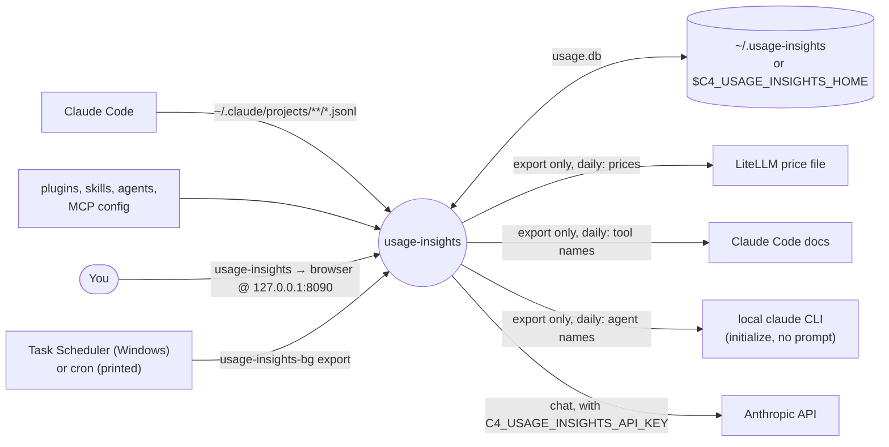
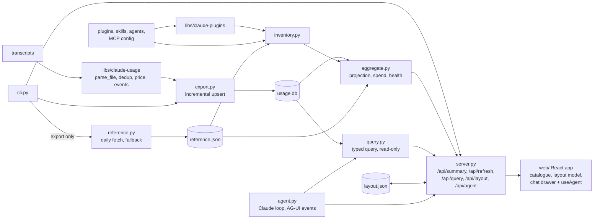
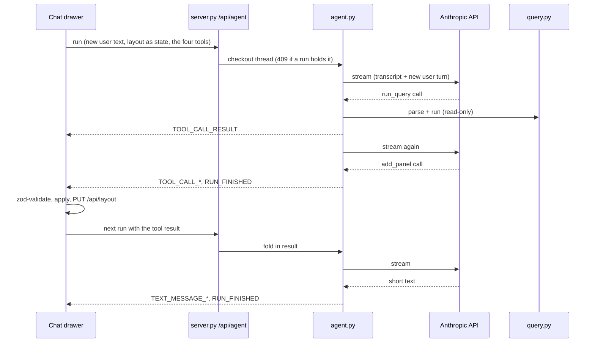
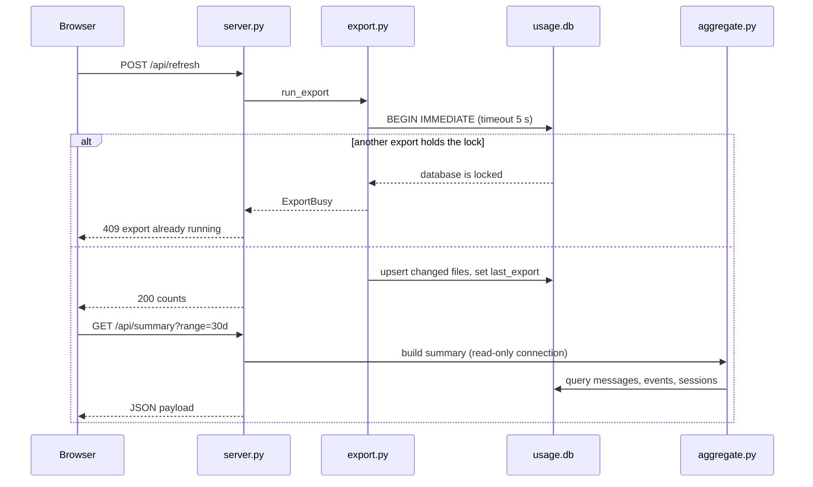

# usage-insights — Architecture

A local dashboard that answers "what will I spend?", "where does it go?", and "what should I fix?"
over Claude Code usage. An exporter copies transcripts into an upsert-only SQLite store, an
aggregator turns the store plus an inventory of installed skills, agents, and MCP servers into one
JSON payload, and a React page renders that payload through a data-driven layout. Parsing and
pricing live in the in-repo `claude-usage` library, and plugin reading in `claude-plugins`.
With an API key set, a chat drawer talks to a Claude agent over AG-UI. The agent edits a saved
layout whose generated panels each hold a typed query that the server computes.

## System context

## Components

| Module | Owns |
|--------|------|
| `cli.py` | `usage-insights` (export, then serve and open the browser) and `usage-insights export` (which also refreshes reference data); the bind-failure handling. |
| `reference.py` | `reference.json`: LiteLLM prices, docs tool names, `claude` CLI agent names, each re-fetched after 24 h, each falling back to the built-in list. |
| `query.py` | The typed query: `parse` validates a spec into `Spec`, `run` computes rows, total, and the previous-period change read-only. |
| `agent.py` | The chat loop: per-thread append-only transcript, frontend tool allowlist, `list_values` and `run_query`, one `RUN_FINISHED` or `RUN_ERROR` per run. |
| `store.py` | Schema, `PRAGMA user_version`, the backup before a rebuild, `BEGIN IMMEDIATE` and `ExportBusy`. |
| `export.py` | Skip unchanged files by size and mtime, upsert sessions, messages, and events. |
| `inventory.py` | Installed skills and agents (user, plugin, project), MCP servers, built-in lists. |
| `aggregate.py` | The `/api/summary` payload. Every tunable number is a constant at its top. |
| `server.py` | Host check, `/api/health`, `/api/summary`, `/api/refresh`, `/api/query`, `/api/layout`, the SSE response of `/api/agent`, static files. |
| `web/src/catalogue/` | Presentational components with exported props types and no fetching; `kinds.tsx` holds the four generated panel kinds and their zod schemas. |
| `web/src/layout/defaultLayout.ts` | Sections as data: `{ id, title, question, panels: { component, select }[] }`. |
| `web/src/layout/model.ts`, `edits.ts` | The saved layout (refs to default panels plus generated panels), `resolve` back to renderable panels, and the agent's four edits. |
| `web/src/hooks/useAgent.ts` | One `HttpAgent` per thread; validates each tool call, applies it, saves the layout, and answers with a tool result. |

## Key flow — a chat question

## Key flow — refresh

## Key Decisions

### 2026-10-14 — Own an upsert-only store instead of reading transcripts live

**Status:** Accepted
**Context:** Claude Code deletes old transcripts, and re-parsing 979 MB of them takes about 9 s.
**Decision:** `usage-insights export` copies transcripts into SQLite, re-parsing only files whose
size or mtime changed, and only ever upserts rows. A schema version change backs the file up to
`usage.db.bak.v<old version>` (one file per version, so a second change never overwrites the
first backup, added 2026-10-15) and rebuilds from the transcripts still on disk.
**Consequences:** History outlives Claude Code's cleanup, and a repeat export takes well under 1 s.
A schema change loses rows for deleted transcripts, so additive changes are preferred. A copy of a
reply with fewer output tokens never replaces the stored one (added 2026-10-15), because a fork's
mid-stream snapshot, re-parsed later, used to shrink the finished reply.

### 2026-10-14 — Cost is computed at query time

**Status:** Accepted
**Context:** Prices change, and the price table had errors before this app existed.
**Decision:** The store keeps token counts only. `aggregate.py` prices them with
`claude_usage.price_for` on every request. Unknown models are reported as unpriced, never $0.
**Consequences:** A price fix needs no re-export.

### 2026-10-14 — One writer, and a second export gives up instead of waiting

**Status:** Accepted
**Context:** A first export of large history can take minutes, and the scheduled task, the CLI, and
the refresh button can all start one.
**Decision:** WAL mode, one `BEGIN IMMEDIATE` per export with a 5 s timeout, and `ExportBusy` on a
locked store: the CLI prints "export already running" and exits 0, and `/api/refresh` returns 409.
**Consequences:** The server keeps reading during an export. A refresh during a long export reports
busy instead of hanging.

### 2026-10-14 — Scheduled export, server on demand

**Status:** Accepted
**Context:** `usage-dashboard` kept a server running from logon. Here, the store only has to stay
current.
**Decision:** The Windows setup registers `\ClaudeAutomation\usage-insights\export`, running
`usage-insights-bg.exe export` (a GUI-script entry point, so no console window) daily at 12:00
and at logon. macOS and Linux get a printed cron line. The `usage-insights` command exports, then
serves until Ctrl+C.
**Consequences:** No background server and no port held between uses.

### 2026-10-14 — Stdlib HTTP server bound to localhost, with a Host check

**Status:** Accepted
**Context:** One local user and two JSON endpoints, and the payload holds session titles taken from
prompts.
**Decision:** `http.server.ThreadingHTTPServer`, bound to 127.0.0.1, rejecting any `Host` that is
not `127.0.0.1:<port>` or `localhost:<port>` with 403, against DNS rebinding.
`allow_reuse_address = False`, because on Windows `SO_REUSEADDR` lets a second bind onto a busy
port succeed.
**Consequences:** No web framework dependency. The Vite dev proxy must set `changeOrigin`.

### 2026-10-15 — Same-origin refresh, and a read-only server

**Status:** Accepted
**Context:** The review found that any web page could fire a no-cors `POST /api/refresh` (the
Host check passes, since the browser sends `Host: 127.0.0.1:<port>`), and that the server opened
the store read-write.
**Decision:** A POST must be same-origin: `Sec-Fetch-Site` decides when the browser sends it
(only `same-origin` and `none` pass), else an `Origin`, when present, must be the server's own
host. `Origin` alone is not enough, because the Vite dev proxy forwards the dev server's
`Origin`. The server reads the store through `store.connect_read_only` (`mode=ro`).
**Consequences:** Only the page itself, or a tool with no `Origin` such as `curl`, can start an
export. A server bug cannot write to the store.

### 2026-10-14 — The page layout is data, ready for AG-UI

**Status:** Accepted
**Context:** A later phase lets an AG-UI agent rearrange the dashboard.
**Decision:** Every panel is a catalogue component with a typed props contract and no data fetching.
`defaultLayout.ts` lists sections and panels as data, each panel with a `select` from the payload to
its props, and `App.tsx` renders the list. Charts are CSS bars, with no chart library.
**Consequences:** The AG-UI phase replaces the layout list at runtime and adds an agent, without
touching the components.

### 2026-10-14 — "Troubled" means followed by an interrupt, not by a tool error

**Status:** Accepted
**Context:** On local data a tool error follows 39.8% of all tool calls within 15 minutes, so tool
errors flagged almost every busy skill. An interrupt follows 4.5%.
**Decision:** `troubled` needs at least 3 uses in the last 30 days, and at least 20% of them
followed by an `interrupt` in the same session within 15 minutes. The numbers are constants in
`aggregate.py`.
**Consequences:** 13 flagged skills on local data dropped to 4. Tool errors stay in the store for a
later rule.

### 2026-10-21 — Generated panels hold a typed query, never agent-written figures

**Status:** Accepted
**Context:** A chat agent places panels. A wrong figure is the worst failure for a dashboard used
to decide things, and a model writing numbers into a component can produce one.
**Decision:** A generated panel holds a query (metric, one grouping, filters, range including the
calendar month, optional previous-period comparison, limit). The server validates it once and
computes it read-only with the same row helpers as the summary. There is no free-form SQL tool,
and captions never quote a figure. Figures the agent writes in chat come from `run_query`.
**Consequences:** Every number on screen comes from the same store and code as the default
panels. Questions needing two groupings at once (cost per model per day) are out of reach until a
new chart kind exists.

### 2026-10-21 — The chat uses an API key of its own, not a subscription login

**Status:** Accepted
**Context:** Anthropic's docs reserve subscription tokens for Claude Code and claude.ai.
`ANTHROPIC_API_KEY` is read by Claude Code too, so setting it user-wide for the dashboard could
switch the user's own `claude -p` runs to API billing.
**Decision:** The key is `C4_USAGE_INSIGHTS_API_KEY`, passed explicitly to `Anthropic(api_key=...)`.
Without it `/api/agent` answers 503 and the Chat button is disabled, with a hint naming the
variable. The model defaults to
`claude-sonnet-5-5` for cost per turn, overridable with `C4_USAGE_INSIGHTS_MODEL`.
**Consequences:** Chat costs land on the user's API key, which the README states. The `claude`
CLI call used for agent names strips both key variables from its environment.

### 2026-10-21 — Prices and built-in lists are fetched daily, with the hand-kept lists as fallback

**Status:** Accepted
**Context:** The built-in price table had a wrong rate (Sonnet 5.5 cache reads), and the hand-kept
tool and agent lists drift from Claude Code's.
**Decision:** Only `usage-insights export` refreshes `reference.json`, at most once a day per part:
prices from LiteLLM's price file (overlaying `MODEL_PRICES`, so models LiteLLM lacks still
price), tool names from the docs tools table (fewer than 10 counts as a failure), and agent names
from the `claude` CLI's prompt-free `initialize` request. A failed part keeps its previous value,
and the write is a temp file plus rename. The dashboard's start, `/api/refresh`, and the tests never
touch the network.
**Consequences:** Prices and lists follow upstream within a day and fall back silently offline. The
`initialize` control request is not a documented public interface, so a CLI change falls back to
the hand-kept agent list.

### 2026-10-21 — Stream AG-UI from the stdlib server instead of adding FastAPI

**Status:** Accepted
**Context:** The AG-UI agent template runs on FastAPI and uvicorn. This app is one local user on
`ThreadingHTTPServer`.
**Decision:** `/api/agent` writes SSE from the existing handler: HTTP/1.0, no `Content-Length`,
each event written and flushed, the connection closed at the end. A failed write (Stop, a closed
tab) closes the run before its next model request, and the next run answers every unpaired tool
call with an error result. One run per thread at a time (409 otherwise), and threads live in
memory, capped at 20.
**Consequences:** The only new runtime dependencies are `anthropic` and `ag-ui-protocol`. A restart
loses chats but never the layout, which lives in `layout.json`.

### 2026-10-14 — A project is labelled by its launch folder

**Status:** Accepted
**Context:** Labelling a project by its latest `cwd` renamed a project whenever a session moved into
a subfolder.
**Decision:** The label is the basename of the `cwd` that encodes to the project folder name, else
the latest `cwd`, else the encoded folder name. Two projects with the same basename get the folder
name appended.
**Consequences:** Labels stay stable as sessions move around inside a repo.
