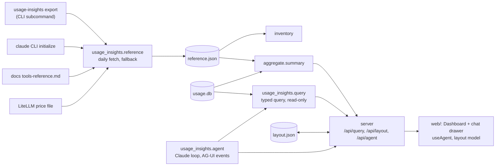

## Goal

Phase 2 of `apps/usage-insights` (the first phase is `product/plans/usage-insights.md`, built).
A user who sets an Anthropic API key in `C4_USAGE_INSIGHTS_API_KEY` opens a chat beside the
dashboard and asks an analysis question, such as "which projects got more expensive than last
month?" or "show my Opus spend per week".
The agent answers by placing new panels on the dashboard and can rearrange or remove panels. The
agent never writes a figure into a panel. Each generated panel holds a **typed query**, the server
computes the result from the store, and the component draws it. So every number on screen comes
from the same store as the default panels. The page always starts from the default layout, never a
blank canvas. The user's edited layout is saved and survives a restart, and Reset restores the
default. Without a key, the chat is hidden and the dashboard works as it does today. The same phase
replaces the hand-kept prices, built-in tool list, and built-in agent list with data fetched by
the `usage-insights export` command, falling back to the hand-kept versions.

## Scope

**In:**

- Prices fetched from LiteLLM's public price file by `usage-insights export` (the scheduled
  task), at most once a day, overlaying the built-in table. The built-in table is the fallback,
  and its Sonnet 5.5 cache-read rate is corrected if the pricing page shows it is wrong. The
  payload says which price source was used.
- Built-in tool names fetched from the Claude Code docs tools table, and built-in agent names from
  the `claude` CLI's prompt-free `initialize` control request, by the same command at most once a
  day, with the hand-kept lists as the fallback.
- `POST /api/query`: a typed query (metric, grouping, filters, range including the calendar month,
  an optional previous-period comparison, limit) that the server validates and runs read-only
  against the store.
- Four generated panel kinds: bars, trend, table, and stat. Each holds a title, a caption, and a
  query, and draws the server's result for it.
- A serialisable layout: sections of panels, where a panel is either a reference to a default panel
  or a generated panel. It is saved to `layout.json` in the store dir, read on load, and cleared by
  Reset.
- A generated panel without its own range follows the top bar's range.
- `POST /api/agent`: an AG-UI endpoint on the existing server that streams a Claude run over SSE,
  with backend tools to list filter values and preview a query, and the layout edits passed
  through as frontend tools.
- A chat drawer on the page, with New chat and Stop, shown only when `C4_USAGE_INSIGHTS_API_KEY`
  is set.
- Agent layout edits: add a generated panel to a section, add a section, move a panel, remove a
  panel. Every edit is validated, applied, and saved.
- `C4_USAGE_INSIGHTS_API_KEY` holds the key, and `C4_USAGE_INSIGHTS_MODEL` picks the model,
  default `claude-sonnet-5-5`.
- Docs: README (key, cost, the three network sources), CLAUDE.md, ARCHITECTURE.md, and the root
  env-var lists.

**Out:**

- Retiring `apps/usage-dashboard`: the user's call, after this phase ships, in its own change.
- Claude subscription login (`claude -p` or Agent SDK OAuth): Anthropic's docs reserve
  subscription tokens for Claude Code and claude.ai, so the agent uses an API key only.
- The agent writing figures into a panel, or a free-form SQL tool: a wrong figure is the worst
  failure for a decision dashboard, and a typed query cannot carry one.
- Saved chat threads: they live in server memory. A restart loses the chat, never the layout.
- Several named dashboards, undo history beyond Reset, and per-panel resizing: one layout is
  enough to learn whether users rearrange at all.
- A second grouping (e.g. daily cost per model): one grouping plus a previous-period comparison
  answers the Goal's questions, and two-level results need a new chart kind.
- Human approval steps and live state panels (`ceh-ag-ui` add-ons): no agent action here is
  irreversible, since Reset restores the default.
- Other providers (Bedrock, Vertex, Foundry): the `anthropic` SDK supports them through its own
  env vars, but nothing here is tested against them.
- Editing `defaultLayout.ts`'s panels or the `/api/summary` payload beyond the fields named below.
- Plan-limit forecasts: still not in the transcripts.

## Design

### Components



### Stack additions

- **Python runtime deps:** `anthropic` (the Claude client) and `ag-ui-protocol` (AG-UI event
  types and the SSE encoder). The server stays stdlib `ThreadingHTTPServer`. One local user needs
  no ASGI server. The handler speaks HTTP/1.0, so the SSE response sends no `Content-Length`,
  writes and flushes each event, and ends by closing the connection. Network fetches use stdlib
  `urllib.request`.
- **Frontend deps:** `@ag-ui/client` (`HttpAgent`) and `zod` (tool argument schemas), as in the
  `ceh-ag-ui:build-ag-ui` canvas template. The theme stays Meridian. No chart library: the trend
  panel reuses `PaceStrip`'s CSS bars.

### Reference data (`usage_insights.reference`, `libs/claude-usage`)

- **Cache file:** `<store dir>/reference.json` =
  `{"prices": {...}, "prices_fetched": ISO|null, "tools": [...], "agents": [...], "lists_fetched": ISO|null}`.
  `reference.refresh(home, now, progress)` runs only in the `usage-insights export` subcommand in
  `cli.py` (the scheduled task's command), before `run_export`. It does not run inside
  `run_export`, on the serve path, or in `/api/refresh`, so tests that call `run_export` and the
  dashboard's start never wait on the network. It re-fetches a part only when that part's
  timestamp is missing or older than `REFERENCE_MAX_AGE_H = 24`, and prints one line per fetch
  (`fetched prices`, `fetched tool list`, `fetched agent list`) and one per failure. A failed
  fetch keeps the previous part and its timestamp. It never raises. It writes `reference.json.tmp`
  and renames it, so a reader never sees half a file, and two concurrent exports at worst both
  fetch.
- **Reading it:** `reference.load(home) -> Reference` (frozen dataclass: `prices`,
  `prices_fetched`, `tools`, `agents`) returns empty values when the file is missing or
  unreadable, which means "use the built-in table and lists". The server calls it per request.
- **Tests never touch the network:** an autouse fixture in `tests/conftest.py` makes
  `urllib.request.urlopen` and `subprocess.run` inside `usage_insights.reference` raise, so any
  test that reaches them unstubbed fails loudly.
- **Prices:** GET
  `https://raw.githubusercontent.com/BerriAI/litellm/main/model_prices_and_context_window.json`,
  timeout 10 s. `claude_usage.prices_from_litellm(data) -> dict[str, ModelPrice]` (new, exported)
  keeps entries whose `litellm_provider` is `anthropic` and whose key starts with `claude-`, mapping
  per-token costs x 1e6: `input_cost_per_token`, `output_cost_per_token`,
  `cache_creation_input_token_cost`, `cache_read_input_token_cost`, and
  `cache_creation_input_token_cost_above_1hr` (missing: 2x input). An entry missing input or output
  cost is skipped. Only the parsed table is cached (22 entries on 2026-10-21), not the 3 MB file.
- **Price lookup:** `price_for(model_id, prices=None)` and `estimated_cost(counts, prices=None)`
  gain an optional overlay. The longest prefix is matched over `{**MODEL_PRICES, **prices}`, so a
  fetched exact id beats a built-in prefix, and models LiteLLM lacks (`claude-opus-4`,
  `claude-3-5-haiku`) still price from the built-in table. Existing callers pass nothing and are
  unchanged.
- **Built-in tools:** GET `https://code.claude.com/docs/en/tools-reference.md`, timeout 10 s. The
  names are the first backticked cell of each row of the first Markdown table whose header starts
  `| Tool`. Fewer than 10 names is treated as a failed fetch, so a page redesign falls back instead
  of emptying the list.
- **Built-in agents:** when `shutil.which("claude")` finds it, call
  `subprocess.run([path, "-p", "--input-format", "stream-json", "--output-format", "stream-json", "--verbose", "--no-session-persistence"], input=<line>, capture_output=True, timeout=INIT_TIMEOUT_S)`
  with `INIT_TIMEOUT_S = 20`, the user's home as cwd, and `<line>` =
  `{"type":"control_request","request_id":"ui","request":{"subtype":"initialize"}}` plus a newline.
  Closing stdin ends the CLI after it answers. The timeout bounds the whole call, and
  `TimeoutExpired` is a failed fetch. The child's env is the parent's minus `ANTHROPIC_API_KEY`
  and `C4_USAGE_INSIGHTS_API_KEY`, so it never runs on API billing. On Windows, pass
  `creationflags=subprocess.CREATE_NO_WINDOW`, because the scheduled export runs under `pythonw`.
  The list is the `agents[].name` of the `control_response` line whose `request_id` is `ui`. No
  prompt is sent, so no model turn runs (checked 2026-10-21 on Claude Code 2.1.306: exit 0, 5
  agents returned).
- **Use:** `inventory.load_inventory` takes the cached tool and agent lists in place of
  `BUILTIN_TOOLS` and `BUILTIN_AGENTS` when present, and those constants stay as the fallback. An
  agent from the CLI that is also found as a file keeps the file's source.
  `aggregate.summary(..., prices=None)` gains a `prices` parameter. The server passes
  `reference.load(home).prices`, and `summary` uses it for both the cost and the unpriced-model
  check, so a model priced only by LiteLLM is not reported as unpriced. The payload's `totals` gains
  `"prices_as_of": ISO|null` (`null` = built-in table), shown in the unpriced-models badge area as
  "Prices from LiteLLM, <date>" or "Built-in prices".

### Query (`usage_insights.query`, `POST /api/query`)

**Spec**, parsed once at the boundary into a frozen dataclass. Anything else gets 400
`{"error": "..."}` naming the field:

```json
{
  "metric": "cost_usd | tokens | sessions | skill_uses | agent_uses | tool_calls | interrupts",
  "group_by": "none | project | model | session | day | week | skill | agent | tool",
  "filters": {"project": ["label"], "model": ["id prefix"], "name": ["skill, agent or tool name"]},
  "range": "7d | 30d | 90d | month | all",
  "compare": "previous",
  "limit": 12
}
```

- Every field except `metric` is optional. `group_by` defaults to `none`, `filters` to none,
  `compare` to none, `limit` to 12 (1 to 100), and `range` to the request's `?range=` (the top
  bar's range).
- **Ranges:** `Nd` starts today minus (N − 1) days, as in `aggregate`. `month` is the calendar
  month to date, from the 1st. `all` has no start.
- **Compare:** with `compare: "previous"`, each row also carries `previous`, the same metric for
  the same key over the previous period, and `change`, the ratio against it (`null` when
  `previous` is 0). The previous period is the equal-length window before an `Nd` range, the same
  days 1 to today of the previous calendar month for `month`, and not allowed for `all` (400).
  `compare` is not allowed with `day` or `week` groupings (400), because their keys don't repeat
  across periods.
- **Metric families:** `cost_usd`, `tokens`, and `sessions` read `messages`, and group by `none`,
  `project`, `model`, `session`, `day`, or `week`. `skill_uses` reads `skill` and `command` events
  (a `command` only when it matches an inventory skill, as in `aggregate`), and groups by `none`,
  `skill`, `project`, `day`, or `week`. `agent_uses` reads `agent` events, with groupings `none`,
  `agent`, `project`, `day`, or `week`. `tool_calls` reads `tool` events, with groupings `none`,
  `tool`, `project`, `day`, or `week`. `interrupts` reads `interrupt` events, with groupings
  `none`, `project`, `day`, or `week`. Any other pair is a 400 that names the allowed groupings.
  The `name` filter applies only to event metrics, and `model` only to message metrics.
- **Filters:** `project` matches display labels exactly, applied in Python after labelling,
  because labels are computed, not stored. `model` matches an id prefix with
  `substr(model, 1, length(?)) = ?`, never `LIKE`, so `%` and `_` are literal. `name` matches
  exactly, as a bound parameter.
- **Semantics match `aggregate`:** local dates with `tz=None`, the same range start, project
  labels from `aggregate._labels` (made public as `project_labels`), and cost from
  `estimated_cost` with the cached prices. `week` is the Monday's date. `day` and `week` series
  include zero buckets across the range (`all`: from the first row), sort by key, and are never
  cut by `limit`. Other groupings sort by value descending, and `limit` keeps the top rows.
- **Result:**
  `{"metric", "group_by", "range", "unit": "usd|tokens|count", "rows": [{"key": str, "label": str, "value": number, "previous"?: number, "change"?: number|null}], "total": number, "truncated": bool}`.
  `label` equals `key`, except for `session`, where it is the session title (else the id). `total`
  covers the whole range before `limit`. For `sessions` it is the count of distinct sessions, not
  the sum of the rows, because one session can touch several days or models. `truncated` is true
  when `limit` cut rows.
- **Read-only:** `store.connect_read_only`. SQL identifiers come from constant maps keyed by the
  enum values, and filter values are bound parameters. A missing store returns empty rows.
- **HTTP:** `POST /api/query?range=<top bar range>` with the spec as the JSON body. It passes the
  Host and same-origin checks like every POST. It returns 400 `{"error": "..."}` on a bad spec and
  500 `{"error": "..."}` on anything else.
- **Shared code:** the per-row loops that `aggregate.summary` and `query.run` both need (message
  cost, labels, local date) move into small functions in `aggregate.py` that both call, so the two
  cannot disagree. `aggregate`'s output stays byte-identical, which its existing tests pin.

### Layout (`layout.json`, `/api/layout`)

- **Shape:**
  `{"version": 1, "sections": [{"id", "question", "note"?, "panels": [Ref | Generated]}]}`, with
  `Ref = {"ref": "<defaultLayout panel id>"}` and
  `Generated = {"id", "kind": "bars|trend|table|stat", "title", "caption", "query": Spec, "wide"?}`.
- **Default:** `defaultLayout.ts` keeps its `Section[]` with `select` functions, unchanged.
  `web/src/layout/model.ts` adds `toLayout(defaultLayout)` (the default as refs) and
  `resolve(layout)` (refs back to their `Panel`, so one renderer draws both). An unknown ref is
  dropped, and a generated panel failing the zod schema is dropped, so a bad file never blanks the
  page.
- **Panel ids:** a ref's id is its `ref` value (the `defaultLayout` panel id). A generated panel's
  id is `g-` plus `crypto.randomUUID()`, set by the canvas, never by the agent. `resolve` keeps
  the first panel with a given id and drops later duplicates. Section ids follow the same rule:
  default sections keep theirs, and new ones are `s-` plus a UUID.
- **Endpoints:** `GET /api/layout` returns the saved layout, or 204 when there is none (the page
  uses the default). `PUT /api/layout` saves the request body after checking it is a JSON object
  with `version: 1` and a `sections` list, no larger than `LAYOUT_MAX_BYTES = 262144`. It writes to
  `layout.json.tmp` then renames, so a crash never leaves half a file. `DELETE /api/layout` removes
  the file (Reset). PUT and DELETE pass the Host and same-origin checks, and the browser is the only
  writer.
- **Store invariant:** "only an export writes `usage.db`" still holds. Request handlers write
  `layout.json` and nothing else, apart from the export that `/api/refresh` already runs. The
  `export` subcommand writes `usage.db` and `reference.json`.

### Generated panels (`web/src/catalogue/`)

- Each kind is a `defineComponent({ name, description, schema, example, Component })` entry,
  ported from the `ceh-ag-ui` template's `define.ts`, so a style-like key in a schema throws at
  startup. Unlike the template, a kind is not a tool of its own. The `add_panel` tool's schema is
  a zod discriminated union on `kind`, built from the four kind schemas and checked by the same
  style-key guard. Each kind's `description` and `example` go into `add_panel`'s tool description.
  `QueryPanel` fetches `/api/query` for its spec and the current range, and then renders:
  - `bars`: `RankedBars` from `rows` (`label`, `value`, and the change as secondary text when
    `compare` is set).
  - `trend`: the `PaceStrip` bars, with `group_by` `day` or `week` required by the schema.
  - `table`: a table of Label and Value, plus Previous and Change when `compare` is set, formatted
    by `unit`.
  - `stat`: one figure, `total`, with `group_by` `none` required by the schema, and the change
    when `compare` is set.
- Each shows the same loading, error (with Retry), and empty ("No data for this query in the last
  N days") states as the page, inside its card. Its eyebrow is the title, and its caption is the
  agent's caption.
- The existing six components are not exposed as agent tools. They render only through refs, so
  their props stay payload-shaped.

### Agent (`usage_insights.agent`, `POST /api/agent`)

- **Enabled** when `C4_USAGE_INSIGHTS_API_KEY` is set. The server passes it explicitly as
  `Anthropic(api_key=...)`. It is not `ANTHROPIC_API_KEY`, because Claude Code reads that variable
  too, and setting it in the user environment for the dashboard could switch the user's own
  `claude -p` runs to API billing. `/api/summary` gains `"chat": {"enabled": bool}`. A POST to
  `/api/agent` without a key gets 503
  `{"error": "set C4_USAGE_INSIGHTS_API_KEY to use the chat"}`. The path sits under `/api`, so
  Vite's existing dev proxy forwards it. `/api/agent` passes the Host and same-origin checks,
  because every run spends the user's API credit.
- **Model:** `C4_USAGE_INSIGHTS_MODEL`, default `claude-sonnet-5-5`, for cost per turn. The builder
  takes the request parameters (streaming, `max_tokens`, `effort`, `eager_input_streaming`,
  fallbacks) from the `claude-api` skill's current guidance when building, not from memory.
- **Loop:** a sync port of the `ceh-ag-ui:build-ag-ui-agent` template's `main.py`, following its
  six rules. One `Thread` per `threadId` holds the model's own transcript, and only new AG-UI
  messages are folded in. Frontend tools pass through, and the run ends on the first frontend tool
  call. Held backend results go out with the canvas's results. An unanswered frontend call gets an
  error result on the next run. Client `system`, `developer`, and `assistant` messages are ignored.
  Every run ends with exactly one `RUN_FINISHED` or `RUN_ERROR`.
- **Stop and limits:** a `BrokenPipeError` or `ConnectionResetError` while writing an event means
  the browser stopped the run (Stop, or a closed tab). The loop then stops calling the model, and
  the unanswered calls get error results on the next run, as above. `MAX_BACKEND_ROUNDS = 8` caps
  model requests per run, after which the run ends with `RUN_ERROR` "Too many steps, try a
  narrower question".
- **One run per thread:** each `Thread` holds a lock. A run that arrives while another holds it
  gets 409 `{"error": "this chat is already running"}`, so a double send cannot interleave two
  transcripts.
- **Frontend tool allowlist:** only the names in `FRONTEND_TOOLS` below are passed to the model.
  Any other tool in `run.tools` is dropped, so the browser cannot add tools to the prompt.
- **Frontend tools** (the canvas applies them to the layout and saves it):
  - `add_panel {section_id, kind, title, caption, query, wide?}`
  - `add_section {question, note?}`, which returns the new id in its tool result
  - `move_panel {panel_id, section_id, index}`
  - `remove_panel {panel_id}`
- **Backend tools** (run by the server, read-only, input validated in the handler because eager
  streaming skips API validation):
  - `list_values {dimension: project|model|skill|agent|tool}`: names seen in the store, so filters
    use real labels.
  - `run_query {query}`: the same `query.run`, so the agent can check a query returns rows before
    placing it, and answer in chat from its result.
- **State:** each run's `state` carries the current layout as `{sections: [{id, question, panels: [{id, title}]}]}`
  (titles of refs from their eyebrow), so the agent knows what exists. The server validates it
  (ids and titles are strings, at most 50 sections and 200 panels, else it is dropped) and adds it
  as a text block, "Current layout: <json>", to the start of the new user turn. It goes into the
  user turn, after any tool results the turn carries (the API requires those first), and only
  when it changed since the last turn. It stays out of the system prompt, so that stays
  cacheable and browser-written text never enters it. The system prompt says: the
  app fixes how panels look, a panel only ever shows its query's result, captions describe what the
  panel answers and never quote a figure, and figures in chat text come from `run_query` results.
- **Threads:** in memory, keyed by `threadId`, capped at `MAX_THREADS = 20` (oldest dropped). The
  marker reads `# less-code: in-memory threads; persist if chats must survive a restart`. When the
  API rejects a request for context length, the run ends with `RUN_ERROR` and the message "This chat
  is too long, start a new chat".

### Chat drawer (`web/src/components/ChatDrawer.tsx`, `web/src/hooks/useAgent.ts`)

- A "Chat" button in the top bar, shown only when `chat.enabled`, opens a right-side drawer (full
  width under 768 px) with the transcript, an input, Stop, and New chat. It starts with three
  starter prompts: "Which projects cost more than last month?", "Show my daily cost this month",
  and "Which skills do I use most?". While a run is going, the drawer shows "Working…", the input
  and the send button are disabled, and Stop is shown. Stop is hidden otherwise.
- `useAgent` is the template's hook: one `HttpAgent` per thread (`useMemo`), the four frontend
  tools with zod schemas, `safeParse` before applying, an `error:` tool result on a failed parse or
  an unknown id, and `MAX_TOOL_ROUNDS = 5` per user message. Stop calls `abortRun()`, and New chat
  makes a new `threadId`.
- Applying an edit updates the layout state and PUTs it. A failed save shows "Could not save the
  layout" in the drawer, and the edit stays on screen. The top bar gets a Reset layout button
  (shown when a saved layout exists) that DELETEs it and returns to the default.
- The drawer lists each run's text messages, and one line per placed panel ("Added panel: <title>").
  `RUN_ERROR` shows its message with a Retry that resends the last user message.

## Phases

### Phase 1: Fresh prices and built-in lists

- **Builds:**
  - In `libs/claude-usage`: `prices_from_litellm` and the `prices` overlay on `price_for` and
    `estimated_cost`, exported, plus README and CLAUDE.md. The Sonnet 5.5 cache-read rate in
    `MODEL_PRICES` is checked against the pricing page in the `claude-api` skill's live sources
    and corrected if it is wrong, with the existing pricing test updated to pin it.
  - In the app: `reference.py` per Design / Reference data, called from the `export` subcommand
    in `cli.py`, and the autouse network-blocking fixture in `tests/conftest.py`. The inventory
    and `aggregate.summary(..., prices=)` read it, and `totals.prices_as_of` reaches the
    frontend's unpriced-models badge area.
- **Check:**
  - `cd libs/claude-usage && uv run pytest && uv run mypy src` passes, including
    `test_prices_from_litellm_maps_anthropic_entries` (a trimmed real entry, with a non-anthropic
    entry and one missing output cost skipped), `test_overlay_exact_id_beats_builtin_prefix`, and
    `test_no_overlay_is_unchanged`.
  - `cd apps/usage-insights && uv run ruff check . && uv run mypy src && uv run pytest` passes,
    including `test_refresh_skips_fresh_parts` and `test_refresh_failure_keeps_previous` (with
    `urlopen` and `subprocess` stubbed), `test_tools_table_parse_and_minimum`,
    `test_initialize_reads_agents` (a stubbed `subprocess.run` returning a recorded
    `control_response` line, and asserting the child env has no API key),
    `test_reference_load_unreadable_is_empty`, `test_litellm_only_model_is_not_unpriced`, and
    `test_inventory_uses_reference_lists_else_constants`. Every existing test still passes with
    the network-blocking fixture on, which proves `run_export` and the server never fetch. Also
    `cd tools/usage-report && uv run bash tests/smoke.sh` and
    `cd apps/usage-dashboard && uv run bash tests/smoke.sh` each print `PASS`, unedited.
  - On real data, with a temp `C4_USAGE_INSIGHTS_HOME`: `uv run usage-insights export` prints the
    three `fetched` lines and writes `reference.json` holding at least 20 prices, at least 40
    tools, and at least 4 agents. A second run within the hour prints no `fetched` line, and the
    `prices_fetched` and `lists_fetched` timestamps are unchanged.
- **Status:** done. Lib: `uv run pytest` 47 passed, 100% coverage, mypy clean. App: ruff and
  mypy clean, `uv run pytest` 39 passed. Both smoke scripts print `PASS`. Real data (temp
  store): first export printed `fetched prices`, `fetched tool list`, `fetched agent list` and
  wrote 22 prices, 46 tools, 5 agents. The second printed no `fetched` line and kept both
  timestamps. No new `.jsonl` under `~/.claude/projects`. The pricing page gives Sonnet 5.5
  cache hits as $0.10 (0.05x input), so `MODEL_PRICES` was corrected from $0.20. The docs site
  answers 403 to urllib's default User-Agent, so fetches send `User-Agent: usage-insights`.
  The four existing `cli export` tests now reach `refresh`, so `test_export.py` gained one
  autouse fixture stubbing it; the tests themselves are unedited.

### Phase 2: Typed query endpoint

- **Builds:** `query.py` and `POST /api/query` per Design / Query, plus the shared row functions in
  `aggregate.py`.
- **Check:** `cd apps/usage-insights && uv run ruff check . && uv run mypy src && uv run pytest`
  passes, including:
  - `test_query_matches_summary` (project cost and model cost for each range equal
    `summary()`'s `projects` and `models`)
  - `test_query_compare_matches_summary_change` (`cost_usd` by `project` with `compare` gives the
    same `change` as `summary()`'s `projects` for 30d)
  - `test_query_month_range_and_previous_month` (fixed clock on the 10th: `month` covers days 1
    to 10, and its previous period is days 1 to 10 of the month before)
  - `test_query_rejects_bad_specs` (an unknown metric, a disallowed metric and grouping pair, a
    limit of 0, a non-list filter, `compare` with `all`, and `compare` with `day` each give a
    `ValueError` naming the field)
  - `test_query_day_series_is_never_cut` (a 30d `day` query with the default limit returns 30
    rows ending today, zero days included)
  - `test_query_sessions_total_is_distinct` (one session over two days: rows sum to 2, `total` is 1)
  - `test_query_skill_uses_counts_typed_skill_once`
  - `test_query_model_filter_is_literal` (a model filter of `"%"` returns no rows)
  - `test_query_session_label_is_title`
  - `test_server_query_endpoint` (200 with rows, 400 on a bad spec, 403 on a cross-site POST)
  - Every existing aggregate test, unedited.
- **Status:** done. `uv run ruff check . && uv run mypy src && uv run pytest`: clean, clean,
  67 passed, `tests/test_aggregate.py` unedited. Choices the Design left open: a spec field
  outside the six is a 400 naming it; `filters.model` on an event metric and `filters.name` on
  a message metric are 400s, not ignored; the `model` grouping leaves out `unknown` like the
  summary's model list; `group_by: none` returns one row, key `all`, label `All`; the request
  body is capped at 16 KB.

### Phase 3: Serialisable layout and generated panels

- **Builds:** `/api/layout` (GET, PUT, DELETE) per Design / Layout, `web/src/layout/model.ts`, the
  `defineComponent` helper, `QueryPanel` and the four kinds per Design / Generated panels, and
  `Dashboard` rendering a resolved layout. `App` loads the saved layout or the default, and the
  Reset layout button.
- **Check:**
  - `cd apps/usage-insights && uv run pytest` passes, including `test_layout_roundtrip_and_reset`,
    `test_layout_rejects_oversize_and_bad_shape`, and `test_layout_write_is_atomic` (no `.tmp`
    left after a PUT).
  - `cd apps/usage-insights/web && bun run typecheck && bun run test && bun run build` passes.
    Vitest covers: `resolve(toLayout(defaultLayout))` renders the same panels as today (the
    existing `App.test.tsx` assertions stay, with its fetch mocks updated to answer
    `GET /api/layout` with 204 first), an unknown ref, an invalid generated panel, and a
    duplicate id are dropped, each kind renders from a mocked `/api/query`, `trend` without a day or week grouping
    fails its schema, `defineComponent` throws on a `style` key, and a generated panel refetches
    when the top bar range changes.
- **Status:** done. `uv run pytest`: 70 passed. `bun run typecheck && bun run test && bun run
  build`: clean, 42 passed, built. `App.test.tsx` assertions are unedited: its fetch stub answers
  `GET /api/layout` with 204 and sends every other call to the test's own mock. The trend kind
  draws through `DayBars`, extracted from `PaceStrip` with the same markup. `kinds.tsx` also
  exports `panelSchema` (the union without `id`), which Phase 5's `add_panel` uses. Reset
  failures show "Could not reset the layout" in the top bar's message line.

### Phase 4: Agent endpoint

- **Builds:** `agent.py` and `POST /api/agent` per Design / Agent, the `chat.enabled` payload
  field, and the `anthropic` and `ag-ui-protocol` dependencies.
- **Check:** `cd apps/usage-insights && uv run ruff check . && uv run mypy src && uv run pytest`
  passes with no API key in the environment. A scripted stand-in replaces the client's stream
  method, yielding `content_block_*` events and a final message. The suite includes:
  - `test_agent_import_needs_no_key`
  - `test_run_ends_on_frontend_tool_call` (events end `TOOL_CALL_END`, then `RUN_FINISHED`)
  - `test_backend_tool_runs_and_loop_continues` (`run_query` produces a `TOOL_CALL_RESULT`, then
    a second model request)
  - `test_unanswered_frontend_call_gets_error_result`
  - `test_transcript_is_append_only` (each request's `messages` starts with the previous one's)
  - `test_unknown_frontend_tool_dropped` and `test_client_system_message_ignored`
  - `test_layout_state_goes_into_user_turn` (and an oversized state is dropped)
  - `test_disconnect_stops_model_calls` (a write raising `BrokenPipeError` ends the loop with no
    further stream call)
  - `test_backend_rounds_capped`
  - `test_concurrent_run_on_thread_gets_409`
  - `test_agent_503_without_key` (with `ANTHROPIC_API_KEY` set and
    `C4_USAGE_INSIGHTS_API_KEY` unset, the chat stays disabled) and `test_agent_403_cross_site`
  - `test_exception_becomes_run_error`
  - A boot check: the server on a free port answers a scripted run on `/api/agent` with
    `text/event-stream` events ending in `RUN_FINISHED`, read until the connection closes.
- **Status:** done. With no API key in the environment: ruff and mypy clean, `uv run pytest`
  87 passed (17 in `tests/test_agent.py`). `anthropic` resolved to 2.0.0; its
  `beta.messages.stream` takes the template's parameters unchanged. Request parameters, from the
  `claude-api` skill: streaming, `max_tokens` 64000, `effort: medium`, `eager_input_streaming`
  on every tool, `fallbacks: "default"` with the `server-side-fallback-2026-07-01` beta, plus
  top-level `cache_control` for automatic prompt caching. Departures from the template, needed
  for Stop: every `tool_use` id stays in `awaiting` until its result is held or sent, so a
  disconnect at any point leaves the next run able to pair it. The layout block follows the
  canvas's tool results, not before them (the API wants `tool_result` blocks first in a user
  turn), and is sent only when it changed. The write loop is `agent.pump`, so the
  `BrokenPipeError` test needs no socket.

### Phase 5: Chat drawer

- **Builds:** `useAgent`, `ChatDrawer`, the top bar's Chat button, and layout edits applied and
  saved per Design / Chat drawer.
- **Check:**
  - `cd apps/usage-insights/web && bun run typecheck && bun run test && bun run build` passes.
    Vitest uses a mocked `HttpAgent` that emits AG-UI events, and covers: `add_panel` places a
    panel and PUTs the layout, `add_panel` with a `style` key renders without it, invalid
    arguments return an `error:` tool result and place nothing, `remove_panel` with an unknown id
    returns an error result, the Chat button is hidden when `chat.enabled` is false, the input is
    disabled and Stop shown only while a run is going, Stop leaves placed panels, and a failed
    save shows its message.
  - The Phase 5 serve check from the first plan, rerun: it prints `PASS`.
  - Live check, which spends API credit, so the builder asks the user before running it, smallest
    scope first: with a key set, one prompt, "Which projects cost more than last month?". It
    places a `bars` or `table` panel whose query has `group_by: project`, `range: month`, and
    `compare: previous`, and whose figures match `/api/query` for that spec. The panel is still
    there after a page reload. Then view at 1440 px and 390 px against the `ceh-ui-design`
    review checklist, which no command can judge.
- **Status:** todo, waiting on the live check only. `bun run typecheck && bun run test && bun
  run build`: clean, 51 passed (9 in `ChatDrawer.test.tsx`), built. The tests run the real
  `HttpAgent` against a stubbed `fetch` that answers `/api/agent` with scripted SSE events, not a
  mocked `HttpAgent` class, so the client's own event parsing is covered too. The first plan's
  serve check prints `PASS`. Layout review with a dummy key (no message sent, no API call):
  at 1440 px the open drawer covered the right column and the Chat button, so the page now pads
  right while it is open; at 390 px (iframe) the drawer sat 10 px off-screen because `100vw`
  counts the scrollbar, so it is now anchored with `inset: 0`. Both fixed and rechecked. Found
  while building: `HttpAgent.runAgent` resolves on `RUN_ERROR`, so `useAgent` reads it through
  `onRunErrorEvent`. Not run: the live prompt, because `C4_USAGE_INSIGHTS_API_KEY` is not set in
  this environment and the run spends API credit.

### Phase 6: Docs

- **Builds:**
  - `apps/usage-insights/README.md`: the chat, `C4_USAGE_INSIGHTS_API_KEY` (and why it is not
    `ANTHROPIC_API_KEY`) and its cost, `C4_USAGE_INSIGHTS_MODEL`,
    the three network sources (LiteLLM, the docs page, the local `claude` CLI) and their fallbacks,
    `layout.json`, `reference.json`, and Reset.
  - `CLAUDE.md`: new modules and the updated store invariant.
  - `product/ARCHITECTURE.md`: diagram and Key Decisions (typed query over agent-written figures,
    API key over subscription login, fetched reference data with fallback, stdlib SSE over
    FastAPI).
  - Root `README.md` env-var table and root `CLAUDE.md` env list gain `C4_USAGE_INSIGHTS_API_KEY`
    and `C4_USAGE_INSIGHTS_MODEL`.
    `libs/claude-usage` README notes the overlay. `setup/` needs no change, because the install
    script's parameters, task, and detection are unchanged. The builder confirms that by grep.
- **Check:** `grep -c "C4_USAGE_INSIGHTS_API_KEY\|C4_USAGE_INSIGHTS_MODEL" README.md CLAUDE.md apps/usage-insights/README.md`
  gives at least 2 for each file. Every check in Phases 1 to 5 reruns green. The web and python CI workflows pass
  on the PR.
- **Status:** todo

## Open

- **Sonnet 5.5 cache-read price:** settled in Phase 1: the pricing page says $0.10, and the
  built-in table now does too.
- **One timestamp for two lists:** `lists_fetched` covers the tool and agent lists. Assumed: it
  is set when either list fetched, so a machine without the `claude` CLI doesn't re-fetch the
  docs page on every export. A failed list then waits a day for its retry.
- **Saved layouts freeze the defaults:** a saved layout holds refs to the defaults that existed
  when it was saved. A default panel added in a later release does not appear until Reset, which
  also drops generated panels. Accepted for this phase (user's call, 2026-10-21).
- **What a prompt-free `claude -p` leaves behind:** with `--no-session-persistence` it should
  write no transcript. Whether the user's SessionStart hooks fire on an `initialize`-only run is
  untested. Phase 1's real-data run checks both: no new `.jsonl` under `~/.claude/projects`, and
  no hook side effect the user would notice.
- **Default model:** `claude-sonnet-5-5` was assumed for lower cost per turn. The Phase 5 live check
  shows whether it places sensible panels. If it doesn't, the default moves up a tier.
- **Headless `claude -p` and `ANTHROPIC_API_KEY`:** that headless runs prefer an
  `ANTHROPIC_API_KEY` over the subscription login is inferred, not checked against the docs. The
  design avoids the variable either way.
- **Docs tools table:** it lists platform-specific tools (`PowerShell`, and `Glob`/`Grep`, which
  are off by default on macOS and Linux), so a user can see a tool they never had as "unused
  built-in". Accepted for now.
- **`initialize` stability:** the control protocol is not documented as public. A CLI change falls
  back to the hand-kept agent list, and the export prints one line saying so.

## Record

- 2026-10-21 Planned: status ready
- 2026-10-21 Reviewed: Revise first, 4 blocking (refresh inside run_export makes the test suite hit the network and the claude CLI; ANTHROPIC_API_KEY collides with Claude Code's own auth; the typed query cannot express the Goal's previous-month and per-model-daily questions; limit cuts day/week series to the 12 oldest buckets)
- 2026-10-21 PR: #72 https://github.com/cheneeheng/claude-code-command-center/pull/72
- 2026-10-21 Built Phase 1: fresh prices and built-in lists, checks green
- 2026-10-21 Built Phase 2: typed query endpoint, checks green
- 2026-10-21 Built Phase 3: serialisable layout and generated panels, checks green
- 2026-10-21 Design changed: State line was "adds it as a text block, "Current layout: <json>",
  to the start of the new user turn"; now after the turn's tool results and only when changed,
  because a user turn answering tool calls must start with its `tool_result` blocks
- 2026-10-21 Built Phase 4: agent endpoint, checks green
