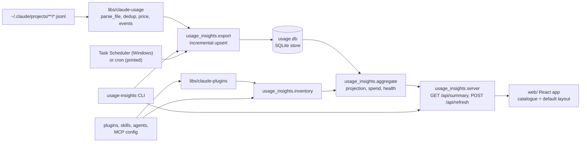

## Goal

Build `apps/usage-insights`, a local dashboard for individual Claude Code users that helps them
decide what to change, not show off. One page answers three questions: "what will I spend?"
(token and cost projection from past pace), "where does it go?" (projects, models, sessions), and
"what should I fix?" (skills, subagents, and tools that are never used, fading, or followed by
trouble). The flow that matters most: run `usage-insights`, the browser opens, and a glance shows
this week's forecast and the skills that need attention. Data comes from an incremental exporter
that copies Claude Code transcripts into a local store, so history outlives Claude Code's
transcript cleanup. Every panel is a typed catalogue component, so a later AG-UI phase can let the
user rearrange the dashboard from this default layout.

## Scope

**In:**

- Accurate token counts: each streamed assistant reply is counted once, every tool call in it is
  kept, and subagent transcripts are attributed to their parent session.
- Accurate cost: per-model-version prices, with unknown models flagged as unpriced instead of
  costed at $0.
- `usage-insights export`: incremental export of transcripts into a local SQLite store that keeps
  rows after Claude Code deletes the transcript. Unchanged files are skipped.
- Scheduled export on Windows (daily and at logon). On macOS and Linux, the setup script prints a
  cron line, and the dashboard exports on every launch and refresh on every OS.
- Projection: tokens and cost so far plus forecast (with a low/high band) for the current week and
  month, overall and per project.
- A 30-day pace strip (daily tokens or cost) inside the projection section.
- Spend breakdown for the selected range: projects ranked by cost with their change against the
  previous period of equal length, models ranked by cost, top sessions with title, project, date,
  tokens, and cost.
- Skill health: every installed or used skill with a status (`never_used`, `unused_lately`,
  `declining`, `troubled`, `healthy`), uses in range, last used, 30-day trend, trouble rate, and
  how it was invoked (Claude chose it, or the user typed it).
- Subagent health: the same table for subagents.
- Tools: tool calls ranked by count, plus built-in tools and MCP servers with no calls in range.
- Range selector: 7d, 30d (default), 90d, all.
- Loading, error, and empty states. The empty state lists the data directories searched and the
  store path.
- A `usage-insights` command that serves the page on 127.0.0.1 and opens the browser.
- Install from the local checkout with one script per OS.
- A component catalogue and a data-driven default layout, so a later AG-UI phase only adds an
  agent.

**Out:**

- AG-UI dynamic layout: phase 2 of the product, in its own plan once this ships. The catalogue
  and layout list here are what it builds on.
- Plan-limit percentages (5h and 7d) and limit forecasts: transcripts don't record them, and the
  user chose not to have `statusline-hook` write files again.
- Retiring `apps/usage-dashboard` (deleting it, its `setup/` descriptor, `C4_STATUSLINE_LIVE_TIMEOUT`
  and `C4_PLAN_PRICE_USD`): a separate change after this ships, confirmed by the user first,
  because it deletes a member and removes env vars.
- Year activity heatmap: the user replaced it with the 30-day pace strip.
- Publishing to PyPI, npm, or any registry: local install only for now.
- Tokens or cost attributed to each skill or subagent: needs a per-turn attribution model the
  library doesn't have. Use counts and trouble rate answer "which skill to fix".
- An always-on server with logon autostart: the scheduled export keeps the store current, and
  the command starts the server on demand.
- Auto-updating prices from LiteLLM: adds network access and upkeep. A version-keyed table is
  enough now.
- CSV and Markdown export, dark-mode toggle (the theme follows the OS), VSCode extension.
- Changes to `tools/usage-report` code: it picks up the library fixes automatically.

## Design

### Components



### Stack

- **Backend:** Python 3.11, stdlib `http.server.ThreadingHTTPServer` and stdlib `sqlite3`. One
  local user and two JSON endpoints need nothing more. Package `usage_insights` lives in
  `apps/usage-insights/src/usage_insights/`, with `[tool.uv] package = true` and a hatchling
  build. Entry points:
  - `[project.scripts] usage-insights = "usage_insights.cli:main"`.
  - `[project.gui-scripts] usage-insights-bg = "usage_insights.cli:main"`, run by the scheduled
    task under `pythonw`, so no console window opens.
- **Dependencies:** `claude-usage` and `claude-plugins` via `[tool.uv.sources]` path entries.
  Dev dependencies: ruff, mypy (strict), pytest.
- **Frontend:** `apps/usage-insights/web/`, Bun, Vite, React 19, TypeScript (strict). No router
  (one page) and no state library. Test dependencies: `vitest`, `@testing-library/react`,
  `jsdom`. `package.json` scripts: `typecheck` (`tsc --noEmit`), `test` (`vitest run`), `build`
  (`vite build`), `dev` (`vite`). React matches the `ceh-ag-ui` canvas skills the AG-UI phase
  will use.
- **Charts:** no chart library. Ranked bars are CSS-width bars, the pace strip is a CSS flex row
  of bars, and the forecast band is drawn in the stat tile as text plus a CSS range bar.
- **Theme:** Meridian, copied from
  `~/.claude/plugins/cache/ceh-claude-code-library/ceh-ui-design/1.0.5/skills/design-ui/references/meridian/brand.css`
  to `web/src/brand.css` and imported first. Only theme tokens are used.
- **Build output:** Vite builds into `src/usage_insights/static/`, which is git-ignored, and the
  server serves it.
- **Dev proxy:** Vite's dev server proxies `/api` to `127.0.0.1:8090` with `changeOrigin: true`,
  so the Host check accepts proxied requests.

### Library changes (`libs/claude-usage`)

**Compatibility:** `tools/usage-report` and `apps/usage-dashboard` (still a consumer until it is
retired) need no code edits. Their `tests/smoke.sh` and `mypy` keep passing. Existing public
names keep their signatures. `model_family` is unchanged.

**Per-file parse and global merge.** Parsing is split in two:
- **Per file:** `parse_file(path) -> FileParse`, public, reads one transcript into records keyed
  for dedup. `FileParse` holds `session_id`, `project`, `title`, `cwd`, `messages:
  list[MessageUsage]`, and `events: list[UsageEvent]`. The exporter calls it directly.
- **Merge:** `load_usage` merges every `FileParse` into sessions and `Activity`. Dedup happens
  here, and is global across all files in one `load_usage` call, so resumed and forked sessions
  and folded subagent files count each reply once.

**`MessageUsage`:** a frozen dataclass `MessageUsage(key, session_id, model, ts, input, output,
cache_write, cache_read, cache_write_1h)`, with `ts` an aware UTC `datetime` (or `None` when the
line has no timestamp). `cache_write` holds 5-minute-TTL writes and `cache_write_1h` 1-hour-TTL
writes, split from `usage.cache_creation`. The two never overlap, so summing a `TokenCounts`
dict still gives the total (`usage-report` sums the values).

**Dedup:**
- **Usage:** `key` is `message.id` + `requestId` when `message.id` is present, otherwise `uuid`.
  The last line seen for a key wins for the token counts, because it carries the final usage.
  `session_id` is kept from the first time the key is seen, so a message copied into a resumed or
  forked session stays with the session where it happened.
- **Tool calls:** a streamed reply spreads its content blocks over several lines, so `tool_use`
  blocks are collected from every line of the message and deduped by the block's `id`. Blocks
  without an `id` are never deduped (each counts), as `test_activity_counts_tool_use_blocks`
  already expects. Events built from them follow the same dedup.
- **Ordering:** token counts are added to `Activity` buckets only after dedup.

**Subagent and workflow files:**
- Every `.jsonl` anywhere under `projects/<proj>/<session-uuid>/` (including `subagents/` and
  `subagents/workflows/wf_*/`) folds into session `<session-uuid>`[:8] with project `<proj>`.
- If no `<session-uuid>.jsonl` parent file exists, the session is created from the folded files.
- `title` and `cwd` come from the parent file only. A folded file's `FileParse` has both `None`.

**Pricing:**
- **`ModelPrice`:** a new frozen dataclass, `ModelPrice(input, output, cache_write, cache_read,
  cache_write_1h)`, in $ per million tokens. `cache_write_1h` is 2x input. 87% of local
  cache-write tokens are 1-hour writes (687M of 789M, measured 2026-10-14), so pricing them at the
  5-minute rate would under-count cache-write cost by about a third.
- **`MODEL_PRICES`:** a new table keyed by model-id prefix. The longest matching prefix wins.
- **`MODEL_COSTS`:** stays family-keyed (`claude-fable`, `claude-opus`, `claude-sonnet`,
  `claude-haiku`) as the fallback table, with its values updated to the fallback rates below.
  Keeping the `claude-fable` row keeps `model_family` and `per_family` unchanged.
- **`price_for(model) -> ModelPrice | None`:** tries the prefix table, then the family fallback,
  and returns `None` for anything else. `estimated_cost` and `model_costs` keep their
  signatures and both price through `price_for`, so they never disagree. `estimated_cost` adds
  $0 for `None` models, which the caller reports as unpriced.
- **Exports:** `ModelPrice`, `MODEL_PRICES`, `price_for`, `parse_file`, `FileParse`,
  `MessageUsage`, and `UsageEvent` join `__all__`.

Prefix rates come from the claude-api reference (cached 2026-10-06):

| Prefix | Input $/MTok | Output $/MTok |
| ------ | ------------ | ------------- |
| `claude-fable-5-1`, `claude-fable-5` | 10.00 | 50.00 |
| `claude-opus-5-5` | 4.00 | 20.00 |
| `claude-opus-5`, `claude-opus-4-8`, `-4-7`, `-4-6`, `-4-5` | 5.00 | 25.00 |
| `claude-opus-4` (4, 4.1) | 15.00 | 75.00 |
| `claude-sonnet-5-5`, `claude-sonnet-5` | 2.00 | 10.00 |
| `claude-sonnet-4` (4, 4.5, 4.6) | 3.00 | 15.00 |
| `claude-haiku-5-5` | 0.10 | 0.50 |
| `claude-haiku-4-5` | 1.00 | 5.00 |
| `claude-3-5-haiku` | 0.80 | 4.00 |

Family fallback rates in `MODEL_COSTS`: `claude-fable` 10.00 / 50.00, `claude-opus` 5.00 / 25.00,
`claude-sonnet` 3.00 / 15.00, `claude-haiku` 1.00 / 5.00.

Cache write = 1.25x input (5-minute TTL) or 2x input (1-hour TTL), and cache read = 0.1x input,
except the published cache reads of $0.20 for Opus 5.5 and Sonnet 5.5 and $0.25 for Fable 5.1
(confirmed in Phase 1 against the claude-api skill's `shared/prompt-caching.md` and
`shared/models.md`). `claude-fable-5-1` and `claude-sonnet-5-5` get their own prefix rows for
those read rates.

The existing tests `test_model_costs_known_and_unknown` and
`test_estimated_cost_sums_all_four_token_buckets` compare against `MODEL_COSTS["claude-opus"]`,
not a literal, so they pass unedited with the new rates.

**New `Session` fields:**
- **`title: str`:** the last `custom-title` record's `customTitle`. Otherwise the first
  `type: "user"` record whose content is plain text (one line, 80 characters), skipping
  `isMeta` records, `tool_result` blocks, and tag-wrapped records such as `<command-name>` and
  `<local-command-stdout>`. Otherwise the session id.
- **`cwd: str | None`:** the last `cwd` seen in the parent file.

**`UsageEvent`:** `UsageEvent(kind, name, ts, session_id, key)`, where `key` is `<kind>:<id>`, so
the `tool` and `skill` events of one `Skill` call never collide. `<id>` is the `tool_use` block id
for `tool`, `skill`, and `agent`, the `tool_use_id` for `tool_error`, and the record `uuid` for
`command` and `interrupt`. `kind` is one of:
- `"tool"`: every deduped `tool_use` name.
- `"skill"`: the `skill` input of a `Skill` call.
- `"command"`: a slash command from `<command-name>/x</command-name>`, leading slash stripped,
  only in a `type: "user"` record whose string content starts with `<command-`. The same tag
  inside `tool_result`, `tool_use`, or attachment content is quoted output, not a command.
- `"agent"`: the `subagent_type` input of an `Agent` or `Task` call, defaulting to
  `general-purpose`.
- `"interrupt"`: a `type: "user"` record with a text block that starts with
  `[Request interrupted by user`. The marker inside `tool_result` output does not count. `name`
  is empty.
- `"tool_error"`: a `tool_result` block with `"is_error": true`. `name` is the tool name of the
  matching `tool_use` id when it is in the same file, otherwise empty.

`ACTIVITY_DAYS` is unchanged (no heatmap).

### Store and exporter (`usage_insights.store`, `usage_insights.export`)

**Location:** `$C4_USAGE_INSIGHTS_HOME/usage.db`, default `~/.usage-insights/usage.db`. The
directory is created by `export` (the explicit action), and the server opens the store read-only
and shows the empty state when it is missing.

**Schema** (`PRAGMA user_version = 1`; a mismatched version makes `export` drop and rebuild
the derived tables from the transcripts still on disk, after copying the old file to
`usage.db.bak.v<old version>`, one file per version, and print a warning that rows for deleted
transcripts are lost):

- `meta(key TEXT PRIMARY KEY, value TEXT)`: holds `last_export`, set at the end of every export
  run, even when no file changed. The payload's `last_export` reads it.
- `files(path TEXT PRIMARY KEY, size INTEGER, mtime_ns INTEGER, exported_at TEXT)`
- `sessions(id TEXT PRIMARY KEY, project TEXT, title TEXT, cwd TEXT, started TEXT, ended TEXT)`
- `messages(key TEXT PRIMARY KEY, session_id TEXT, model TEXT, ts TEXT, input INTEGER,
  output INTEGER, cache_write INTEGER, cache_read INTEGER, cache_write_1h INTEGER)`
- `events(key TEXT PRIMARY KEY, kind TEXT, name TEXT, ts TEXT, session_id TEXT)`
- Indexes on `messages(ts)`, `events(kind, ts)`, `events(session_id, ts)`.

Timestamps are stored as UTC ISO-8601. Local dates are computed at query time. Cost is computed
at query time from `price_for`, so a price fix needs no re-export.

**Export rules:**
- A file is re-parsed only when its `size` or `mtime_ns` differs from `files`.
- Rows are upserted, never deleted, so a reply seen in two files counts once and rows survive
  transcript deletion. A message is replaced only by a copy with at least as many output tokens
  (`ON CONFLICT(key) DO UPDATE ... WHERE excluded.output >= messages.output`), so a fork's
  mid-stream snapshot never shrinks a finished reply. Events are first-seen-wins
  (`ON CONFLICT(key) DO NOTHING`), like the library's event dedup.
- Messages and events without a timestamp are stored but left out of every dashboard figure.
- `sessions`: `started` is the minimum and `ended` the maximum `ts` over the session's messages.
  `title` and `cwd` are only overwritten by a non-`None` value, so a folded subagent file never
  blanks them.
- The store uses WAL mode, so the server keeps reading while an export writes. Each export run is
  one `BEGIN IMMEDIATE` transaction with `timeout=5`. A first export of large history can take
  well over 30 s (the local transcripts total 979 MB), so a second run never waits it out: on
  `database is locked` it raises `ExportBusy`.
- `ExportBusy` handling: `usage-insights export` prints "export already running" and exits 0.
  `usage-insights` (serve) prints the same and serves the store as it is. `POST /api/refresh`
  returns 409 `{"error": "export already running"}`.
- `export` prints a progress line every 100 files parsed, then `files scanned, files parsed,
  messages, events`, and exits 0.

### Inventory (`usage_insights.inventory`)

`load_inventory(claude_dirs, project_paths) -> Inventory(skills, agents, mcp_servers,
builtin_tools)`, each a list of `Item(name, source)`, with `source` one of `user`,
`plugin:<plugin>`, `project`, `built-in`. It reads:

- **User items:** `<claude_dir>/skills/*/SKILL.md` and `<claude_dir>/agents/*.md`, read with
  `load_plugin_skills` / `load_plugin_agents`: the frontmatter `name:`, else the folder or file
  name.
- **Plugin items:** `claude_plugins.load_plugin_entries` (added in Phase 4) returns every
  registry entry once. `user` entries count, and `local`/`project` entries count when their
  normalised `projectPath` is one of `project_paths`, deduped by `installPath`. (Calling
  `load_installed_plugins` once per project re-normalised every entry each time: 34,383
  `resolve()` calls and 5.4 s on local data, now 0.15 s.) Each entry's skills and agents
  come from `load_plugin_skills` and `load_plugin_agents`, named `<plugin>:<member>`, where
  `<plugin>` is the registry key before `@`.
- **Project items:** `<path>/.claude/skills` and `<path>/.claude/agents` for each path in
  `project_paths`.
- **MCP servers:** the `mcpServers` keys in each claude dir's global config, which is
  `<claude_dir>/.claude.json` when that file exists and `~/.claude.json` otherwise (top level, and under
  `projects[<path>]` for each path in `project_paths`), in `<path>/.mcp.json`, and in each
  installed plugin's `.mcp.json`. A server counts as used when a `tool` event name starts with
  `mcp__<server>__`, with non-alphanumerics mapped to `_` on both sides before comparing
  (Claude Code keeps dashes in some, e.g. `mcp__claude-in-chrome__navigate`). Used servers that
  no config lists still show, with source `unknown`.
- **Built-in agents:** a constant list: `general-purpose`, `Explore`, `Plan`, `statusline-setup`,
  `claude-code-guide`.
- **Built-in tools:** a constant list: `Agent`, `AskUserQuestion`, `Bash`, `Edit`, `Glob`,
  `Grep`, `NotebookEdit`, `Read`, `Skill`, `TodoWrite`, `WebFetch`, `WebSearch`, `Write`.

`project_paths` is the set of `sessions.cwd` values that still exist on disk.

Rules for what shows:
- Disabled plugins are installed, so their unused members appear.
- Used names missing from the inventory still show, with source `unknown`. Built-in skills land
  here.
- A `command` event counts as a skill use only when its name matches an inventory skill, so
  built-ins like `/clear` stay out. A matching `command` counts as one use and marks the skill
  `typed`. A typed skill does not also write a `Skill` tool call: none of 304 typed commands in
  the local transcripts was followed by one (checked by the plan review on 2026-10-14), so there
  is no double count.

### Aggregation (`usage_insights.aggregate`)

All tunable numbers live as named constants at the top of `aggregate.py`.

**Range:** `7d`, `30d`, `90d`, `all`. The range start for `Nd` is today minus (N − 1) days, so
`7d` covers today and the 6 days before. A message or event is in range when its local date is
on or after the range start. The previous period is the equal-length window before it (`all` has none,
so its change values are `null`).

**Projection** (independent of the selected range):
- Week runs Monday to Sunday, month is the calendar month, both in local time.
- `PACE_DAYS = 14`: the daily series of the last 14 complete days, zeros included.
- Forecast = actual so far (today included) + mean(daily) x remaining days, where remaining days
  = the unelapsed fraction of today + the whole days left in the week or month. Today is never
  counted twice.
- Band: low = actual + min(p25, mean) x remaining, high = actual + max(p75, mean) x remaining,
  so the band always contains the forecast even when one heavy day pulls the mean outside the
  quartiles.
- Computed for tokens and cost overall, and for cost per project (the payload's `by_project`).
  Projects with a zero month forecast are left out of `by_project`.
- Local dates use the system zone with the rules in force at each timestamp (the server passes
  `tz=None` to `aggregate.summary`), so history from before a DST change keeps its own offset.

**Skill and subagent health**, evaluated over all history in the store, first match wins:
1. `never_used`: in the inventory, no uses ever.
2. `troubled`: at least `TROUBLE_MIN_USES = 3` uses in the last 30 days, and at least
   `TROUBLE_RATE = 0.2` of them are followed by an `interrupt` event in the same session within
   `TROUBLE_WINDOW_MIN = 15` minutes. (Tuned in Phase 5 on local data: a tool error follows
   39.8% of all tool calls within 15 min, so tool errors are noise; an interrupt follows 4.5%.)
3. `declining`: uses in the last 30 days are below half of the 30 days before, and the earlier
   window has at least `DECLINE_MIN_USES = 4`.
4. `unused_lately`: last use more than 30 days ago.
5. `healthy`: everything else.

Rows sort by status in the order above, then by uses. `invoked` is `auto` (only `Skill` calls),
`typed` (only `command` events), or `both`, and `null` with no uses. Subagents use `agent`
events and are never `typed`.

### Interface

**CLI:**
- `usage-insights [--host 127.0.0.1] [--port 8090] [--claude-dir DIR ...] [--no-open]`: runs an
  export, then serves the page and opens the browser. The server sets
  `allow_reuse_address = False`, because on Windows `SO_REUSEADDR` lets a second bind onto a busy
  port succeed. On a failed bind: if a running instance answers `GET /api/health` on that port,
  the command opens the browser (unless `--no-open`) and exits 0. Otherwise it exits 1 with a
  message naming the port.
- `usage-insights export [--claude-dir DIR ...]`: runs one export and exits.
- `C4_CLAUDE_DIR` is still honoured through the library.

**HTTP**, bound to 127.0.0.1 by default:

- Host header check: any request whose `Host` is not `127.0.0.1:<port>` or `localhost:<port>`
  gets 403. The payload includes session titles taken from prompts, so this guards against DNS
  rebinding.
- `GET /api/health` returns `{"ok": true}`.
- `POST /api/refresh` runs an export and returns its counts. The frontend calls it from the
  refresh button. A cross-site POST gets 403 `{"error": "cross-site request"}`: when the browser
  sends `Sec-Fetch-Site`, only `same-origin` and `none` pass (the Vite dev proxy keeps its own
  `Origin`, so `Origin` alone would reject it); otherwise an `Origin`, when present, must be the
  server's own host.
- Any other failure building the summary (e.g. a store file without schema) returns 500
  `{"error": "..."}`, so the page's error state can show it. The server opens the store with
  `mode=ro`.
- `GET /api/summary?range=7d|30d|90d|all` (default `30d`; anything else gets 400
  `{"error": "..."}`) returns:

  ```json
  {
    "range": "30d",
    "generated_at": "ISO-8601",
    "data_dirs": ["C:/Users/x/.claude"],
    "store_path": "C:/Users/x/.usage-insights/usage.db",
    "last_export": "ISO-8601",
    "totals": {
      "cost_usd": 0.0,
      "tokens": {"input": 0, "output": 0, "cache_write": 0, "cache_read": 0, "total": 0},
      "sessions": 0,
      "unpriced_models": []
    },
    "projection": {
      "week": {"tokens": {"actual": 0, "forecast": 0, "low": 0, "high": 0},
               "cost_usd": {"actual": 0.0, "forecast": 0.0, "low": 0.0, "high": 0.0}},
      "month": {"tokens": {"actual": 0, "forecast": 0, "low": 0, "high": 0},
                "cost_usd": {"actual": 0.0, "forecast": 0.0, "low": 0.0, "high": 0.0}},
      "by_project": [{"project": "", "week_cost_forecast": 0.0, "month_cost_forecast": 0.0}],
      "pace": [{"date": "YYYY-MM-DD", "tokens": 0, "cost_usd": 0.0}]
    },
    "projects": [{"project": "", "tokens": 0, "cost_usd": 0.0, "share": 0.0,
                  "change": 0.0, "sessions": 0}],
    "models": [{"model": "", "tokens": 0, "cost_usd": 0.0, "sessions": 0}],
    "sessions": [{"id": "", "title": "", "project": "", "started": "", "ended": "",
                  "tokens": 0, "cost_usd": 0.0, "models": []}],
    "skills": [{"name": "", "source": "", "status": "", "uses": 0, "last_used": null,
                "trend": [0, 0], "trouble_rate": 0.0, "invoked": "auto"}],
    "agents": [{"name": "", "source": "", "status": "", "uses": 0, "last_used": null,
                "trend": [0, 0], "trouble_rate": 0.0, "invoked": "auto"}],
    "tools": {
      "used": [{"name": "", "calls": 0}],
      "unused_builtin": [""],
      "mcp_servers": [{"name": "", "source": "", "calls": 0}]
    }
  }
  ```

  Payload rules:
  - `projection.pace` always holds the last 30 local days, ending today.
  - Every `project` value in the payload is a display label: the basename of the launch folder,
    meaning the `cwd` that encodes (non-alphanumerics to `-`) to the project folder name, else the
    latest `cwd` among that project's sessions, falling back to the encoded folder name (e.g.
    `C--Users-x-repo`) when no session has a `cwd`. Two projects with the same basename get the
    folder name appended in parentheses. (The latest `cwd` alone renamed this repo's project to
    `usage-insights` once a session moved into that subfolder.)
  - `projects.change` is the cost change ratio against the previous period, `null` when that
    period's cost is 0 or the range is `all`.
  - `sessions` holds the top 100 by tokens. `models`, `projects` sort by cost. `tools.used` sorts
    by calls.
  - `uses` counts uses in range. `trend` is `[uses in the 30 days before, uses in the last 30
    days]`. `last_used` spans all history, so "never used" differs from "not used lately".
  - With no store yet, every list is empty and `last_export` is `null`.
- `GET /` and `GET /assets/*` serve from `static/`. If `static/index.html` is missing, `/`
  returns 503 with "frontend not built: run the setup script".
- Any other path returns 404.

### Page layout and catalogue

**Catalogue:** `web/src/catalogue/`, one component per file, each with an exported props type and
no data fetching: `StatTile` (label, actual, forecast, low, high, unit), `PaceStrip` (daily
series, metric toggle), `RankedBars` (rows of label, value, secondary text), `SessionTable`,
`HealthTable` (skill or subagent rows with a status badge), `UnusedList` (names with source).

**Default layout:** `web/src/layout/defaultLayout.ts` exports an ordered list of sections, each
`{ id, question, panels: Panel[] }`, with `Panel = { id, component, select, eyebrow, caption,
count?, wide? }`, where `select` maps the summary payload to that component's props. The
question is the section heading. `App.tsx` renders the list. The AG-UI phase replaces this list
at runtime, which is why it is data, not JSX.

Top bar plus three sections, following the `ceh-ui-design` dashboard rules:

1. **Top bar:** product name on the left. Range control (segmented buttons), the last export
   time, and a refresh button on the right. Refresh is the one primary action. While
   `POST /api/refresh` runs, the button shows a spinner and is disabled, and the page keeps the
   current data. On 200 it refetches the summary and the last export time updates. On 409 it
   shows "Export already running, try again shortly" next to the button. On any other failure it
   shows the error next to the button with a Retry.
2. **What will I spend?:** `StatTile` for this week and this month (cost, with tokens in the
   secondary line and the low/high band), and `PaceStrip` with a Tokens / Cost toggle. A
   `RankedBars` of month forecast by project.
3. **Where does it go?:** `RankedBars` for projects (with change), `RankedBars` for models, and
   `SessionTable` (10 rows, "Show 100").
4. **What should I fix?:** `HealthTable` for skills and for subagents, `RankedBars` for tools
   (top 10, "Show all"), and `UnusedList` for unused built-in tools and MCP servers.

**States:**
- Loading: skeleton blocks shaped like the sections.
- Error: in place, with what failed and a Retry button.
- Empty (no store, or no sessions in the range and no usage in the last 30 days): a title, one
  line, the `data_dirs` searched, and the `store_path`. The title is "No Claude Code usage yet"
  with no history or on All, and "No usage in the last N days" on a shorter range.
- Unpriced models: a warning badge on the cost tiles that lists them.
- While a range change or reload runs, the current figures stay, dimmed, with `aria-busy`.

Every panel carries an eyebrow, with a count where the panel is a list, e.g. `PROJECTS · 7`.

### Install and scheduling

`scripts/usage-insights-setup.ps1 -Action install|uninstall` (Windows) and
`scripts/usage-insights-setup.sh install|uninstall` (macOS, Linux):

- **Preflight:** fail with a clear message if `bun` or `uv` is not on PATH. The PowerShell script
  checks `$LASTEXITCODE` after every native call, the bash script uses `set -euo pipefail`.
- **install:**
  1. `bun install --frozen-lockfile` and `bun run build` in `web/`.
  2. `uv tool install --editable <app dir>`.
  3. Windows: register `\ClaudeAutomation\usage-insights\export`, triggers daily at 12:00 and at
     logon, running `usage-insights-bg.exe export` by its absolute path under
     `uv tool dir --bin`. macOS/Linux: print the crontab line
     `0 12 * * * <bin>/usage-insights export`, without editing the crontab.
- **uninstall:** removes the task (Windows) and runs `uv tool uninstall usage-insights`. The
  store is kept, and the script prints its path.

### CI

- **Phase 4**, in `.github/workflows/python.yml`: add `apps/usage-insights` to the `ruff` lint
  matrix, a `pytest (usage-insights)` job running `uv run pytest` in `apps/usage-insights`, and a
  `mypy` matrix entry `{member: apps/usage-insights, target: src}`.
- **Phase 6:** add `.github/workflows/usage-insights-web.yml` (bun install with a frozen lockfile,
  `typecheck`, `test`, `build`).

## Phases

### Phase 1: Library accuracy fixes

- **Builds:**
  - In `libs/claude-usage`: `parse_file` with the global merge, usage dedup, tool-block dedup,
    and subagent and workflow file folding.
  - The pricing changes: `ModelPrice`, `MODEL_PRICES`, `price_for`, and the updated
    `MODEL_COSTS` fallback, exported. Before committing the rates, confirm the cache-write and
    cache-read rates against the pricing page listed in the claude-api skill's
    `shared/live-sources.md`.
  - Update the two existing pricing tests, plus `libs/claude-usage/README.md` and `CLAUDE.md`.
- **Check:** `cd libs/claude-usage && uv run pytest && uv run mypy src` passes, including:
  - `test_dedup_keeps_last_usage_per_message_id`
  - `test_split_message_keeps_every_tool_use` (one message over two lines with two `tool_use`
    blocks counts 2)
  - `test_dedup_is_global_across_files`
  - `test_subagent_and_workflow_files_fold_into_parent`
  - `test_orphan_subagent_folder_creates_session`
  - `test_price_for_prefix_fallback_and_unknown`
  - `test_model_costs_agrees_with_price_for`
  - `test_message_keeps_first_session_id`
  - `test_id_less_tool_blocks_each_count`
  - the existing `test_model_family_matches_each_known_family`, unedited

  Then `cd tools/usage-report && uv run bash tests/smoke.sh` prints `PASS`, and
  `uv run mypy src` passes, with no edits to `tools/usage-report`. The same holds for
  `apps/usage-dashboard`'s `tests/smoke.sh`, with no edits to it.
- **Status:** done. `cd libs/claude-usage && uv run pytest && uv run mypy src`: "37 passed",
  coverage 100%, mypy "no issues found in 3 source files". `usage-report` smoke `PASS` and mypy
  clean, `usage-dashboard` smoke `PASS`, all unedited. (`usage-dashboard`'s own `mypy .` reports
  one error in `backend/live_statusline.py:33` on the base commit too, unrelated.) Design
  changed: 1-hour cache writes priced separately (see Record). `UsageEvent` (kind `tool` only)
  landed here because the global tool-call dedup needs it; Phase 2 adds the other kinds. On real
  data: 11.83B tokens / $28,781 / 3,052 sessions before, 5.33B / $4,493 / 2,008 after, full
  parse 9.3 s.

### Phase 2: Library session fields and usage events

- **Builds:**
  - `Session.title`, `Session.cwd`, `MessageUsage`, `UsageEvent` with all six kinds, and
    `FileParse.messages` / `FileParse.events`, exported in `__all__`. README updated.
- **Check:** `cd libs/claude-usage && uv run pytest && uv run mypy src` passes, including:
  - `test_title_prefers_custom_title_then_first_plain_prompt` (skips meta, `tool_result`, and
    command-wrapped records)
  - `test_cwd_recorded_from_parent_only`
  - `test_events_capture_tool_skill_command_agent`
  - `test_events_capture_interrupt_and_tool_error`
  - `test_markers_inside_tool_result_are_not_events` (an interrupt marker and a
    `<command-name>` tag inside `tool_result` output yield no event)

  Then `tools/usage-report`'s and `apps/usage-dashboard`'s smoke and mypy pass again, unedited.
- **Status:** done. `cd libs/claude-usage && uv run pytest && uv run mypy src`: "43 passed",
  coverage 100%, mypy clean. `usage-report` smoke `PASS` + mypy clean, `usage-dashboard` smoke
  `PASS`, both unedited. Real data: 2,034 skill, 1,084 agent, 1,164 command, 154 interrupt, and
  1,667 tool_error events (per file, before global dedup), and 1,996 of 2,008 sessions titled.

### Phase 3: App package, store, and exporter

- **Builds:**
  - `apps/usage-insights/` with `pyproject.toml` per Design / Stack, `README.md` stub,
    `CLAUDE.md`, and `src/usage_insights/` with `cli.py` (the `export` subcommand only),
    `store.py`, `export.py`.
  - The store schema, version handling, and export rules per Design / Store and exporter.
  - `tests/fixtures/claude/`: a small projects tree with a subagent file, a duplicate streamed
    reply across two files, a `custom-title`, Skill, Agent, slash-command, interrupt, and
    `is_error` lines, an interrupt marker and a `<command-name>` tag quoted inside `tool_result`
    output, plus one user skill, one plugin with an unused skill, and one MCP server.
- **Check:** `cd apps/usage-insights && uv run ruff check . && uv run mypy src && uv run pytest`
  passes, including:
  - `test_export_counts_match_fixture`
  - `test_export_skips_unchanged_files` (counts `parse_file` calls on a second run)
  - `test_rows_survive_transcript_deletion`
  - `test_duplicate_reply_across_files_counts_once`
  - `test_folded_file_does_not_blank_title`
  - `test_version_mismatch_backs_up_and_rebuilds`
  - `test_concurrent_export_raises_export_busy` (a second connection holds `BEGIN IMMEDIATE`;
    `export` prints "export already running" and exits 0)

  Then on real data, `uv run usage-insights export` twice in a row: the second run prints
  `files parsed 0` and takes under 1 s.
- **Status:** done. `uv run ruff check . && uv run mypy src && uv run pytest`: ruff and mypy
  clean, "8 passed". Real data (store in a temp `C4_USAGE_INSIGHTS_HOME`): first run "files
  scanned 3319, files parsed 3319, messages 49721, events 64400"; second run "files parsed 0" in
  0.15 s in-process (0.3-0.4 s for the whole command). Store total 5.34B tokens, matching
  `load_usage`. Deferred to Phase 4, where the inventory reads them: the fixture's plugin with an
  unused skill and its MCP server (they need the `claude-plugins` registry format). Added beyond
  the named tests: `test_cli_export_prints_counts`. The schema backup runs before the write lock
  (`store.backup_if_stale`), because `sqlite3` backup cannot read through the same connection's
  open write transaction.

### Phase 4: Inventory, aggregation, and API

- **Builds:**
  - `inventory.py`, `aggregate.py`, `server.py`, and the full CLI per Design / Inventory,
    Aggregation, and Interface, including the Host check, the bind behaviour, and
    `POST /api/refresh`.
  - The Phase 4 CI changes.
- **Check:** `cd apps/usage-insights && uv run ruff check . && uv run mypy src && uv run pytest`
  passes, including:
  - `test_summary_totals_match_hand_computed_fixture`
  - `test_range_scoping_and_previous_period_change`
  - `test_projection_forecast_and_band` (fixed clock at 18:00 on a Wednesday, known daily
    series; asserts the remaining days are 0.25 + 4 for the week, so today counts once)
  - `test_project_label_from_cwd_with_collision`
  - `test_skill_status_each_rule` (one fixture skill per status)
  - `test_typed_vs_auto_invocation`
  - `test_unused_builtin_tools_and_mcp_servers`
  - `test_plugin_inventory_spans_projects`
  - `test_slash_builtin_not_counted_as_skill`
  - `test_index_served_from_static` (a temporary `static/` with a stub `index.html`)
  - `test_cli_exits_1_when_port_held` (port held by a plain socket)
  - `test_server_smoke` (boots on a free port: `/api/summary` 200, wrong `Host` 403, bad
    `range` 400, `POST /api/refresh` 200, and 409 while another connection holds the write
    lock)
- **Status:** done. `uv run ruff check . && uv run mypy src && uv run pytest`: ruff and mypy
  clean, "24 passed" (all named tests plus `test_project_label_prefers_the_launch_folder`,
  `test_used_mcp_server_not_configured_shows_unknown`, `test_summary_without_store_is_empty`,
  `test_cli_reuses_running_instance`). `libs/claude-plugins` gained `load_plugin_entries`
  (29 passed, coverage 100%). Real data: inventory 0.15 s, summary 0.41 s, payload 85 KB.
  The plugin/MCP fixture files deferred from Phase 3 landed here.

### Phase 5: Frontend: catalogue, default layout, all sections

- **Builds:**
  - The `web/` project per Design / Stack, with Meridian `brand.css`, a typed API client whose
    types mirror the `/api/summary` payload, and the dev proxy.
  - The six catalogue components, `defaultLayout.ts`, the top bar, the three sections, and the
    loading, error, empty, and unpriced states, per Design / Page layout and catalogue.
- **Check:**
  - `cd apps/usage-insights/web && bun run typecheck && bun run test && bun run build` passes.
    Vitest covers: each catalogue component from fixture props, `defaultLayout` selectors against
    a fixture payload (section eyebrow counts, ranking order, a `troubled` skill sorted first
    after `never_used`), the pace strip's 30 bars ending today, and the states from a mocked
    fetch.
  - From `apps/usage-insights` in bash, this prints `PASS`. It points both env vars at temp dirs,
    so it never writes to the user's store, and polls `/api/health` instead of sleeping:
    `t=$(mktemp -d); C4_CLAUDE_DIR=tests/fixtures/claude C4_USAGE_INSIGHTS_HOME=$t uv run usage-insights --no-open --port 8795 & pid=$!; for i in $(seq 30); do curl -sf -H "Host: 127.0.0.1:8795" http://127.0.0.1:8795/api/health >/dev/null && break; sleep 1; done; curl -s -H "Host: 127.0.0.1:8795" http://127.0.0.1:8795/ | grep -q 'id="root"' && echo PASS; kill $pid; wait $pid 2>/dev/null; rm -rf "$t"`
  - Manual check, because no command judges visual quality or whether a glance answers the three
    questions: run against real data, view at 1440 px and 390 px, and pass the `ceh-ui-design`
    review checklist.
- **Status:** done (commit `b2f671d`). Rerun 2026-10-15: `bun run typecheck && bun run test &&
  bun run build`, "17 passed", build clean; the serve check prints `PASS`. The manual review at
  1440 px and 390 px (iframe) ran on 2026-10-14 and tuned `StatTile` and `HealthTable` (see
  Record). Open's health-threshold item was settled by that review: interrupts only, rate 0.2.

### Phase 6: Install, scheduling, CI, docs, setup

- **Builds:**
  - Both setup scripts per Design / Install and scheduling.
  - The Phase 6 CI workflow.
  - Docs: `apps/usage-insights/README.md` (install per OS, the cron line, the store and its
    retention, what each health status means), `CLAUDE.md`, and `product/ARCHITECTURE.md`.
  - Monorepo: root `README.md` catalog line and env-var table, root `CLAUDE.md` app list and
    `C4_USAGE_INSIGHTS_HOME` in the env-var list, and `usage-insights` named as a
    `claude-plugins` and `claude-usage` consumer in the root docs and both libs' `README.md`,
    `CLAUDE.md`, and `__init__.py` docstrings.
  - `setup/`: a `usage-insights` descriptor in `registry.ps1` (detected by the export task),
    plus `command-center.config.example.jsonc`, setup's README, `CLAUDE.md`, and
    `product/ARCHITECTURE.md` where they list members.
- **Check:**
  - `pwsh -File apps/usage-insights/scripts/usage-insights-setup.ps1 -Action install` exits 0.
    Then `Start-ScheduledTask -TaskPath '\ClaudeAutomation\usage-insights\' -TaskName export`
    finishes with `LastTaskResult` 0, the store's `last export` time moves forward, and no
    console window opens.
  - `usage-insights` opens the browser on real data and exits cleanly on Ctrl+C.
  - `-Action uninstall` removes the task and the command and leaves `usage.db`.
  - `bash apps/usage-insights/scripts/usage-insights-setup.sh install` under Git Bash exits 0 and
    prints the cron line. A real macOS or Linux run is not available on this machine, so CI's web
    and pytest jobs on Ubuntu are the cross-platform evidence.
- **Status:** done. On 2026-10-15 the user ran every Check step by hand and all passed: install
  exits 0, the task finishes with `LastTaskResult` 0 and moves `last_export` forward with no
  console window, `usage-insights` opens on real data and stops on Ctrl+C, the bash script exits
  0 with the cron line, and uninstall removes the task and the command and keeps `usage.db`.
  Earlier, the session's permission classifier denied running the install script (it registers
  a task and installs a `uv` tool), which is why the user ran the steps. What the session ran:
  both scripts parse (`bash -n`, the PowerShell parser), `usage-insights-setup.sh bogus` exits 2
  with usage, `setup/command-center.ps1 list` shows `usage-insights v0.1.0`, its `Detect` returns
  `False` before install, and app `ruff`/`mypy`/`pytest` ("24 passed") plus both libs' suites
  (43 and 29 passed) stay green after the docstring edits. The new CI workflow has not run on
  GitHub yet. Both scripts pass `--reinstall` to `uv tool install`, so a re-run picks up library
  changes instead of stopping at "already installed". The user's install run settled the Open
  item on editable installs.

## Open

- **Cache rates:** cache-write and cache-read rates for models without a published exception are
  assumed to be 1.25x and 0.1x input. Phase 1 confirms them against the pricing page.
- **Health thresholds:** `TROUBLE_RATE`, `TROUBLE_WINDOW_MIN`, and the decline rule are first
  guesses. Tool errors are common in normal work (a raw grep on 2026-10-14 found 1,566
  `"is_error":true` strings in the local transcripts, an upper bound because it also counts
  mentions inside tool output), so `troubled` may flag too much. Phase 5's manual check
  reviews the flagged skills on real data and tunes the constants.
- **Editable install:** `uv tool install --editable` is assumed to honour the `[tool.uv.sources]`
  path entries. Phase 6's check proves it. If it doesn't, the setup scripts install a shim that
  runs `uv run --project <app dir> usage-insights`. Resolved 2026-10-15: the installed command
  ran the dashboard, which imports both path-sourced libs, so no shim is needed.
- **Built-in lists:** the built-in agent and tool lists are hand-kept and can drift from Claude
  Code's. Unknown used names still show, with source `unknown`.
- **Required checks:** making the new CI checks required needs a branch-protection change on
  GitHub, which the user does by hand.

## Record

- 2026-10-14 Planned: status ready
- 2026-10-14 Reviewed: Revise first, 3 blocking (interrupt/command matching too broad, claude-fable dropped from fallback, export lock timeout unhandled)
- 2026-10-14 Design changed: was "`ModelPrice(input, output, cache_write, cache_read)`", now "`ModelPrice(input, output, cache_write, cache_read, cache_write_1h)`" (and `MessageUsage` / `messages` gain `cache_write_1h`), because 87% of local cache-write tokens are 1-hour writes priced at 2x input
- 2026-10-14 Built Phase 1: `cd libs/claude-usage && uv run pytest && uv run mypy src`, 37 passed, coverage 100%
- 2026-10-14 Built Phase 2: `cd libs/claude-usage && uv run pytest && uv run mypy src`, 43 passed, coverage 100%
- 2026-10-14 Built Phase 3: `cd apps/usage-insights && uv run ruff check . && uv run mypy src && uv run pytest`, 8 passed; real-data second export "files parsed 0" in 0.15 s
- 2026-10-14 Design changed: was "`load_installed_plugins` ... is called once per path in `project_paths`", now "`claude_plugins.load_plugin_entries` returns every entry once", because per-project calls took 5.4 s on local data
- 2026-10-14 Design changed: was "Band: low = actual + p25(daily) x remaining, high = actual + p75(daily) x remaining", now "min(p25, mean) / max(p75, mean)", because a heavy day can push the mean outside the quartiles
- 2026-10-14 Design changed: was "the basename of the latest `cwd`", now "the basename of the launch folder (the `cwd` that encodes to the project folder name)", because a session that moved into a subfolder renamed the project
- 2026-10-14 Design changed: was "server name's non-alphanumerics mapped to `_`", now "both sides mapped, and used-but-unconfigured servers shown as `unknown`", because Claude Code keeps dashes in some MCP tool names and the user's used MCP servers are not in any local config
- 2026-10-14 Built Phase 4: `cd apps/usage-insights && uv run ruff check . && uv run mypy src && uv run pytest`, 24 passed
- 2026-10-14 Design changed: was "`TROUBLE_RATE = 0.4` ... `interrupt` or `tool_error`", now "0.2, `interrupt` only", because tool errors follow 39.8% of all tool calls (base rate); 13 flagged skills dropped to 4
- 2026-10-14 Design changed: was "copied ... imported first", now "copied without its Google Fonts @import", because the local dashboard makes no network calls
- 2026-10-14 Design changed: was "`StatTile` (label, actual, ...)", now "no label (the panel eyebrow names it) and a 0..high scale", and `HealthTable` gained status chips with counts that filter, because the manual review found a repeated label and 67 never-used rows hiding the troubled ones
- 2026-10-14 Built Phase 5: `bun run typecheck && bun run test && bun run build`, 17 passed; serve check PASS; manual review at 1440 px and 390 px (iframe) done
- 2026-10-15 Phase 5 rechecked: 17 passed, build clean, serve check PASS; Status set to done
- 2026-10-15 Phase 6 built, not checked: install script run denied in session; scripts, CI workflow, docs, and setup/ descriptor written
- 2026-10-15 Reviewed: Request changes, 2 blocking (`--claude-dir` before `export` dropped; 7 unrecorded divergences), 13 advisory; review in `.agents_workspace/code-reviews/feat-usage-insights-2026-10-15.md`
- 2026-10-15 Design changed: was "Rows are upserted (`INSERT ... ON CONFLICT(key) DO UPDATE`) ... (last wins)", now "replaced only by a copy with at least as many output tokens; events first-seen-wins", because a fork's mid-stream snapshot re-parsed later shrank finished replies
- 2026-10-15 Design changed: was "`<claude_dir>/skills/*/SKILL.md` (name = folder)", now "frontmatter `name:`, else the folder", recording what `load_plugin_skills` already did
- 2026-10-15 Design changed: was "Computed for tokens and cost, overall and for each project", now "tokens and cost overall, cost per project, zero-forecast projects omitted", matching the payload schema the plan already gave
- 2026-10-15 Design changed: was "`{ id, title, question, panels: { component, select } [] }`" and "Every section header carries an eyebrow with a count", now "`{ id, question, panels }`, eyebrows per panel, counts on list panels", recording the Phase 5 build: the question is the heading, so a separate title repeated it
- 2026-10-15 Design changed: was "Empty (no store or no transcripts)", now "range-aware empty title", because a quiet 7-day range claimed "No Claude Code usage yet"
- 2026-10-15 Fixed review findings: `--claude-dir` in either position, `mode=ro` store reads, JSON 500 from `/api/summary`, cross-site POST 403, DST-correct local dates, health table Last used / Trend / Trouble columns, refresh Retry, stale-range dimming, a11y text in the pace strip and loading state; `uv run pytest` 30 passed, `bun run test` 26 passed
- 2026-10-15 Design changed: was "copying the old file to `usage.db.bak`", now "`usage.db.bak.v<old version>`, one file per version", because a second schema change overwrote the first backup, which can be the only copy of rows for deleted transcripts (user's call on the review question)
- 2026-10-15 Built Phase 6: the user ran the install checks by hand, all passed (install exit 0, task `LastTaskResult` 0, dashboard on real data, bash cron line, uninstall keeps `usage.db`)
- 2026-10-15 Status: built
