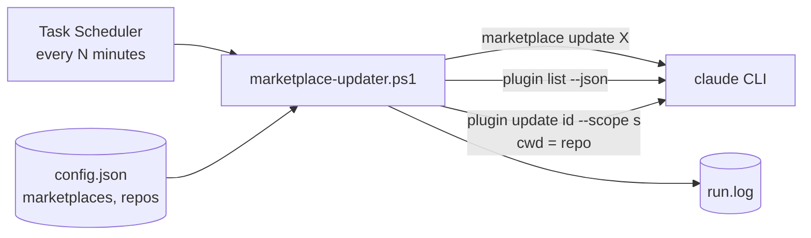
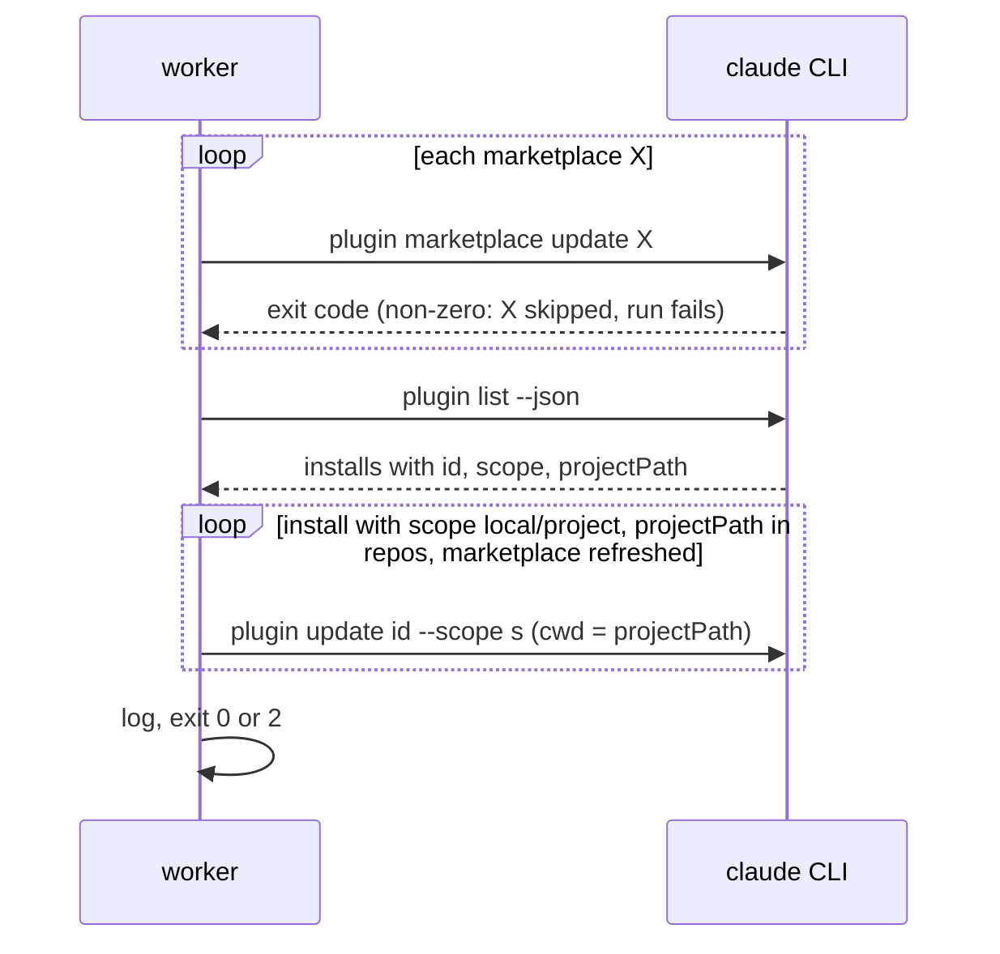

# marketplace-updater — Architecture

A scheduled job that keeps Claude Code plugins current. It refreshes configured marketplaces,
then updates the plugins from them that are installed for configured repos. It drives the
`claude` CLI and nothing else.

## System context

## Key flow — one run

## Key Decisions

- **Shell out to the CLI, never edit its state.** The CLI owns marketplaces and the plugin cache, so
  the tool survives changes to their file formats.
- **Repos are matched through `projectPath` from `plugin list --json`.** That is the only record of
  which repo a local or project install belongs to.
- **No `-y`.** An unattended run does not accept a marketplace-declared command on anyone's behalf.
- **The interval lives in the task, the rest in `config.json`.** Marketplaces and repos change
  often and are re-read every run. The interval needs a task re-registration.
- **Windows only.** Matches `file-sync`; a cron twin was left out because nobody asked for it.
