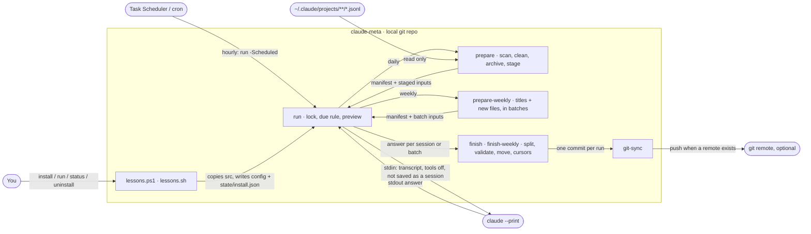
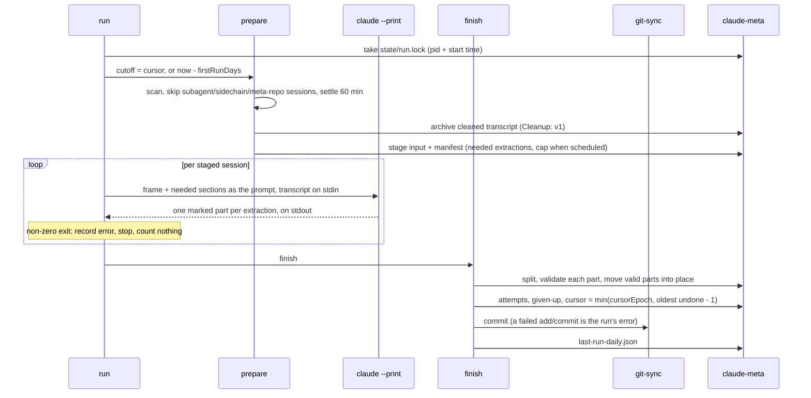
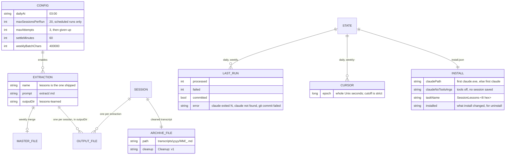

# scheduled-session-digests — Architecture

## Overview

Every Claude Code session you finish becomes a lessons-learned file, and every week the new lessons
merge into one master file, in a local git repo you own, without you doing anything after install.

## Components

The CLI installs a copy of `src/` into the meta repo. An hourly scheduled entry runs it, and it
finds the meta repo from its own location.

## Key flow — one daily run

One `claude` call per session asks for every extraction the session still needs. Only validated
parts are moved into place.

## Data model

What the tool keeps in the meta repo. `config.json` is committed and shared. `state/` is per
machine and gitignored.

## Key Decisions

### 2026-07-02 — Two run mechanisms per scheduler: unattended cron and interactive skill

**Status:** Superseded by 2026-10-11 — One headless background pipeline with one CLI
(amended 2026-07-16: the mechanisms now shared the prepare script instead of duplicating
discovery logic)
**Context:** Fully unattended digests need programmatic `claude --print`, which consumes
programmatic credit that may be rate-limited. Users sometimes want the same digest run from an
interactive session instead, using that session's capacity.
**Decision:** Ship each scheduler as both a **cron** trigger and a **skill**
(`/session-digest-<name>`). Install offers a split list so any combination is possible (e.g. skill
for daily, cron for weekly). The daily skills are coordinators (fan-out per chat); the weekly skill
is a single-pass harvest — preserve that shape.
**Consequences:** Users pick the credit source per scheduler.

### 2026-07-02 — `git-sync` is the sole writer of `claude-meta` history

**Status:** Accepted (amended 2026-10-12: a failed add or commit is now the run's error, see
2026-10-12 — A failed commit is a run error)
**Context:** Three schedulers all need to commit their output to `claude-meta`. Duplicating
add/commit/push into each would fragment the git logic and risk inconsistent commit messages or
partial commits.
**Decision:** Centralize all git writes in `git-sync.ps1`: it stages `-A`, makes one
timestamped `"<label>: <ts>"` commit, and pushes only if a remote is configured. Each scheduler
calls it once, after all its output is written (one commit per run, not per chat). It no-ops
cleanly when there's nothing staged or `claude-meta` isn't a git repo.
**Consequences:** One commit-per-run with consistent messages, and push is optional (commit-only
without a remote). Digest scripts never touch git directly. The staging area is gitignored so an
interrupted run never lands a half-finished commit.

### 2026-07-02 — Four independently installable schedulers, each with its own README

**Status:** Superseded by 2026-10-11 — One headless background pipeline with one CLI
**Context:** The monorepo rule is one README per member, but these four schedulers install, run, and
release independently and each has non-trivial config/output worth documenting on its own.
**Decision:** Keep each scheduler in its own folder (`daily-summary/`, `daily-lessons/`,
`weekly-lessons/`, `git-sync/`) with its own README and scripts — a sanctioned exception to the
one-README rule. Shared daily scripts live in `lib/`; `skills/` holds the installable skills,
copied to `$C4_CLAUDE_META_DIR/.claude/skills/`. Windows (PowerShell/Task Scheduler) and Linux
(Bash/cron) paths are kept behaviourally equivalent.
**Consequences:** Each scheduler is documented and installable on its own. The cost is four READMEs
to maintain and a two-platform sync obligation for every behaviour change.

### 2026-07-16 — Triggers consume the prepare scripts; one shared daily implementation

**Status:** Superseded by 2026-10-11 — One headless background pipeline with one CLI (the single
owner of scan and stage survives as `src/prepare`)
**Context:** The cron triggers and skill prepare scripts each carried an independent copy of the
scan/extract logic per scheduler per language (~1200 duplicated lines), with divergent temp-file
locations (`.claude/scripts/` inputs, `/tmp` mktemps, `docs/claude_logs/` staging vs
`.claude/scheduler-jobs/`).
**Decision:** The prepare script is the single owner of scan/filter/stage; it writes per-job inputs
plus `manifest.json` to `$C4_CLAUDE_META_DIR/.claude/scheduled-session-digests/<scheduler>/`
(gitignored, reset per run, deleted by the consumer when done). The cron trigger runs prepare, then
loops the manifest through `claude --print`, substituting each job's paths into the prompt template
(`{{INPUT_FILE}}`/`{{OUTPUT_FILE}}`); the skill fans the same manifest out to subagents. The two
daily schedulers share one parameterized `lib/daily-digest-prepare.{ps1,sh}` and
`lib/daily-digest-trigger.{ps1,sh}`. The daily-lessons cron prompt embeds the lessons methodology
and writes directly to the output path — the `ceh-lessons-learned` marketplace-skill dependency was
dropped after its output contract changed upstream (see DECISION_LOG entry 55).
**Consequences:** Cron/skill and summary/lessons parity is structural. All transient files live in
one gitignored staging root and are cleaned up by the consumer even on crash (trap/finally).

### 2026-07-16 — Cursor files replace output-mtime cutoffs

**Status:** Superseded by 2026-10-11 — The cursor never skips undone work (cursor files kept,
moved to `state/`, with a new advancing rule)
**Context:** Deriving the cutoff from output-file mtimes is fragile: a crash mid-run advances the
cutoff past unprocessed chats, and touched/moved digests corrupt it.
**Decision:** Each scheduler keeps `.claude/<scheduler>-cursor` — the Unix-epoch mtime (whole
seconds, both platforms truncate identically) of the newest source file fully handled. Prepare
reads it as the scan cutoff; consumers advance it only over verified outputs (oldest-first,
stopping at the first failure), and to the newest scanned file after a fully successful run. The
UUID-already-digested check remains as a safety net. Skip-short thresholds
(`minUserTurns`/`minTranscriptChars` from `scheduler-config.json`) are unchanged.
**Consequences:** A crashed or failed job is retried exactly; completed work is never redone. First
run after upgrade rescans history once (the UUID check makes it a cheap re-filter).

### 2026-10-11 — One headless background pipeline with one CLI

**Status:** Accepted
**Context:** The first-run audit found the four-scheduler install hard to use: interactive
questions, two mechanisms, an environment variable needing a new terminal, and no status. The
product decision of 2026-10-11 made the product headless, for individual users, lessons only.
**Decision:** One CLI (`lessons.ps1` on Windows, `lessons.sh` on Linux) with `install`, `run`,
`status`, `uninstall`. One hourly scheduled entry per meta repo runs whichever of the daily and
weekly jobs is due, so missed runs catch up. The installed scripts find the meta repo from their
own location. The interactive skills and daily-summary are removed, and one README replaces four.
**Consequences:** Nothing to do after install. The first scheduled run waits for the first
`dailyAt`, so a dry run comes before any unattended spend.

### 2026-10-11 — One claude call per session carries every extraction

**Status:** Accepted
**Context:** A second extraction (decisions) is planned. A call per extraction would pay for the
same transcript twice.
**Decision:** An extraction is a config entry plus a prompt section. The prompt is `daily-frame.md`
plus each still-needed section. The answer is split on whole-line `<<<extraction:NAME>>>` markers,
and each part is validated on its own. A valid part is kept even when another fails, so a retry
asks only for what is missing.
**Consequences:** A new extraction can be backfilled with `run -All` without paying for lessons
again. All extractions in one call share one model.

### 2026-10-11 — Claude writes nothing and uses no tools

**Status:** Accepted
**Context:** The old prompts had Claude write its own output file, so a killed run could leave a
partial file, and the meta repo's settings allow `git` and `mkdir`.
**Decision:** Every call runs with `--tools "" --no-session-persistence` and answers on stdout.
The scripts write the answer to staging, validate it, and move it into place. `--bare` is not
used, because it reads only `ANTHROPIC_API_KEY`, never the user's login.
**Consequences:** A killed run never leaves a partial output or a damaged master file. Headless
runs are never saved as sessions, so the tool never digests its own runs.

### 2026-10-11 — The cursor never skips undone work

**Status:** Accepted
**Context:** A cap per scheduled run, `claude` outages, and invalid answers can each leave some
sessions undone inside a scanned range.
**Decision:** After a run, the cursor becomes the smaller of `cursorEpoch` and the oldest undone
session's mtime minus 1 second. Only runs whose cutoff is at or before the stored cursor move it.
A non-zero `claude` exit stops the run and counts no attempt. An invalid answer counts one, and
after `maxAttempts` the session is given up for that extraction.
**Consequences:** An outage never gives up sessions, and unattended spend per run is bounded by
the cap.

### 2026-10-11 — Cleaned transcripts are archived, with a versioned cleanup

**Status:** Accepted
**Context:** Claude Code deletes old raw transcripts, and the planned decisions extraction needs
to reach past them.
**Decision:** Each session's cleaned transcript is kept in `transcripts/yyyy/MM/`. `[USER]` holds
only what the user typed, and AskUserQuestion questions, options, and answers are kept. The
header line `Cleanup: v1` names the rule set, and any rule change bumps it.
**Consequences:** Later extractions can tell old copies apart. Raw JSONL is not archived (889 MB
on the owner's machine).

### 2026-10-11 — The weekly merge sends titles, not the master file

**Status:** Accepted
**Context:** The owner's master file is 442 KB with 716 lessons, too large to send or return
every week.
**Decision:** Each weekly batch holds the existing `### ` titles grouped by section plus at most
`weeklyBatchChars` of new lessons files. Claude returns only new lessons, and the script merges
them, skipping titles that already exist.
**Consequences:** The weekly cost grows with new lessons, not with the master file.

### 2026-10-11 — PowerShell and Bash twins, proven equivalent

**Status:** Accepted
**Context:** Windows and Linux users, and no single runtime both have without an install
(PowerShell 7 on Windows, Bash 4 with `jq` on Linux).
**Decision:** Every rule exists in both shells, each file names its twin in a `Cross-reference:`
comment, and the `equivalence` suite diffs their outputs on the same fixtures.
**Consequences:** Every behaviour change is the same edit twice plus a passing `equivalence` run.

### 2026-10-12 — Install prefers the native claude.exe

**Status:** Accepted
**Context:** The live run found `install` had recorded a `claude.ps1` wrapper earlier on the
owner's PATH. PowerShell pipes input into a `.ps1` as `$input`, and that wrapper never passed it on,
so every call ran on an empty transcript. A `.cmd` target was rejected: cmd cuts a multi-line
argument at its first newline.
**Decision:** On Windows, `claudePath` is the first `claude.exe` on PATH, else the first `claude`
command (an npm `claude.ps1` shim does forward input). Bash is unchanged: a Linux shell wrapper
inherits stdin.
**Consequences:** A user wrapper's own flags do not apply to headless runs.

### 2026-10-12 — A failed commit is a run error

**Status:** Accepted
**Context:** In the live run a commit failed ("Filename too long"), and the run still reported
no error, so the failure showed only in the log.
**Decision:** A failed `git add` or `git commit` becomes the run's `error` when there is no
`claude` error, and the run exits non-zero. The due rule retries at the next tick. A failed push
stays a warning, because the commit is safe and the next run pushes it.
**Consequences:** `status` shows a failed commit. While a commit keeps failing, the job is due
every hour, at no `claude` cost.
