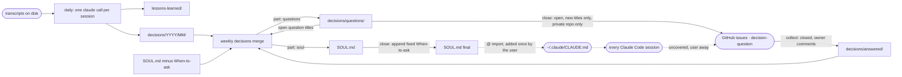

## Goal

Add a second extraction, **decisions**, to the existing pipeline, so Claude Code learns how its
user weighs options, not only which mistakes to avoid. The daily job records each real decision
the user made in a session (what was on the table, what they chose, their own reason). The
weekly job folds the new records into **SOUL.md**, a short file of priorities and "when X,
prefer Y, because Z, unless W" rules in the meta repo, which the user imports from their global
`~/.claude/CLAUDE.md` so every session loads it. Whatever the records cannot settle (a missing
reason, two choices that contradict each other) becomes a question in a **GitHub Issues queue**
on the meta repo's private remote. The user answers by comment from any device, and the next
weekly run reads the answer back as a decision with a stated reason. The flow that matters most:
the user works as usual, answers a few issues a week, and their sessions start deciding the way
they would.

Background: `.agents_workspace/virtual-clone.md` (the "virtual EeHeng" idea), and the session of
2026-10-13 that replaced its decision skill with a SOUL.md imported from global CLAUDE.md
(OpenClaw's SOUL.md idea) and chose GitHub Issues as the question UI (no terminal prompt, no GUI
to maintain). Review findings: `.agents_workspace/plan-reviews/decisions-soul-2026-10-13.md`
(R1-R20 below).

## Scope

**In:**

- A `decisions` extraction, off by default, that writes one decisions file per session next to
  the lessons file, from the same single `claude` call.
- An upgrade-safe config: re-running `install` on an existing meta repo adds new default keys
  inside each extraction while keeping the user's values (R1).
- A weekly merge that rewrites `SOUL.md` from its current text, the new decisions files, the
  answered questions, and the list of questions still open, capped at `weekly.maxLines` lines.
- A fixed "When to ask" section the script (not Claude) appends to SOUL.md, telling agents to ask
  in-session when the user is present and, only when the queue is active on a private repo, to
  open a `decision-question` issue otherwise.
- Weekly questions from the merge (missing reasons, contradictions) opened as issues on the meta
  repo's GitHub remote, deduplicated by title, and never on a public repo.
- Closed `decision-question` issues read back into decisions files, keeping only comments by the
  repo owner, before the weekly merge runs.
- `install` and `status` print the one `@` import line the user adds to global CLAUDE.md when
  `decisions` is enabled, and the README documents the feature.

**Out:**

- A separate tool. The pipeline was built for this (one call per session carries every
  extraction, archived transcripts, cursors, `git-sync`), and a new member would have to copy
  scan, cleanup, and archive logic it may not import.
- A decision skill. Superseded by SOUL.md: CLAUDE.md is always loaded, a skill depends on its
  description triggering.
- A master decisions file. The daily files are the examples archive and SOUL.md holds the rules;
  a third file has no reader.
- Editing `~/.claude/CLAUDE.md` from `install`. One line the user adds once; editing a global
  file every session reads is a bigger blast radius than the line is worth.
- Hand-pinned SOUL.md sections. Answers reach SOUL.md through issues, which carry a stated reason.
- Backfill from `transcripts/` (the archive). `prepare` scans only the `.jsonl` files still under
  the scan roots, so `run -All` backfills sessions still on disk; reading the archive is a new
  input path with no user asking for it yet (R6).
- The one-off interview (Phase 5, unplanned): it needs a few weeks of real records first.
- Sorting the 716 master lessons into decision vs gotcha as seed rules. A one-time task for the
  owner in a session, not a product feature.
- A non-GitHub queue (GitLab, local inbox file). Individuals first; the queue is optional and
  SOUL.md works without it.

## Design

### Components



### Config (`config.default.json`)

```json
"decisions": {
  "enabled": false,
  "prompt": "extract/decisions.md",
  "outputDir": "decisions",
  "none": "_No decisions extracted from this session._",
  "weekly": {
    "prompt": "merge/decisions.md",
    "master": "SOUL.md",
    "mode": "replace",
    "maxLines": 150,
    "questions": { "enabled": true, "label": "decision-question" }
  }
}
```

- `none` moves into config for every extraction (lessons gets
  `"none": "_No lessons extracted from this session._"`). `prepare-weekly` and `finish` read it
  instead of the hard-coded `$Ext -eq 'lessons'` / `LessonsStub` / `LESSONS_STUB` checks, so a
  new extraction needs no script edit.
- **Upgrade merge (R1).** `install` on an existing `config.json` merges defaults into each
  extraction recursively, the user's values winning: Bash
  `.extractions = ($d.extractions * (.extractions // {}))` (jq's recursive merge) replacing the
  shallow `+` in `lessons.sh`; PowerShell does the same per key and sub-key in `lessons.ps1`,
  replacing the copy-only-missing-extractions loop. A user who set `lessons.enabled: false`
  keeps it; an upgraded `lessons` gains `none`.
- `weekly.mode` is `append` (today's lessons behaviour, the default when absent) or `replace`.
- `weekly.maxLines` caps the `soul` part, which excludes the fixed When-to-ask section (R15).
- Both shells change in lockstep, and each phase adds its own `equivalence` cases (R9).

### Daily part: `prompts/extract/decisions.md`

The part, after the same four header lines the lessons part uses (`# Decisions — <Date>`,
`**Session**`, `**Title**`, `**Project**`), holds one block per decision:

```markdown
## <short title naming what was decided>

- **Situation:** what was being decided, enough to recognise a similar case
- **Options:** the alternatives on the table, including the assistant's proposal
- **Chosen:** what the user picked
- **Reason:** the user's reason, quoted or closely paraphrased from [USER]/[ANSWER] blocks, or `none given`
- **Reason source:** stated | inferred | none (`none` exactly when the reason is `none given`)
- **Override:** yes | no (yes when the user rejected or corrected the assistant's default)
- **Domain:** architecture | scope | verification | tooling | communication | agent-design | other
```

Prompt rules: plain approvals ("ok", "go ahead") are not decisions; never invent a reason, a
reason not in the user's own turns is `inferred`; an `[ANSWER]` to a `[QUESTION]` is a decision
with its options given. Validation is the existing rule (non-empty, contains the session UUID);
the `none` form counts as valid and nothing-found. Files land where every extraction's do:
`decisions/YYYY/MM/<date>_<uuid>[_<title>].md` (R7).

### Weekly replace merge

- **Input.** `prepare-weekly`, for a `replace` extraction, writes each batch input as
  `Run date`, then `# Open questions` (every `### ` title in `<outputDir>/questions/*.md` that
  has no `<outputDir>/answered/issue-*.md` whose first line is `## <that title>`, or
  `(none)`), then `# New session files` (R5). It collects files from `<outputDir>` recursively
  as today, which takes in `answered/`, and skips `<outputDir>/questions/`.
- **Current file at call time.** `prepare-weekly` writes a `# Current file` section holding a
  `{{CURRENT_FILE}}` line right after `Run date`, and `run` replaces that line with SOUL.md's
  current text just before each call (into `batch-<k>.md.call`), so batch k sees batch k-1's
  result and the input still starts with `Run date`. `run` also fills `{{MAX_LINES}}` in the
  merge prompt from `weekly.maxLines`. The text is cut at
  the first line equal to `## When to ask` (that line and everything after it dropped), so the
  model never sees the script's section (R2). No SOUL.md yet: `(none yet)`.
- **Answer.** Two parts on the existing marker convention, split with the existing
  `Split-Answer` / `split.jq`: `<<<extraction:soul>>>` and `<<<extraction:questions>>>`.
- **Validation (`finish-weekly` per batch).** The `soul` part is valid when its first line is
  `# SOUL`, it contains `## Priorities` and `## Rules`, and it has at most `weekly.maxLines`
  lines. If it contains a `## When to ask` line, the script cuts it there instead of rejecting
  (R2). Valid: write `SOUL.md` = the soul part. Invalid or missing: the existing attempts /
  given-up path. A missing or malformed `questions` part means no questions and never
  invalidates a valid `soul` (R18).
- **Questions file (R3).** A `questions` part other than `_No questions._` is written to
  `<outputDir>/questions/<runDate>_<batch cursorEpoch>.md`. Batches in one run have distinct
  `cursorEpoch`s (a same-mtime group is never split), and a retry of the same batch overwrites
  only its own file. Committed by `git-sync`, so it survives a failed send.
- **Counts (R18).** For `replace`, a batch's `added` is 1 when SOUL.md's bytes changed, else 0;
  the per-batch log line reads `Batch <k>: SOUL.md updated.` or `Batch <k>: SOUL.md unchanged.`,
  and the close line reads `Weekly decisions: <n> update(s), ...`.
- **Fixed section at close (R13).** `finish-weekly -Close` (after `open`, Phase 3) cuts SOUL.md
  at `## When to ask` and appends:

  ```markdown
  ## When to ask

  - No priority or rule above covers the decision, or it is irreversible: ask the user in the
    session if they are present.
  - When they are not: run `gh issue create --repo <owner/repo> --label decision-question`
    with the situation, the options, and your recommendation, then continue on the most
    conservative option and say so. Never comment on or close these issues.
  ```

  The second bullet is written only when the queue is active (`questions.enabled`, `gh` found,
  `origin` a GitHub URL, visibility `PRIVATE`); otherwise it reads "When they are not: continue
  on the most conservative option and say so." Phase 2 always writes the short form; Phase 3
  adds the queue condition.
- **Extractions keep going (R14).** In `run`'s weekly loop, an invalid batch (`finish-weekly`
  exit 3) ends that extraction's batches and moves on to the next extraction; a `claude` failure
  still stops the whole run. Both shells.
- **Merge prompt rules (`prompts/merge/decisions.md`).** Rules shaped "when X, prefer Y, because
  Z, unless W"; a `stated` reason outranks an `inferred` one; an override weighs more than a
  choice the user did not object to; a contradiction with an existing rule refines its "unless"
  when the records show the difference, and becomes a question when they do not; a rule with
  only `inferred` or `none` reasons becomes a question; never ask a question listed under
  `# Open questions` again, and reuse its exact title when it still applies; stay under
  `maxLines` by merging and retiring rules, never by truncating.

### Question queue: `src/questions.ps1` / `src/questions.sh`

Twins with `Cross-reference:` comments. Two modes. The queue is **active** when
`weekly.questions.enabled` is true, `ghPath` is set, and `origin` is a GitHub URL; otherwise
each mode logs one line and does nothing.

- **`collect`** runs in `run`'s weekly path only after the confirm prompt and `Open-Log` /
  `open_log`, before the `-Mode stage` / `--mode stage` call to `prepare-weekly` for `decisions`.
  Never on `-DryRun` or the confirm preview (R11). It creates the label when missing
  (`gh label create <label>`, R13), then runs
  `gh issue list --state closed --label <label> --limit 1000 --json number,title,body,comments`
  (R4). For each issue with no `<outputDir>/answered/issue-<n>.md` and at least one comment by the
  repo owner (`gh api user` login equals the `origin` owner), it writes that file: first line
  `## <issue title>`, then the issue body as **Situation**, only the owner's comments as
  **Reason**, and `**Reason source:** stated`. An issue closed with no owner comment is skipped
  and rechecked next week.
- **`open`** runs inside `finish-weekly -Close`, before the fixed section and `git-sync`. Like
  `collect`, it first creates the label when missing (`gh label create --force`). It refuses with a warning when `gh repo view --json visibility` is not `PRIVATE`. It reads every
  `### ` block in `<outputDir>/questions/*.md`, skips titles already in
  `gh issue list --state all --label <label> --limit 1000 --json title` (R4), and creates the rest
  with the label. Idempotent, so a failed send retries next week at no `claude` cost.
- **Warnings (R12).** A `gh` failure in either mode is a warning, never the run's `error`, like a
  failed push. `collect`'s warning reaches `last-run-weekly.json` through a new
  `-QuestionsWarning <text>` / `--questions-warning <text>` argument to `finish-weekly -Close`;
  `open`'s is set inside close. Both land in the `questionsWarning` field.
- **`ghPath` (R16).** `install` records `ghPath` in `state/install.json` beside `claudePath`: the
  first `gh` on PATH, else `null`. A missing `gh` never fails install; re-running `install`
  picks up a `gh` installed later. Tests swap in `tests/fake-gh.{sh,ps1}` through `ghPath`, the way
  they swap `claude`.

### CLI

- When `decisions` is enabled, `install` and `status` both print (R17)
  `Add this line to ~/.claude/CLAUDE.md to load your decisions:` and, on the next line,
  `  @<meta>/SOUL.md`, with `<meta>` written with forward slashes on Windows. Disabled:
  neither prints it.
- `status` adds `decisions: SOUL.md <n> lines, <k> open question(s)` when enabled (open count
  from `gh`, or `unknown` when the queue is not active).
- README: how to enable (`"enabled": true` under `extractions.decisions` in
  `<meta>/.claude/session-lessons/config.json`), the import line, answering issues, what text
  reaches GitHub, and that `run -All` backfills sessions still on disk at one sonnet call each,
  uncapped for a manual run, so preview it with `-DryRun` first (R6).

### Model

Daily decisions ride the existing daily call (sonnet, medium): one call per session carries every
extraction, so decisions share lessons' model. The weekly merge uses the existing weekly model
(opus, medium).

### Tests

- `tests/fake-claude.{sh,ps1}` learn the new prompts (R8): a daily answer with a decisions part
  (and its `none` form through a control file), and a weekly branch keyed on the decisions merge
  prompt's first line, answering from control files named like the existing `weekly-answer.md` /
  `weekly-bad` (e.g. `weekly-decisions-answer.md`, a SOUL over `maxLines`, a SOUL carrying
  `## When to ask`).
- Test envs that need a GitHub `origin` set `remote.origin.url` to a GitHub URL and
  `remote.origin.pushurl` to a local bare repo, so `git-sync` never reaches github.com (R10).
- All fixtures stay synthetic (the repo is public).

## Phases

### Phase 1: Daily decisions extraction

- **Builds:** `prompts/extract/decisions.md`; the `decisions` config entry; `none` per extraction
  replacing the lessons-only stub checks in `finish` and `prepare-weekly`; the recursive upgrade
  merge in `install` (both CLIs); the daily side of `fake-claude`.
- **Check:** `bash tests/run.sh bash daily && bash tests/run.sh pwsh daily && bash tests/run.sh
  bash cli && bash tests/run.sh pwsh cli && bash tests/run.sh bash equivalence` pass, with new
  cases: a fake answer with both parts writes `decisions/YYYY/MM/<date>_<uuid>*.md`; a missing
  decisions part keeps lessons and retries decisions; the decisions `none` form counts as
  nothing-found; an upgrade over an old config adds `lessons.none` and keeps a user-edited
  `lessons.enabled: false`; `equivalence` diffs `decisions/` between the shells. Manual, because
  prompt quality has no assertion (R19): the owner runs
  `pwsh lessons.ps1 install -MetaDir <scratch> -NoSchedule` on a fresh `git init` folder with no
  remote, sets `extractions.decisions.enabled` to `true` in its config, previews with
  `pwsh lessons.ps1 run -MetaDir <scratch> -Since <a date 1 to 2 days back> -DryRun`, runs the
  same command with `-Yes` when it shows 5 to 10 sessions, and accepts the
  `<scratch>/decisions/` records before Phase 2.
- **Status:** done, 2026-10-14. Automated part passed on 2026-10-13: `tests/run.sh bash daily`
  "passed 84, failed 0", `pwsh daily` "passed 84, failed 0", `bash cli` "passed 65, failed 0",
  `pwsh cli` "passed 67, failed 0", `bash equivalence` "passed 16, failed 0". Manual part:
  `run -Since 2026-10-13 -Yes` on a scratch meta repo processed 12 real sessions ("12
  processed, 0 failed"; decisions "11 written, 1 with nothing found", 55 decisions). The review
  found 36 of 45 reasonless decisions marked `stated`, which led to the `none` source (see
  Record); a rerun of 3 of those sessions with the fixed prompt marked 28 of 28 reasonless
  decisions `none` and kept the 3 with real reasons as before. The owner accepted the records.

### Phase 2: Weekly replace merge into SOUL.md

- **Builds:** `weekly.mode` (`append` | `replace`); `# Open questions` in replace-mode batch
  inputs; the call-time `# Current file` prepend with the When-to-ask cut in `run`; `soul` /
  `questions` split, validation, cut, and counts in `finish-weekly`; per-batch questions files;
  the fixed section (short form) at close; continue-to-next-extraction on an invalid batch;
  `prompts/merge/decisions.md`; the weekly side of `fake-claude`.
- **Check:** `bash tests/run.sh bash weekly && bash tests/run.sh pwsh weekly && bash tests/run.sh
  bash equivalence` pass, with new cases: batch 2's input contains batch 1's SOUL.md and no
  `## When to ask`; a soul part over `maxLines` is invalid and counts an attempt; a soul part
  carrying `## When to ask` is cut, not rejected; two batches that both ask questions leave two
  files under `decisions/questions/`; a question title already in a questions file appears under
  `# Open questions`, and disappears once a matching `answered/` file exists; a missing
  `questions` part keeps a valid SOUL.md; an invalid lessons batch still lets the decisions merge
  run; the final SOUL.md ends with the short fixed section; lessons `append` output is
  byte-identical to before; `equivalence` runs `cmp` on SOUL.md and the questions files.
- **Status:** done, 2026-10-13: `bash tests/run.sh bash weekly` "passed 55, failed 0", `pwsh
  weekly` "passed 55, failed 0", `bash equivalence` "passed 28, failed 0". "Lessons `append`
  output byte-identical to before" is shown by the unchanged lessons weekly cases passing, not
  by a separate golden file.

### Phase 3: GitHub Issues question queue

- **Builds:** `questions.ps1` / `questions.sh` with `collect` and `open`; `ghPath` at install;
  `collect` placement in `run`; `open` and the queue-aware fixed section in `-Close`;
  `-QuestionsWarning` / `--questions-warning`; `questionsWarning` in `last-run-weekly.json`;
  `tests/fake-gh.{sh,ps1}` answering from fixture JSON and logging its calls; the `pushurl` test
  setup.
- **Check:** a new `questions` suite passes in both shells (`bash tests/run.sh bash questions &&
  bash tests/run.sh pwsh questions`) and `bash tests/run.sh bash equivalence` passes with diffs of
  `answered/` and the fake-gh call logs. Cases: a closed issue with an owner comment becomes
  `answered/issue-<n>.md` holding only the owner's text; closed with only a non-owner comment
  writes nothing; 35 fixture issues are all seen (the `--limit`); `open` skips an existing title
  and creates a new one with the label; a missing label is created; `PUBLIC` visibility creates
  nothing, warns, and SOUL.md keeps the short fixed section; `PRIVATE` gives the issue bullet
  naming the fixture repo; a failing fake `gh` leaves `error` null and sets `questionsWarning`;
  `-DryRun` never calls `gh`; `install` with no `gh` on PATH succeeds with `ghPath: null`.
- **Status:** done, 2026-10-13: `bash tests/run.sh bash questions` "passed 25, failed 0", `pwsh
  questions` "passed 25, failed 0", `bash equivalence` "passed 28, failed 0". The
  no-`gh` install case lives in the `cli` suite (Phase 4's run), where a PATH without `gh` can
  be built; it asserts `ghPath: null` only when that PATH has no `gh` (Windows here), and a gh
  path otherwise (Linux, where gh shares `/usr/bin` with bash). A case where gh is signed in as
  someone else was added.

### Phase 4: CLI and docs

- **Builds:** the `@` import line in `install` and `status`; the `status` decisions line; the
  README section; a Key Decisions entry in `product/ARCHITECTURE.md`; a CHANGELOG `Unreleased`
  entry.
- **Check:** `bash tests/run.sh bash cli && bash tests/run.sh pwsh cli` pass, with cases: enabled
  `status` prints the import line with forward slashes and `SOUL.md 0 lines` before the first
  weekly run; disabled `status` prints neither. Manual: the owner enables `decisions` in their
  real meta repo, runs `pwsh lessons.ps1 run -Job weekly -Yes` once, adds the import line, and
  confirms a new session can quote SOUL.md's first priority without reading any file.
- **Status:** done, 2026-10-14. Manual part: on the owner's real meta repo, `install` from this
  branch, `run -Since 2026-10-12 -Yes` ("18 processed, 0 failed"; decisions "16 written, 2 with
  nothing found"), then `run -Job weekly -Yes` ("SOUL.md updated", 42 lines, 5 questions). The
  first `open` failed on a token without issue write access (which led to gh's error in
  `questionsWarning`); after the owner fixed the token, `questions.ps1 open` opened issues #1 to
  #5 and `status` read "decisions: SOUL.md 42 lines, 5 open question(s)". The owner added
  `@~/claude-meta/SOUL.md` to `~/.claude/CLAUDE.md`, and a new session quoted SOUL.md's first
  priority. Automated part passed on 2026-10-14, in the full runs on the final tree:
  `bash tests/run.sh bash` (every suite plus equivalence) "passed 296, failed 0" and `bash
  tests/run.sh pwsh` "passed 270, failed 0". The manual part (the owner's real meta repo, a
  real weekly run, and a new session quoting SOUL.md) is not run. Built: README section, Key
  Decision in `product/ARCHITECTURE.md`, CHANGELOG `Unreleased`, and the `questions` suite in
  CI's Linux pwsh step.

### Phase 5: One-off interview

- **Builds:** 20 to 30 trade-off questions generated once from SOUL.md's rules and the questions
  history, sent through the same queue.
- **Status:** unplanned (needs a few weeks of real records to know which tensions exist)

## Open

- Owner-comment rule: assumes the meta repo's `origin` owner is the user answering. A repo under
  an organisation would match no comments; until it comes up, `collect` treats such a repo as
  having no owner comments and logs it.
- Agent comments (R20): agents run `gh` as the same account, so an agent's comment on a closed
  issue would count as a stated reason. Accepted for now; the fixed section tells agents never to
  comment on or close these issues.
- `@` import of an absolute path: assumed that Claude Code resolves a forward-slash absolute path
  (Windows drive letter included) in `~/.claude/CLAUDE.md`, and that it may ask once to approve an
  import outside the project. Phase 4's manual check settles it; if it fails, print the path as
  `@~/...` when the meta repo is under the home folder. Settled 2026-10-14: the owner used the
  `@~/claude-meta/SOUL.md` form and a new session loaded it; the absolute form `install` prints
  is not separately tested.
- `maxLines` 150: assumed from OpenClaw's guidance to keep always-loaded files short; tune after
  a few weeks of real SOUL.md output.
- Domain list in the daily part: taken from `virtual-clone.md`; the merge may group differently.

## Record

- 2026-10-13 Planned: status ready
- 2026-10-13 Reviewed: Revise first, 5 blocking (shallow config merge drops `lessons.none` on upgrade, echoed When-to-ask section fails validation, per-batch questions file overwritten, `gh issue list` 30-item default breaks dedupe, merge never sees questions already asked)
- 2026-10-13 Built Phase 2: `bash tests/run.sh bash weekly` / `pwsh weekly`, "passed 55, failed 0" each; `bash equivalence` "passed 28, failed 0"
- 2026-10-13 Built Phase 3: `bash tests/run.sh bash questions` / `pwsh questions`, "passed 25, failed 0" each
- 2026-10-13 Design changed: was "`run` prepends `# Current file` plus SOUL.md's current text to each batch input just before the call", now "`prepare-weekly` writes a `{{CURRENT_FILE}}` slot after `Run date`, `run` fills it per call", because the merge prompt says the input starts with `Run date`
- 2026-10-13 Design changed: was "`install` and `status` both print (R17): `Add this line to ~/.claude/CLAUDE.md to load your decisions: @<meta>/SOUL.md`", now "the text line, then `  @<meta>/SOUL.md` on its own line", because the CLI keeps every non-path line within 80 columns
- 2026-10-14 Built Phases 1-4 automated checks, full runs on the final tree: `bash tests/run.sh bash` "passed 296, failed 0", `bash tests/run.sh pwsh` "passed 270, failed 0"; Phases 1 and 4 stay todo for their manual checks
- 2026-10-14 Design changed: was "`Reason source: stated | inferred`", now "`stated | inferred | none`, `none` exactly when the reason is `none given`, and the merge turns a rule resting only on `inferred` or `none` reasons into a question", because the Phase 1 manual run (12 real sessions, 55 decisions) marked 36 of 45 reasonless decisions `stated`, which would let a missing reason skip the question queue
- 2026-10-14 Built Phase 1 manual check: 12 real sessions, then 3 rerun with the `none` source ("3 processed, 0 failed", 28 of 28 reasonless decisions `none`); owner accepted
- 2026-10-14 Built Phase 4 manual check: real meta repo, weekly run wrote a 42-line SOUL.md and issues #1 to #5; a new session quoted SOUL.md's first priority through `@~/claude-meta/SOUL.md`
- 2026-10-14 PR: #65 https://github.com/cheneeheng/claude-code-command-center/pull/65
