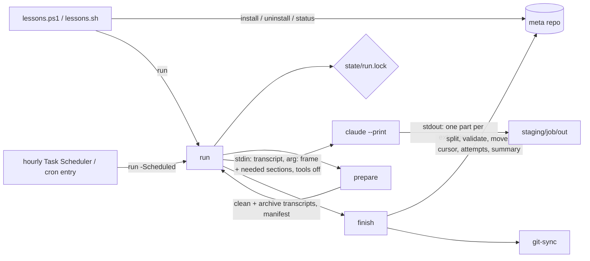

## Goal

Rebuild `tools/scheduled-session-digests` from scratch as a product for individual Claude Code
users, installed from a local clone, that runs in the background once installed. On a schedule it
runs each new Claude Code session through a fixed prompt in headless mode (`claude --print`) and
files the answer in a local git repo the user owns. Every enabled **extraction** comes back from a
**single call per session**. The product ships one extraction, lessons learned: one file per
session (daily) and one cross-project master file (weekly). The pipeline is built so that a second
extraction (decisions, planned in `.agents_workspace/virtual-clone.md`) is a prompt file and a
config entry, not a rebuild. Each session's cleaned transcript is archived, so later extractions
can still reach it. The flow that matters most: clone, run one install command, and from then on
find a lessons file for each of their sessions without doing anything. A manual run, whose size
(sessions and rough input tokens) is shown before it starts, is there for a first look and for
catching up.

Every decision traces to one of these sources:

- the first-run audit, `.agents_workspace/ux-audits/scheduled-session-digests/run-001/UX_AUDIT.md`
  (F1-F9);
- the first plan review (R1-R26);
- the needs of the decision skill in `virtual-clone.md` (V1-V4);
- the second plan review (S1-S27);
- the third plan review (T1-T8).

## Scope

**In:**

- One CLI, `lessons.ps1` (Windows, PowerShell 7.4+) / `lessons.sh` (Linux, Bash 4+), with four
  commands: `install`, `run`, `status`, `uninstall` (F3, F7). Every command takes `-MetaDir` /
  `--meta-dir` (R9).
- `install` asks no questions. It checks its prerequisites, lists every change it will make, and
  writes nothing until the user confirms. Every setting has a default and a flag (F2, F4, F6, F8,
  R24, S25).
- One scheduled entry per meta repo runs every hour and does whichever of the daily and weekly jobs
  is due, one at a time. A job missed while the machine was asleep, off, or on battery runs at the
  next hourly tick. A backlog left by the cap, or a run stopped by a `claude` error, is picked up
  at the next tick (F8, R2, R11, R14, S5).
- The first scheduled run happens at the first `dailyAt` after install, never at the first hourly
  tick, so a user's first look with a dry run comes before any unattended spend (S22).
- Only one run touches a meta repo at a time, scheduled or manual (R2, S4).
- **Extractions (V1).**
  - An extraction is a named entry in `config.json` with a prompt section, an output folder, and an
    optional weekly merge. The product ships one, `lessons`.
  - The daily job sends each session to `claude` once, asking for every enabled extraction the
    session does not have yet. It splits the answer and files each part in that extraction's
    folder.
  - An extraction enabled later only processes the sessions that lack its output, so it can be
    backfilled with `run -All` without paying for lessons again.
- **Transcript cleanup for decision signals (V2, S1, S2, S20).**
  - Only the user's own sessions are read. Subagent transcripts are excluded: their "user" turns
    are the parent agent's prompts.
  - `[USER]` holds only what the user typed, including messages typed while Claude was working.
    Hook output, system reminders, command and bash output, task notifications, compaction
    summaries, and interrupt notices are not `[USER]`.
  - AskUserQuestion questions, their options with descriptions, and the user's answers are kept.
    So are tool calls the user rejected, with their reason, and interruptions.
- **Transcript archive (V3, S12, S13).**
  - Each session's cleaned transcript is kept once in `transcripts/<yyyy>/<MM>/`, committed with the
    rest of the meta repo, so it outlives Claude Code's own transcript cleanup.
  - `install` offers a one-time archive of every session still on disk, at no `claude` cost. On the
    owner's machine that is about 3,100 sessions from 2026-06-04 onward. Earlier raw transcripts are
    already gone, while lessons go back to 2026-03-30 (checked 2026-10-11).
  - Each archive file records which cleanup rules made it (`Cleanup: v1`), so a later extraction
    can tell old copies apart and remake them from the raw file while that still exists.
- A first run is bounded: it covers the last 7 days unless the user passes `-All` / `--all` (F1).
- A scheduled run processes at most 20 sessions (`maxSessionsPerRun`). The rest carry over to the
  next hourly tick, which bounds unattended credit spend per run. A manual run is not capped,
  because its preview asks first.
- A manual `run` shows a preview first (sessions found, skipped, deferred, rough input tokens,
  since when) and asks for confirmation. A scheduled run logs the same preview and does not
  ask (F1, R25).
- Every run prints and logs one progress line per session and ends with a summary line (processed,
  per-extraction files written and "none found", failed and retried next time, given up, deferred,
  where the files are). The summary is saved for `status` (F5).
- Claude writes nothing to disk and runs with tools disabled. Its answer comes back on stdout, and
  the script writes it to staging, validates each part, then moves it into place. A killed run
  never leaves a partial output file or a damaged master file (audit hypothesis, R6, S19).
- A session whose answer is missing or invalid 3 times for an extraction is given up for that
  extraction, reported in the summary and in `status`, and no longer retried or paid for (R12,
  S14).
- A `claude` failure (non-zero exit: logged out, usage limit, network) stops the run at once,
  records the error, and counts no attempt, so an outage never gives up sessions (S3).
- `status` shows the schedule and next run time, each cursor as a date, the last run summary for
  daily and weekly (including its error, if any), and the given-up sessions (F5, R24).
- `uninstall` removes the schedule and the tool's own files, keeping `config.json` and all data.
  It never deletes the meta dir or its `.git`, even when `install` created them (T3). With
  `-Purge` / `--purge` it also deletes
  this tool's data: each extraction's output folder and master file (`lessons-learned/`,
  `master-lessons/`), `transcripts/`, `.claude/session-lessons/`, and this tool's logs. It never
  touches the meta dir itself, `.git`, or anything else, and says which before acting (F6, R10).
- An upgrade keeps all lessons extracted so far, and the user's old schedule times and thresholds.
  - `install` never deletes `lessons-learned/` or `master-lessons/`.
  - The new pipeline continues from where the old one stopped, through the carried cursors, and
    writes new files into the same folders in the same format, so the weekly harvest keeps
    building on the existing master file.
  - `-Purge` exists only on `uninstall` (S21).
- `install` finds a previous install of this member, lists what it will remove (its scheduled
  tasks, named scripts, and interactive skills), removes exactly those on confirmation, and
  carries over the cursors and settings. Files it does not name are left alone (R1, S21).
- The PowerShell and Bash implementations behave the same, and the tests prove it on the same
  fixtures, staged inputs included (R19, S9, S10).
- On-screen lines fit 80 columns, and no prompt or message uses a term the README does not
  define (F9, R26).
- Tests plus a CI workflow, wired the same way as `statusline.yml`. Test fixtures copy the
  structure of real transcripts with made-up text only, because this repo is public (S11).
- Docs: one outcome-first README with a privacy note (the meta repo holds lessons and cleaned
  transcripts) before any remote is added, a rewritten member CLAUDE.md, and updates to the root
  README, the root CLAUDE.md, `setup/README.md`, and `setup/registry.ps1` (R21).
- A second audit round (run-002) on the rebuilt install, including a live, bounded run.

**Out:**

- The decision extraction itself (its prompt, record format, weekly merge, the decision skill,
  escalation, and the interview): a separate plan built on this one, per `virtual-clone.md`, which
  first wants the prompt tried on 5 to 10 transcripts and reviewed by the owner.
- Reading the archive as a backfill source when a session's raw transcript is gone: part of the
  decision plan. The archive keeps the staged-input format, so it can be fed in directly.
- Archiving raw JSONL transcripts: 889 MB on the owner's machine. The cleaned archive plus its
  `Cleanup:` version line is enough.
- Subagent transcripts as sessions (owner's decision, S1).
- A separate model per extraction: one call serves all extractions in it. Splitting an extraction
  into its own call is the way out if one ever needs a stronger model.
- Interactive Claude Code skills (`/session-digest-*` today): removed by the product decision of
  2026-10-11. The product is headless and runs in the background.
- Windows PowerShell 5.1: PowerShell 7 (`pwsh`) only, by the product decision of 2026-10-11.
- `lessons.ps1` on Linux and `lessons.sh` on Windows: the supported pairs are `lessons.ps1` on
  Windows and `lessons.sh` on Linux.
- A `lessons` command on PATH: the CLI runs from the clone, and every message prints the real
  invocation (S24).
- daily-summary: dropped by the product decision. Existing `daily-summaries/` data is left in place.
- Team mode (shared lessons, aggregation, redaction): future work, after individuals.
- macOS (launchd): future work.
- A single-language port: future work. PowerShell + Bash was chosen.
- Publishing or a component release tag: the product is local clone only. `VERSION` is bumped,
  but nothing is tagged.
- Secret redaction in lessons and transcripts: the owner's remote is private. The README warns
  before a remote is added. Redaction is part of team mode.
- Renaming the member folder: churn across the registry, the task paths, and the docs, for no user
  gain now (see Open).
- Interactive prompts for times, thresholds, or the meta dir: replaced by defaults and flags (F2).
- A `.claude/settings.json` in the meta repo, and `--permission-mode`: Claude uses no tools, so it
  needs no permissions.
- Digesting the new part of a session that continued after it was digested: a session is digested
  once, as a whole, after it has been quiet for an hour.
- Estimating cost in currency: prices change. The preview shows rough input tokens.

## Design

**Stack.**

- PowerShell 7.4+ (`pwsh`, Windows; every `.ps1` starts with `#Requires -Version 7.4`; built in
  Phase 2: versions before 7.3 drop the empty-string argument in `--tools ""`) and Bash 4+
  with `jq` (Linux; the scripts check both and exit with one line if either is missing). `git`
  and `claude` are needed at run time. No other dependencies (S25).
- All files are read and written as UTF-8 without a BOM, with LF line endings, on both platforms
  (R7, S9).
- A "character" is a Unicode code point everywhere it is counted: truncation, `minTranscriptChars`,
  and `approxTokens`. PowerShell counts and cuts by code point, never by UTF-16 unit, so it never
  splits a surrogate pair (S10).
- Paths stored in manifests and state files are relative to the meta repo and use `/` (S9).

**Components.**



- **prepare** is the single owner of scanning, filtering, transcript cleanup, archiving, and
  staging, for both the daily and the weekly job (`-Job daily|weekly`). It follows the rules below
  exactly.
- **finish** is the single owner of splitting the answer, validation, moving outputs into place,
  the weekly merge, advancing the cursor, attempt counting, the last-run summary, git-sync, and
  staging cleanup. Today the cursor rule is copied into the trigger and into SKILL.md. It moves
  into code that tests can cover.
- **run** is the only consumer.
  - It takes the lock, checks that `claudePath` exists, and calls prepare.
  - It shows the preview, and asks for confirmation when run by hand.
  - It pipes each staged transcript into one `claude --print` call, writing stdout to that
    session's `pending` file, with progress lines.
  - It stops at the first non-zero `claude` exit.
  - Then it calls finish and releases the lock.
  - With `-Scheduled` and no `-Job`, it runs each due job in order, daily then weekly.

**Repo layout (member).**

```
tools/scheduled-session-digests/
  lessons.ps1, lessons.sh               CLI
  src/prepare.ps1, prepare.sh
  src/finish.ps1, finish.sh
  src/run.ps1, run.sh
  src/git-sync.ps1, git-sync.sh
  src/lib.sh, lib.ps1                   shared helpers (paths, lock, cutoff); lib.ps1 also holds
                                        Convert-Transcript, the PowerShell cleanup
  src/clean.jq                          the Bash cleanup (rule 5), run by jq
  src/prompts/daily-frame.md            I/O and answer format shared by every extraction
  src/prompts/extract/lessons.md        the lessons section of the daily call
  src/prompts/merge/lessons.md          the lessons weekly merge
  src/prepare-weekly.ps1, .sh           weekly staging (built in Phase 3 as its own script)
  src/finish-weekly.ps1, .sh            weekly merge per batch (-Batch) and close (-Close)
  src/split.jq, merge.jq                the Bash answer split and weekly merge (PowerShell:
                                        Split-Answer and Merge-WeeklyAnswer in lib.ps1)
  tests/run.sh, tests/fixtures/, tests/fake-claude.sh, tests/fake-claude.ps1
  README.md, CLAUDE.md, VERSION
```

**Installed layout (meta repo, default `~/claude-meta`).**

```
claude-meta/
  lessons-learned/<yyyy>/<MM>/<date>_<uuid>[_<title>].md   lessons, daily (format unchanged)
  master-lessons/MASTER_LESSONS_LEARNED.md                 lessons, weekly (format unchanged)
  transcripts/<yyyy>/<MM>/<date>_<uuid>.md                 cleaned transcript archive (committed)
  logs/<yyyy>/<MM>/<stamp>_session-lessons-<job>.log       run logs (gitignored)
  .claude/session-lessons/
    config.json                                            user settings (committed)
    src/ (prepare, finish, run, git-sync, prompts)         copied from the member
    state/install.json                                     machine-specific (see Data model)
    state/daily.cursor, weekly-<extraction>.cursor         Unix epoch, whole seconds
    state/attempts.json, given-up.txt
    state/last-run-daily.json, last-run-weekly.json
    state/run.lock
    staging/daily/, staging/weekly-<extraction>/           transient: manifest.json, in/, out/
```

The installed scripts find the meta repo from their own location (`.claude/session-lessons/src/`
is two levels below `.claude`). So `install` sets no environment variable, needs no new terminal,
and cron needs no env file (F2, F6). `install` writes `.gitignore` lines for
`logs/*session-lessons-*`, `.claude/session-lessons/state/`, and
`.claude/session-lessons/staging/`. Everything machine-specific lives in `state/`, so a meta repo
shared across machines never carries one machine's paths or uninstall record (R23).

**Data model.**

- `config.json` (user settings, committed):
  ```json
  {
    "schedule": { "dailyAt": "03:00", "weeklyDay": "Sunday", "weeklyAt": "04:00" },
    "thresholds": { "minUserTurns": 2, "minTranscriptChars": 500 },
    "firstRunDays": 7, "maxSessionsPerRun": 20, "maxAttempts": 3, "settleMinutes": 60,
    "weeklyBatchChars": 400000,
    "models": { "daily": { "model": "sonnet", "effort": "medium" },
                "weekly": { "model": "opus", "effort": "medium" } },
    "extractions": {
      "lessons": { "enabled": true, "prompt": "extract/lessons.md", "outputDir": "lessons-learned",
                   "weekly": { "prompt": "merge/lessons.md",
                               "master": "master-lessons/MASTER_LESSONS_LEARNED.md" } }
    }
  }
  ```
  - Weekly uses opus at medium effort by the owner's decision: it writes the permanent master file
    (R16).
  - `daily` model and effort apply to the one call per session, whatever extractions it carries.
  - On upgrade, the old `scheduler-config.json` values are carried in place of the defaults: the
    daily-lessons time and thresholds, and the weekly-lessons day and time. The owner's weekly run
    is Sunday 02:00. Phase 4 confirms the key names against the real file (S21).
- `state/install.json` (machine-specific, gitignored):
  `{ version, installedAt, claudePath, claudeNoToolsArgs: [..], scanRoots: [..], taskName, installed: { createdMetaDir, gitInit, tasks: [..], cronLines: [..], gitignoreLines: [..], legacyRemoved: [..] } }`.
  - `install` writes `installed` as the record of exactly what it changed. `uninstall` reverses
    `tasks`, `cronLines`, and `gitignoreLines`. `createdMetaDir`, `gitInit`, and `legacyRemoved` are
    information only and are never reversed, so no uninstall ever deletes the meta dir, its `.git`,
    or the lessons history (T3).
  - `installedAt` is written by the first install and kept by every re-install.
  - `claudePath` and `scanRoots` are resolved at install time, because cron's environment has
    neither the user's PATH nor their variables (R17). On Windows, `claudePath` is the first
    native `claude.exe` on PATH, and only without one the first `claude` command. (Added in
    Phase 6: the live run found a `claude.ps1` wrapper earlier on the owner's PATH that drops
    piped input, so every call ran on an empty transcript.)
  - The test harness writes this file and `config.json` directly, so phases 1 to 3 need no
    `install` (S27).
- Daily manifest:
  `{ job: "daily", cursorFile, cutoffEpoch, cursorEpoch, writeCursor, since, skipped, deferred, approxTokens, jobs: [ { uuid, date, title, project, mtime, input, archive, pending, exit, needed: ["lessons"], outputs: { "lessons": "<path>" } } ] }`.
  - All paths are meta-relative with `/`.
  - `pending` is `staging/daily/out/<uuid>.md` (Claude's whole answer).
  - `exit` is null until `run` calls `claude` for that job, then the call's exit code. `run`
    writes it into the manifest right after each call (T1).
  - `approxTokens` is the code-point count of the staged inputs divided by 4, labelled "rough"
    wherever it is shown.
  - `prepare` deletes `staging/<job>/` before staging, so a killed run's leftover files are never
    read as answers (T1).
- Weekly manifest, one per extraction with a `weekly` entry:
  `{ job: "weekly", extraction, cursorFile, cutoffEpoch, since, batches: [ { cursorEpoch, files: [..], input, pending, merged, exit } ] }`.
  Each batch holds the existing titles grouped by section plus at most `weeklyBatchChars` of
  collected per-session files, and is merged on its own, oldest first (S17). `files` and `exit`
  follow the daily rules.
- `last-run-<job>.json`:
  `{ job, startedAt, finishedAt, trigger: "manual"|"scheduled", processed, results: { "<extraction>": { written, none } }, failed, givenUp, deferred, committed, pushed, error }`.
  `error` is null or one line, for example `claude not found at <path>` or
  `claude exited 1: <first stderr line>`, or `git commit failed: <first git line>`.
- `attempts.json`: `{ "<extraction>:<uuid>": <failed attempts> }`, and for weekly batches
  `{ "weekly-<extraction>:<first file>": <failed attempts> }`, where `<first file>` is the batch's
  first file as a meta-relative path. `given-up.txt` holds one key of the same form per line. A
  given-up weekly batch adds one `weekly-<extraction>:<file>` line per file in it (S14, S17, T2).

**The one daily call (V1, S18, S19).**

- `run` builds the prompt from `daily-frame.md` followed by the section file of each extraction in
  the job's `needed` list, in config order. The transcript goes on stdin.
- `claude` runs with tools disabled. `claudeNoToolsArgs` in `install.json` is
  `["--tools", "", "--no-session-persistence"]`, passed on every call. (Built in Phase 2:
  `claude --help` (2.1.296) documents `--tools ""` as "disable all tools". `--no-session-persistence`
  keeps headless runs from being saved as sessions at all, so the tool can never digest its own
  runs. `--bare` would also skip user hooks, but it reads only `ANTHROPIC_API_KEY`, never the
  user's OAuth login, so it is not used.) This matters because the meta repo's own
  `.claude/settings.json` allows `git` and `mkdir`.
- The frame tells Claude to answer with one part per requested extraction. Each part starts with a
  line `<<<extraction:NAME>>>` and holds only that extraction's file content.
- `finish` splits the answer by these rules:
  - a marker counts only as a whole line;
  - text before the first marker is ignored;
  - parts for names that were not requested are ignored;
  - when a name appears twice, the first part wins;
  - a part is trimmed, and a markdown fence wrapped around the whole part is dropped (the
    prompt shows the template inside a fence, so a model may copy it). (Added in Phase 2.)
- Each part is validated by its extraction's check. A valid part is written to its output path even
  when another part fails, so a retry asks only for what is still missing.

**Prompts.**

- `extract/lessons.md` is today's `daily-lessons/daily-lessons.md` lesson definition and output
  template, carried word for word:
  - what counts as a lesson and what to leave out;
  - the `# Lessons — <Date>` header with the `**Session**`, `**Title**`, `**Project**` lines;
  - the `## YYYY-MM-DD — <title>` blocks with **What happened** / **Lesson**;
  - the no-lessons stub.
- `merge/lessons.md` is today's `weekly-lessons/weekly-lessons.md`, with the keep/discard rules,
  the categories, the deduplication rule, and the lesson template (`### <title>`, `**Source**`,
  `**Lesson**`, `**Apply when**`, `**Tags**`) carried word for word.
- These change:
  - "Read the input file" becomes "the transcript follows on stdin" (in `daily-frame.md`), which
    also explains the transcript's line labels (`[USER]`, `[ASSISTANT]`, `[QUESTION]`, `[ANSWER]`,
    `[USER REJECTED ...]`, `[INTERRUPTED]`).
  - "Create the directory and write the output file" becomes "answer with the parts only".
  - The final "Report" step is removed, because stdout is the answer.
  - Weekly: Claude receives the existing titles grouped under their sections, instead of the master
    file. It answers with only the new lessons, or exactly `_No new lessons._`. It is told it may
    use any existing section as well as the listed categories. Creating the master file and
    updating `Last updated:` move into `finish` (S15).
- Every file in `lessons-learned/` and `master-lessons/` keeps today's format.

**Scan and filter rules (daily `prepare`; both shells follow these exactly) (R5).**

1. Scan roots are the `projects/` folder of each entry in `scanRoots`. `scanRoots` defaults to
   `~/.claude` and `~/.claude_devcontainer`, and is replaced by `C4_CLAUDE_DIR` when that is set
   at install time. `C4_CLAUDE_DIR` is a path-separator list (`;` on Windows, `:` on Linux), as in
   `libs/claude-usage`. Missing roots are skipped.
2. The meta repo's own project folder is excluded. Its name is the meta dir's absolute path with
   every character that is not a letter or digit replaced by `-`, the way Claude Code names project
   folders (`C:\Users\Chen\claude-meta` becomes `C--Users-Chen-claude-meta`). It is compared
   exactly, never as a substring. This also excludes the headless runs' own sessions (S8).
3. Candidate files are `*.jsonl` under each remaining project folder, recursively, except files
   under a `subagents/` folder and files whose first entry has `isSidechain: true` (S1). A
   candidate's mtime must satisfy `cutoffEpoch < mtime <= now - settleMinutes`. Candidates are
   sorted by mtime and then by file name, bytewise. (Built in Phase 1: file name rather than path,
   because path separators differ between the shells and UUIDs are unique.) Mtimes are whole
   Unix seconds, truncated.
4. A candidate's `needed` list is every enabled extraction that has no file whose name contains
   the UUID (the transcript's file name without `.jsonl`) anywhere under its `outputDir`, and no
   `<extraction>:<uuid>`
   line in `given-up.txt`. A candidate is skipped (not staged, counted in `skipped`) when it has
   fewer than `minUserTurns` user turns, or its cleaned transcript is shorter than
   `minTranscriptChars`. It is not staged when `needed` is empty, but it is still archived
   (rule 7).
5. Transcript cleanup reads every line as JSON and skips lines that fail to parse (V2, S2, S20):
   - **Metadata.** `type: "custom-title"` gives the title (the first one wins). The first `cwd`
     seen gives the project (its leaf name, or `unknown`).
   - **Dropped entirely:** entries with `isMeta: true`, `isCompactSummary: true`, or
     `isSidechain: true`. Image blocks are dropped.
   - **Removed from user text:** blocks wrapped in `<system-reminder>`, `<task-notification>`,
     `<command-message>`, `<local-command-stdout>`, `<local-command-stderr>`,
     `<local-command-caveat>`, `<bash-stdout>`, and `<bash-stderr>`.
   - **Kept from user text, tags unwrapped:** `<bash-input>`, `<command-name>`, and
     `<command-args>`, because the user typed them. A slash command therefore shows as
     `[USER]\n/clear` (or `/name args`). (Built in Phase 1: the plan had removed command tags, but
     the real data shows they hold what the user typed.)
   - **User turns.** A `type: "user"` entry with `message.content` as a string, or with `text`
     blocks joined by a newline, becomes `[USER]\n<text>\n` when non-empty after removal, and counts
     as one user turn. A message the user typed while Claude was working is a `type: "attachment"`
     entry with `attachment.type: "queued_command"` and `humanTurn: true`, and is rendered the same
     way. Phase 1 confirmed on the owner's transcripts that these are never written again as a
     `type: "user"` entry (29 of 29). Queued commands without `humanTurn` (peer agents, task
     notifications) are dropped. Within a user entry, tool results come first, then its text.
   - **Interruptions.** `[Request interrupted by user]` and `[Request interrupted by user for tool use]`
     become `[INTERRUPTED]\n`, and do not count as user turns.
   - **Assistant text.** Each `text` block of a `type: "assistant"` entry is trimmed, cut to 10,000
     code points plus `\n[...truncated]`, and becomes `[ASSISTANT]\n<text>\n`.
   - **Questions.** An assistant `tool_use` named `AskUserQuestion` becomes
     `[QUESTION]\n<question>\nOptions:\n- <label>: <description>\n` for each question (`- <label>`
     when the description is empty). Its matching `tool_result` becomes one `[ANSWER]` block with
     `Q: <question>\nA: <answer>` per question, plus `\nNotes: <notes>` when the user added notes.
     Answers come from `toolUseResult.answers` (a multi-select answer is joined with `, `) and notes
     from `toolUseResult.annotations[<question>].notes`. Without structured answers, the result
     text is used. The block counts as one user turn.
   - **Rejections.** A `tool_result` in an entry whose `toolUseResult` is
     `"User rejected tool use"` becomes `[USER REJECTED <tool name>]\n` and is not a user turn. The
     result text is a fixed harness template and never holds the user's reason: the reason arrives
     as the user's next message. (Built in Phase 1: the plan expected a second form with a reason,
     but all 12 rejections on the owner's machine have the single template.)
   - **Dropped:** everything else (other tool calls, tool results, thinking).
6. Output file name, per extraction: `<date>_<uuid>_<safe-title>.md` when a custom title exists,
   else `<date>_<uuid>.md`, under `<outputDir>/<yyyy>/<MM>/`. `date` is the file's local mtime as
   `yyyy-MM-dd`. `safe-title` replaces each of `\ / : * ? " < > |` and each whitespace run with
   `_`.
7. **Archive (V3, S12, S13).**
   - The staged input is the header
     `# Session Transcript\nUUID: <uuid>\nDate: <date>\nTitle: <title or uuid>\nProject: <project>\nCleanup: v1\n\n## Conversation\n\n`
     followed by the cleaned transcript.
   - `prepare` writes it to the archive for every candidate that passes the thresholds, whether or
     not it is staged.
   - The archive path is the existing `transcripts/**/*_<uuid>.md` when there is one, which is
     overwritten in place. Otherwise it is `transcripts/<yyyy>/<MM>/<date>_<uuid>.md`.
   - `Cleanup: v1` names this rule set. Any change to rules 1-5 bumps it.
   - `run -ArchiveOnly` runs this rule alone over the scanned range. It calls no `claude`, stages
     nothing, and never moves a cursor. `install` offers `run -ArchiveOnly -All` once, as an item in
     its change list, to archive every session still on disk.

**Scan rules (weekly `prepare`, per extraction with a `weekly` entry) (S15, S17).**

- Candidates are `<outputDir>/**/*.md` with `cutoffEpoch < mtime`, excluding the extraction's
  no-content stubs (for lessons, files containing `_No lessons extracted from this session._`) and
  files whose key is in `given-up.txt`.
- Candidates are split, oldest first, into batches of at most `weeklyBatchChars` code points. A
  group of files with the same mtime second is never split across batches. A group larger than the
  limit becomes one batch on its own (T2).
- Each batch's input is the existing `### ` titles grouped under their `## ` headings, under
  `# Existing titles` (or `(none yet)`). That is followed by `# New session files`, with one
  `## Source: <file name>` section per file.
- The master file itself is never sent. The owner's is already 442 KB with 716 lessons (checked
  2026-10-11), so returning or even reading the whole file every week would exceed one response and
  cost the most for the least. Titles are enough to deduplicate.

**Weekly merge for lessons (`finish -Job weekly`) (V4, S16).**

- Claude returns only the new lessons, or exactly `_No new lessons._`.
- The answer is a series of `## <Category>` sections, each with one or more `### <title>` lessons in
  today's format.
- A category is valid when it is one of the categories in `merge/lessons.md` or already a `## `
  section of the master file. The owner's file has 7 sections, including "Claude Code & Agent
  Development", which the prompt's list does not name.
- A title that repeats inside the answer is kept once.
- `finish` builds the new master in staging, one batch at a time:
  - it appends each lesson at the end of its `## <Category>` section, creating the section at the
    end of the file when it is missing;
  - it skips a lesson whose `### ` title already exists;
  - it sets the `Last updated:` line to the run date;
  - when there is no master file yet, it starts from today's header.
- The master format is unchanged.
- Built in Phase 3:
  - The batch input starts with a `Run date: YYYY-MM-DD` line, which the prompt uses for
    `**Source**`, as the old harvest header did.
  - Text before the first `## ` line of an answer is ignored, as with the daily preamble.
  - With every lesson already present, the answer counts as nothing new and the master is left
    as it is.
  - `run` calls `finish-weekly -Batch k` right after each batch's claude call, so it can stop
    at the first failed batch. `finish-weekly -Close` then writes the cursors, the last-run
    summary, and the commit.
  - An invalid answer counts as failed but is not an `error`, so the run exits 0. Only a
    `claude` failure is an `error` and exits non-zero, as in the daily job.

**Cursor, cap, and first run.**

- **Cutoff.**
  - `-All` uses 0. `-Since <date>` uses that date. Otherwise the cutoff is the stored cursor, or
    `now - firstRunDays` when there is no cursor file.
  - With no cursor file, a real run (anything but `-DryRun` and `-ArchiveOnly`) writes its own
    cutoff to the cursor file before staging, and `writeCursor` is then true. So a failing first
    run does not let the window slide (R13, T6).
  - `-DryRun` computes the cutoff but never writes it (S7). `-ArchiveOnly` never creates or
    changes a cursor file (T6).
- **When a run may move the cursor.** `writeCursor` is true only when the run's cutoff is at or
  before the stored cursor. A `-Since` later than the cursor, or any run that scans a narrower
  range, never moves it, so no unscanned range is skipped (R4).
- **cursorEpoch.** Without a cap, it is the mtime of the newest candidate, skipped ones included,
  so a zero-job run still advances past skipped files (R13). With `-Scheduled` and more than
  `maxSessionsPerRun` eligible sessions:
  - `prepare` stages the oldest ones up to the cap;
  - it never splits a group of sessions with the same mtime second: it stops before a group that
    would cross the cap, except that a first group larger than the cap is staged whole;
  - `cursorEpoch` is then the mtime of the last staged session, and the rest are reported in
    `deferred` (R3).
- **Advancing (S6).** After a run, the cursor becomes the smaller of `cursorEpoch` and (the mtime of
  the oldest session that is not done, minus 1 second). Because the cutoff is strict, this never
  skips a session that shares its mtime second with a done one. A session is done when every
  extraction in its `needed` list was validated and moved, or given up. A session whose `exit` is
  null (never called) or non-zero is not done.
- **Validation.**
  - A lessons part starts with `# Lessons — ` and contains `**Session**: <uuid>`. The em dash is
    written as a code point in the source, not typed, so the encoding cannot break it (R7).
  - An extraction without a check of its own must be non-empty and contain the session UUID.
  - A weekly lessons answer is exactly `_No new lessons._`, or one or more valid `## <Category>`
    sections, each holding `### ` lessons with a `**Lesson**:` line. The merged master must still
    start with `# Master Lessons Learned` and contain every `### ` title the old one had.
- **Attempts (S3, S14, T1).**
  - `finish` reads a job's `pending` file, moves its valid parts, and counts attempts only when the
    job's `exit` is 0. A job with `exit` null or non-zero is left as it is: nothing is moved,
    nothing is counted, and it is staged again next run.
  - An attempt is counted when `exit` is 0 and a requested part is missing or invalid. It is
    counted per `<extraction>:<uuid>`.
  - At `maxAttempts`, that key is appended to `given-up.txt`, reported, and treated as done.
  - A non-zero `claude` exit counts nothing. It stops the run, records `error`, and leaves the rest
    for the next run.
  - A weekly batch that fails `maxAttempts` times is given up the same way, under the key of its
    first file, and its files are skipped from then on.
- **Weekly (R6, T2).**
  - Each weekly cursor (`weekly-<extraction>.cursor`) advances batch by batch, only over batches
    whose merged master validated, never on exit code alone.
  - The weekly run stops at the first batch that fails, whether by non-zero exit or by an invalid
    answer. Later batches wait for the next run, so nothing past a failure is sent or paid for
    twice.
  - A batch given up at `maxAttempts` counts as done, and the cursor moves past it.

**Lock (R2, S4).**

- `run`, including `-DryRun` and `-ArchiveOnly`, creates `state/run.lock` atomically before
  anything else, and removes it on exit.
- The lock is `{ "pid": <n>, "startTime": <Unix epoch seconds, UTC, truncated> }`, where
  `startTime` is the process's start time. PowerShell takes it from `(Get-Process -Id <pid>).StartTime`.
  Bash takes it from `/proc/<pid>/stat` field 22 together with the boot time in `/proc/stat` and
  the clock-tick rate. Two start times match when they differ by at most 1 second (T5).
- If the lock's process is still alive (same PID and same start time), a second run logs
  `another run is in progress (pid N)` and exits 0, whatever the lock's age.
- A lock whose process is gone, or whose PID now belongs to a different process, is replaced.
- Task Scheduler's 2-hour limit stops a hung scheduled run. A long manual backfill keeps its lock
  for as long as it runs.
- `status` reads without the lock. `install` and `uninstall` refuse to change files while a live
  lock exists, and say why.

**Due rule (scheduled runs) (R11, S5, S22).**

- The daily job is due when any of these holds:
  - its latest scheduled time at or before now (today at `dailyAt`) is later than both
    `installedAt` and `finishedAt` in `last-run-daily.json`;
  - the last daily run reported `deferred > 0`;
  - the last daily run ended with `error`.
- The weekly job uses the same rule with the most recent `weeklyDay` at `weeklyAt`.
- Any finished run without `error` counts, manual included. `-DryRun` and `-ArchiveOnly` never
  write `last-run-*.json`, so they never count (T4).
- So a backlog drains at 20 sessions per hourly tick, a run stopped by an outage retries at the next
  tick, and a machine off all Sunday runs the weekly job at its first tick afterwards.
- Both shells implement the same rule.

**Interface.**

- **Invocation.** The CLI runs from the clone: `pwsh <clone>\lessons.ps1 <command>` on Windows,
  `bash <clone>/lessons.sh <command>` on Linux. Every message that suggests a command prints this
  real invocation with the clone's path filled in (S24).
- **`install`**: `install [-MetaDir <path>] [-DailyAt HH:MM] [-WeeklyDay <day>] [-WeeklyAt HH:MM] [-NoSchedule] [-NoArchive] [-Yes]`.
  Bash uses the same names as `--meta-dir`, `--no-schedule`, and so on.
  - `-MetaDir` defaults to `$env:C4_CLAUDE_META_DIR`, then `~/claude-meta`, on every command.
  - `-NoSchedule` installs the files without registering the scheduled entry, for manual-only use
    and for tests.
  - `-NoArchive` skips the one-time archive of the sessions on disk.
  - `install` refuses, with one line naming what is missing, when `claude`, `git`, or (on Linux)
    `jq` or Bash 4 is not found.
  - It creates the meta dir and runs `git init` when needed, and says so in the change list (R24).
  - Interactive flow: the change list (legacy removals, carried settings, and the one-time archive
    with its session count included), then `Proceed? [y/N]`.
  - Re-running `install` is safe: it updates files and adds missing extraction entries to
    `config.json` without touching the user's values, and it reports and skips an existing
    scheduled entry.
  - The closing line states when the first scheduled run will happen (the next `dailyAt`) and the
    command for a first look, `run -DryRun`.
- **`run`**: `run [-MetaDir <path>] [-Job daily|weekly] [-All] [-Since <yyyy-mm-dd>] [-DryRun] [-ArchiveOnly] [-Yes] [-Scheduled]`.
  - The default job is `daily`.
  - `-DryRun` takes the lock, prints the preview, and exits. It does not call `claude`, write a
    cursor, write a log, archive, or leave anything in `staging/` (S7).
  - `-Scheduled` (used only by the scheduled entry) implies `-Yes`, applies the due rule and the
    cap, and records `trigger: "scheduled"`.
- **`status`**: `status [-MetaDir <path>]`.
- **`uninstall`**: `uninstall [-MetaDir <path>] [-Purge] [-Yes]` (T3).
  - A plain `uninstall` removes the scheduled entry or cron line, the `.gitignore` lines it added,
    and `.claude/session-lessons/src/`, `state/`, and `staging/`.
  - It keeps `config.json`, so a reinstall picks up the user's edits. It also keeps every output
    folder, master file, `transcripts/`, and the logs.
  - `-Purge` additionally removes each extraction's output folder and master file,
    `transcripts/`, this tool's logs, and the rest of `.claude/session-lessons/` (`config.json`
    included).
- **Failure.** Every command exits non-zero on failure, with one line naming the cause (R22).
- **Scheduled entry.** One per meta repo (S23).
  - Windows: task `\ClaudeAutomation\scheduled-session-digests\SessionLessons-<id>`, where `<id>`
    is the first 8 hex characters of the SHA-256 of the meta dir's absolute path. It is recorded in
    `install.json` as `taskName`.
    - It is triggered daily at 00:00 and repeated every hour, running
      `pwsh.exe -NoProfile -NonInteractive -ExecutionPolicy Bypass -File <meta>\.claude\session-lessons\src\run.ps1 -Scheduled`.
    - Its settings are `-StartWhenAvailable`, `-AllowStartIfOnBatteries`,
      `-DontStopIfGoingOnBatteries`, `-MultipleInstances IgnoreNew`, and `-ExecutionTimeLimit` of
      2 hours (R14).
  - Linux: one crontab line
    `0 * * * * <meta>/.claude/session-lessons/src/run.sh --scheduled # session-lessons:<meta>`.
    `uninstall` matches the marker.
- **Headless invocation.** For each staged session (daily) or batch (weekly), `run` executes
  `<claudePath> --print --model <model> --effort <effort> <claudeNoToolsArgs> "<prompt>"` with the
  staged input on stdin, the meta repo as working directory, and stdout written to `pending`.
  - stderr goes to the run log. The first stderr line of a non-zero exit becomes `error`.
  - Claude writes no file and touches no git state.

**Legacy cleanup** (shown in the change list, run on confirmation) (R1, S21):

- Windows tasks under `\ClaudeAutomation\scheduled-session-digests\` named
  `SessionDigest-DailySummary`, `SessionDigest-DailyLessons`, `SessionDigest-WeeklyLessons`.
- On Linux, crontab lines that reference `daily-digest-trigger.sh` or `weekly-lessons-trigger.sh`,
  and `~/.claude/claude-scheduler.env`.
- These named files in `<meta>/.claude/scripts/`, only these, and never the folder:
  - `daily-digest-prepare.{ps1,sh}`, `daily-digest-trigger.{ps1,sh}`
  - `weekly-lessons-prepare.{ps1,sh}`, `weekly-lessons-trigger.{ps1,sh}`
  - `daily-summary.md`, `daily-lessons.md`, `weekly-lessons.md`
  - `git-sync.{ps1,sh}`, `VERSION`, `scheduler-config.json` (its values are carried into
    `config.json` first)
  - Other members (for example `agents-workspace-sync`) keep their files there.
- `<meta>/.claude/skills/session-digest-*` (the old interactive skills) and
  `<meta>/.claude/scheduled-session-digests/`.
- `.claude/daily-lessons-cursor` is copied into `state/daily.cursor`, and
  `.claude/weekly-lessons-cursor` into `state/weekly-lessons.cursor`, when those do not exist yet,
  then removed.
- These are left alone, and the change list names each that is present: `.claude/daily-summary-cursor`,
  `daily-summaries/`, an existing `.claude/settings.json` (the old weekly install wrote it, and the
  user may have edited it), and a user-level `C4_CLAUDE_META_DIR` (harmless, and still read as
  the default meta dir).

**git-sync.**

- stages all changes and makes one commit `lessons(<job>): <yyyy-mm-dd HH:mm>`;
- pushes only when a remote exists.
- A failed `git add` or `git commit` becomes the run's `error`
  (`git commit failed: <first git line>`) when it has no `claude` error, and the run exits
  non-zero. The due rule then retries at the next tick, and that run commits the earlier
  outputs too. A failed push stays a warning, because the commit is safe and the next run
  pushes it. (Added in Phase 6, by the owner's decision.)

`finish` records `committed` and `pushed` in the last-run summary. Today's merge-back of a feature
branch existed because Claude, during interactive skill runs, could be forced onto a branch by a
user hook. Headless Claude now touches no git state, and git-sync commits on whatever branch the
user has checked out, so the merge-back is dropped.

**Tests.**

- `bash tests/run.sh <bash|pwsh> [suite]` runs the suites `archive`, `daily`, `weekly`, `cli`, and
  `equivalence` against a temp meta repo (its path contains a space) and the fixture transcripts.
  The harness writes `config.json` and `state/install.json` itself (S27).
- **Fixtures are synthetic (S11).** This repo is public. Fixtures copy the structure of real
  transcript entries (keys, `type` values, tag forms, result shapes) with made-up text, and no real
  transcript line is ever committed here. They include:
  - a devcontainer root, meta-repo project folders named with an underscore and with a space, and
    an unrelated project whose name contains the meta dir's leaf name;
  - a `subagents/` transcript and an `isSidechain` transcript;
  - array content, tool-only turns, a compaction summary, both interrupt notices, bash input with
    stdout and stderr, a queued mid-turn message, and each injected-text marker;
  - an AskUserQuestion with option descriptions and its answer, and both rejection forms;
  - a custom title with reserved and non-ASCII characters, an assistant block over 10,000 code
    points with an emoji at the boundary;
  - two sessions with the same mtime second, and a session inside the settle window.
- **Test extraction.** The test config adds a second extraction, `echo`, with no weekly entry. It
  proves that one call carries both, that a session already having lessons asks only for `echo`,
  and that a valid part is kept when the other part fails.
- **Fake claude.** `state/install.json`'s `claudePath` points at `tests/fake-claude.{sh,ps1}`.
  - It reads stdin and the prompt, and prints a short preamble, then a marker and a canned valid
    part for each requested extraction (daily), or one `## <Category>` section with two lessons
    (weekly).
  - It prints a truncated part for any key listed in `tests/fixtures/fail.txt`.
  - It exits 1 when `tests/fixtures/exit1` exists.
  - It appends each call's requested extractions to a call log the suites read.
- **`equivalence`** runs both shells on the same fixtures, then diffs the staged inputs, the
  manifests, the output trees, the archive, the cursors, and the summary JSON, with timestamps
  normalised. Because paths are meta-relative and line endings are LF, it passes on Windows (Git
  Bash + pwsh) as well as on Linux (S9).
- **`cli`** installs with `-NoSchedule`, except when `CI=true` and the pair is native
  (`lessons.ps1` on Windows, `lessons.sh` on Linux). There it first registers a dummy legacy task
  or cron line, then checks that `install` removes it and registers the real entry, and that
  `uninstall` removes that too. A local test run never registers a real schedule (R8, R20).
- CI is `.github/workflows/session-digests.yml`, modelled on `statusline.yml`, with no path
  filter (R8):
  - `ubuntu-latest`: `bash tests/run.sh bash` (all suites, real cron in the `cli` suite), then
    `bash tests/run.sh pwsh archive`, `daily`, `weekly`, and `equivalence`.
  - `windows-latest`: `bash tests/run.sh pwsh` (all suites, real task in the `cli` suite), then a
    registry replay step: `pwsh setup/command-center.ps1 install -Member scheduled-session-digests`
    then `uninstall`, with `C4_CLAUDE_META_DIR` set to a temp dir. It asserts that the manifest
    records `{ metaDir }` and that the task is gone afterwards (R22).

## Phases

### Phase 1: Transcript cleanup, archive, and the test harness

- **Builds:**
  - First, a read-only look at real transcripts on the owner's machine to confirm:
    - the injected-text markers, and the compaction, interrupt, bash, and queued-message forms;
    - whether a queued message is also written later as a `type: "user"` entry;
    - the AskUserQuestion answer forms and the rejection forms.
    The findings go into the cleanup rules (rule 5) and into synthetic fixtures. No real text is
    copied.
  - In both shells: the scan, filter, and cleanup rules 1-5, the archive (rule 7), `run
    -ArchiveOnly`, the lock, the cutoff for `-All`/`-Since`, `#Requires` and the Bash prerequisite
    checks;
  - the test harness, fixtures, the `archive` suite, and the `equivalence` suite for archives.
- **Check:** `bash tests/run.sh bash archive && bash tests/run.sh pwsh archive && bash tests/run.sh bash equivalence`
  exits 0. The suites assert:
  - subagent, sidechain, and meta-repo transcripts (underscore and space names) are not archived,
    and the unrelated project with the leaf name in its name is;
  - `[USER]` lines contain only the fixture's typed text, including the queued mid-turn message
    (once) and the bash input. They contain none of the injected text, compaction summary, or bash
    output, and the user-turn count matches;
  - `[QUESTION]` with `label: description` options, `[ANSWER]`, both `[USER REJECTED ...]` forms,
    and `[INTERRUPTED]` appear as specified;
  - the long assistant block is cut at 10,000 code points without splitting the emoji;
  - the archive header has `Cleanup: v1`, and a re-archive of a session overwrites its existing
    file instead of adding one in a new month folder;
  - `-ArchiveOnly` makes no fake-claude call and leaves the cursors untouched, and after
    `-ArchiveOnly -All` on a fresh meta dir no cursor file exists;
  - a run started while another holds a live lock exits 0 and leaves the first run's files
    untouched;
  - a lock whose PID is dead is replaced, and so is a lock whose PID is alive but whose start time
    differs;
  - both shells produce identical archives.
- **Status:** done. `bash tests/run.sh bash archive && bash tests/run.sh pwsh archive && bash tests/run.sh bash equivalence`
  gives "passed 34, failed 0" (bash), "passed 34, failed 0" (pwsh), "passed 2, failed 0"
  (equivalence). Beyond the Check, both cleanups gave identical output on 200 of the owner's real
  transcripts (compared by hash, no content printed). Rule 5 and rule 3 were updated to what the
  real data showed: slash commands kept, a single rejection form, and sorting by file name.

### Phase 2: Daily extraction

- **Builds:** in both shells:
  - `src/prepare` (daily staging, `needed` per session), `src/finish` (daily: split, validate,
    move, attempts, advancing), `src/run` (daily: the `claudePath` check, the tools-off flag, the
    prompt built from `daily-frame.md` plus the needed sections, stop on non-zero exit),
    `src/git-sync`, `src/prompts/daily-frame.md`, and `src/prompts/extract/lessons.md`;
  - the tools-off flag confirmed with `claude --help` and recorded in the harness's
    `install.json`;
  - the bounded first run, the cursor rules (`writeCursor`, cursorEpoch, the same-second cap rule,
    the advancing rule), the preview with `Proceed? [y/N]` (skipped by `-Yes` and `-Scheduled`,
    `-DryRun` as specified), and progress and summary lines;
  - last-run JSON with per-extraction results and `error`;
  - the `echo` test extraction, the `daily` suite, and daily coverage in `equivalence`.
- **Check:** `bash tests/run.sh bash daily && bash tests/run.sh pwsh daily && bash tests/run.sh bash equivalence`
  exits 0, and `claude --help` lists the tools-off flag recorded in the harness. The suites assert:
  - a first run stages only fixtures inside 7 days, writes the cutoff cursor first, and `-All`
    stages all of them;
  - too-short, already-processed, and settling sessions are handled by rule 4, and the
    reserved-character title becomes the expected file name;
  - one fake-claude call per session carries both `lessons` and `echo`, despite the preamble;
  - a session that already has lessons asks only for `echo`;
  - when the `echo` part fails, the lessons part is still written and the retry asks only for
    `echo`;
  - after 3 invalid answers, `echo:<uuid>` is given up and the cursor passes the session;
  - with `exit1` present, the run stops after the first call, records `error`, and counts no
    attempt. Three such runs give up nothing. The uncalled sessions have `exit` null, no attempts,
    and are staged again by the next run;
  - leftover `pending` files from a killed run are deleted by the next `prepare` and never read;
  - a first run with `-All` and no cursor file writes cursor 0 before staging;
  - when one session of the same-second pair fails, the re-run stages it;
  - with `maxSessionsPerRun` 2, `-Scheduled` stages the 2 oldest, the next run stages the next
    ones, and the same-second pair is never split;
  - a manual run ignores the cap;
  - `-Since` later than the cursor leaves the cursor unchanged;
  - `-DryRun` on a first run makes no fake-claude call and writes no cursor, log, archive, or
    staging file;
  - a missing `claudePath` gives a non-zero exit and an `error` line in the last-run JSON;
  - the last-run JSON fields match the run;
  - git-sync makes one commit and pushes nothing without a remote;
  - both shells produce identical staged inputs, manifests, outputs, cursors, and summaries.
- **Status:** done. `bash tests/run.sh bash daily && bash tests/run.sh pwsh daily && bash tests/run.sh bash equivalence`
  gives "passed 65, failed 0" (bash), "passed 65, failed 0" (pwsh), "passed 9, failed 0"
  (equivalence), and `claude --help` lists `--tools <tools...>`. Departures, each recorded in
  Design:
  - `--no-session-persistence` added to `claudeNoToolsArgs`;
  - PowerShell 7.4 minimum;
  - a fence around a part is dropped.
  The scripts pass the log path and meta dir as arguments, never as environment variables
  (repo rule: every variable it defines is `C4_`-prefixed). Equivalence compares the archives
  (the staged inputs are the same text) and the fake's call log in place of the manifests,
  whose JSON formatting differs between jq and `ConvertTo-Json`. Fixed along the way:
  PowerShell's `[Array]::Sort(keys, items)` left items unsorted, which also affected Phase 1's
  scan order.

- **Builds:** `prepare -Job weekly` (batches of grouped titles plus collected files),
  `finish -Job weekly` (the validated merge into the master file, batch by batch), `run -Job
  weekly`, and `src/prompts/merge/lessons.md`, with the `weekly` suite and weekly coverage in
  `equivalence`.
- **Check:** `bash tests/run.sh bash weekly && bash tests/run.sh pwsh weekly && bash tests/run.sh bash equivalence`
  exits 0. It asserts:
  - stub files are skipped, and the `echo` extraction (no weekly entry) gets no weekly run;
  - the staged input holds titles grouped by section, not the master file's body;
  - a valid answer adds each lesson under its category and accepts a category that exists only as
    a master section. It creates a missing valid category, takes several lessons under one
    category, and keeps an in-answer duplicate once. It also skips an existing title, updates
    `Last updated:`, keeps every old title, and advances the cursor;
  - `_No new lessons._` leaves the master file byte-identical and advances the cursor;
  - a malformed answer leaves the master file byte-identical and the cursor unchanged;
  - with `weeklyBatchChars` small, the input splits into batches merged in order, and a batch
    that fails 3 times is given up and passed;
  - a same-second pair at a batch boundary stays in one batch;
  - when the second batch fails, the run stops there, the third batch is not sent, and the next
    run re-sends the second batch with all its files.
- **Status:** done. `bash tests/run.sh bash weekly && bash tests/run.sh pwsh weekly && bash tests/run.sh bash equivalence`
  gives "passed 30, failed 0" (bash), "passed 30, failed 0" (pwsh), "passed 15, failed 0"
  (equivalence, now including a byte comparison of the merged master over several batches).
  The archive and daily suites still pass in both shells. Departures are recorded under
  "Weekly merge for lessons" and in the repo layout: weekly staging and finish are their own
  scripts. Found and fixed along the way: a weekly run that failed in PowerShell would have
  exited 0. A test now covers it.

### Phase 4: CLI install, status, uninstall, scheduling

- **Builds:** `lessons.ps1` / `lessons.sh` with:
  - `install`:
    - the prerequisite checks, the change list, and the confirmation;
    - `config.json` (missing extraction entries added, user values kept, old
      `scheduler-config.json` values carried, with key names confirmed against the owner's real
      file read-only), and `state/install.json` with `installed`, `installedAt`, and `taskName`;
    - `git init` and the `.gitignore` lines;
    - the hourly scheduled entry with the settings above, and `-NoSchedule`;
    - the one-time archive with `-NoArchive`;
    - named-file legacy cleanup with cursor carry-over;
  - `run` passthrough with `-Scheduled` and the due rule;
  - `status`;
  - `uninstall` (the plain and `-Purge` sets as specified, the lock check);
  - `-MetaDir` on every command, the real-invocation messages, non-zero exits on failure;
  - the `cli` suite.
- **Check:** `bash tests/run.sh bash && bash tests/run.sh pwsh` runs every suite and exits 0. The
  `cli` suite asserts:
  - install then a plain uninstall leaves the meta repo with its `.git`, the lessons data, the
    archive, the logs, and `config.json`, and nothing else of this tool's;
  - `-Purge` removes exactly this tool's paths (archive included), and a foreign file in
    `.claude/scripts/` and a `daily-summaries/` file survive both legacy cleanup and `-Purge`;
  - a legacy layout fixture (old scripts, old skills, old cursors, an old `scheduler-config.json`,
    existing lessons and master files) is cleaned up, with these results:
    - its cursors and settings are carried over;
    - its lessons and master files are byte-identical afterwards;
    - the one-time archive covers its sessions;
    - the next run skips their sessions;
  - running install twice is idempotent, keeps an edited `config.json` value, and keeps the first
    `installedAt`;
  - two meta dirs get two different task names;
  - `status` prints the schedule, the next run time, the cursors as dates, the given-up list, and
    the last error;
  - every stdout line captured from every command in the suite is at most 80 code points;
  - `-DryRun` and `-ArchiveOnly` write no `last-run-*.json`, and a dry run before the hourly tick
    does not stop that tick's due daily run;
  - `run -Scheduled`:
    - does nothing before the first `dailyAt` after install;
    - runs a due job, and skips a job whose run already finished after its scheduled time
      (manual included);
    - drains a deferred backlog over consecutive ticks;
    - retries after an `error` run;
    - runs weekly at the first tick after a missed `weeklyDay`.
- **Status:** done locally. `bash tests/run.sh bash && bash tests/run.sh pwsh` gives
  "passed 206, failed 0" (bash: archive, daily, weekly, cli, equivalence) and "passed 191,
  failed 0" (pwsh: archive, daily, weekly, cli); cli is 62/62 in each shell.
  - **Not verified yet:** real Task Scheduler and cron registration. The `cli` suite's block for
    it runs only when `CI=true` on the native pairs, because a local run would register real
    tasks on the owner's machine. Phase 5's CI run covers it.
  - **Departures** (the Design text above is superseded where they differ):
    - Old tasks, cron lines, and `~/.claude/claude-scheduler.env` are removed only when they
      point at the meta repo being installed (a task's arguments or a cron line contain
      `<meta>/.claude/scripts/`). The owner's machine has two live old tasks, and a test run
      must never remove them; this is also right for anyone with two meta repos.
    - Defaults live in `src/config.default.json`, read by both CLIs.
    - The Linux cron line is `0 * * * * PATH='<PATH at install>' bash '<meta>/.claude/session-lessons/src/run.sh' --scheduled # session-lessons:<meta>`.
      cron's PATH lacks the user's, and `claude` may be a node script. `install.json` records
      that marker as `taskName` on Linux.
    - `run --scheduled` with no job runs each due job (daily, then weekly) as its own run with
      its own lock. With `--job`, it runs only if that job is due.
    - The install closing line prints `pwsh ./lessons.ps1 run -DryRun -MetaDir '<meta>'` (or the
      Bash form) "in the clone folder" rather than the clone's absolute path, to keep lines
      within 80 columns. The width test ignores lines that hold a path.
    - The Phase 2 cap tests now pass `--job daily` with `--scheduled`.

### Phase 5: Docs, wiring, and removal of the old implementation

- **Builds:**
  - Docs:
    - the outcome-first README, covering:
      - a 3-command quick start with the real invocations, what runs when, and the first-run
        bound and the cap;
      - the credit it spends, `run` and `status`;
      - what extractions are and that lessons is the one shipped;
      - the transcript archive and its `Cleanup:` version;
      - how to retry a given-up session (remove its line from `given-up.txt`);
      - uninstall and `-Purge`, and a privacy note before "add a remote";
    - the rewritten member CLAUDE.md, with the one-call extraction contract (frame, markers, split
      rules, `needed`, per-extraction checks), the cleanup rules and their version, and the
      synthetic-fixtures rule as invariants;
    - the root README: the catalog entry, the env table row for `C4_CLAUDE_META_DIR`, and this
      member added to the consumers of `C4_CLAUDE_DIR`;
    - the root CLAUDE.md: the docs-exception entry for this member removed (one README now), and
      the `C4_CLAUDE_META_DIR` description updated (it is now only the default meta dir);
    - `setup/README.md` (the member description and the config example).
  - Wiring:
    - the `setup/registry.ps1` descriptor:
      - `SetupScript` is `lessons.ps1`;
      - Install calls `install -Yes -MetaDir` and throws when `$LASTEXITCODE` is non-zero;
      - the manifest records `{ metaDir }`;
      - Uninstall calls `uninstall -Yes -MetaDir $Entry.metaDir`, so old `{ metaDir, picks }`
        entries still replay;
      - Detect checks for a `SessionLessons-*` task or `state/install.json`;
    - the setup config example, with the `picks` key removed;
    - `.github/workflows/session-digests.yml`.
  - Removal: `git rm` of `daily-summary/`, `daily-lessons/`, `weekly-lessons/`, `git-sync/`,
    `lib/`, `skills/`, `setup.ps1`, `setup.sh`. `VERSION` goes to `0.2.0`.
- **Check:**
  - `bash tests/run.sh bash && bash tests/run.sh pwsh` exits 0.
  - `git grep -nE 'daily-digest|session-digest-|SessionDigest-|claude-scheduler.env|"picks"' -- tools/scheduled-session-digests setup README.md CLAUDE.md ':!tools/scheduled-session-digests/tests/fixtures' ':!tools/scheduled-session-digests/product'`
    finds matches only in the legacy-cleanup code (S26). `product/` is excluded: the plan and
    the superseded Key Decisions there name the old files as records.
  - The new workflow, including the Windows registry replay step, passes on the PR.
- **Status:** done. PR #62, CI run 38150232431 green on both jobs:
  - windows-latest: `bash tests/run.sh pwsh` "passed 194, failed 0", including the CI-only real
    task checks, and the registry replay printed "registry replay: ok";
  - ubuntu-latest: `bash tests/run.sh bash` "passed 209, failed 0", including real cron.

  The first CI runs found that the runner's TEMP uses an 8.3 short name, which Git Bash
  keeps and PowerShell expands. It was fixed by encoding long paths (`cygpath -w -l`) in
  `lib.sh` and the harness, and by creating the test meta folder before encoding. One install
  line was shortened to 80 columns. On a machine whose meta repo path is an 8.3 form, old
  tasks written with the other form would not match, and so would stay (safe, but not
  cleaned up).

  Earlier record: everything was built and committed (`b4dc9ce`), and the local checks passed:
  - `bash tests/run.sh bash`: "passed 206, failed 0";
  - `bash tests/run.sh pwsh`: "passed 191, failed 0";
  - the `git grep` matches only the legacy-cleanup code in `lessons.ps1`/`lessons.sh` and its
    tests in `tests/run.sh`;
  - `setup/command-center.ps1 list` shows the member at v0.2.0.

  The last check, the new workflow passing on the PR, needs a push and a PR, which the owner
  has not authorized yet. That run is also the first to exercise real task and cron
  registration (Phase 4) and the registry replay. On the owner's machine, `command-center.ps1
  status` shows this member as installed in the manifest but not detected: the manifest
  records the old install, and Detect now looks for the new one. It resolves when the owner
  runs the new install.

### Phase 6: Second audit round

- **Builds:**
  - Run `ceh-usability-audit:simulate-newcomer-first-run` again as `run-002`, against the rebuilt
    docs and on-screen text, with the same baseline and five personas. The goal and milestones are
    updated for a background product:
    - M1: install finished with the schedule registered;
    - M2: a first look with `run -DryRun`, then `run`;
    - M3: a lessons file opened.
  - One live, bounded run under the user's real `~/.claude`:
    - `install -NoSchedule -NoArchive` into a throwaway meta dir that is a git repo on `main`, then
      `run -DryRun`, then `run`. That run spends credit for at most 7 days of sessions.
    - It measures the machine wait and confirms that the user's global hooks do not disturb a
      headless run.
    - It confirms that its own session is excluded from the next scan.
    - It confirms that a logged-out or failing `claude` shows up as an `error` in `status`.
    - It confirms that an archived transcript of a session that used AskUserQuestion shows the
      question, options, and answer and no injected text.
- **Check:** `run-002/UX_AUDIT.md` reports gate 5/5, or each remaining finding is recorded. A live
  lessons file and its archived transcript exist in the throwaway meta dir, and a second
  `run -DryRun` does not list the first run's own session. This is manual because the live run
  needs the user's Claude account and spends credit, so it runs only with the user's go-ahead.
- **Status:** done. The audit part ran on 2026-10-11: `run-002/UX_AUDIT.md` reports gate 4/5,
  all five personas reached the goal on paper, no Blocker, and findings G1-G7 recorded (G2, no
  undo named at install and nothing on a killed run, fails criterion 4). It was a paper walk over
  real captured screens, with a stand-in `claude`.

  The live run ran on 2026-10-12, bounded by the owner to `-Since` rather than 7 days:
  - The first run (17 sessions, `-Since 2026-10-11`) answered every call, and all 17 failed
    validation. `install` had recorded the owner's PATH wrapper `claude.ps1`, which never passes
    piped input on, so `claude` saw an empty transcript ("no stdin data received"). Fixed:
    `install` now prefers `claude.exe` (see Data model), with a `cli` test that is red without
    the fix. `bash tests/run.sh pwsh` gives "passed 192, failed 0", `bash tests/run.sh bash`
    "passed 206, failed 0".
  - The re-run in a fresh meta dir (4 sessions, `-Since 2026-10-12`) took 34 s: 3 lessons files
    and 1 "nothing found", 0 failed. The user's global hooks did not disturb it.
  - A second `run -DryRun` lists 0 sessions to process. The headless calls left no transcript
    under `~/.claude/projects` (only an empty `memory/` folder), so no run digests its own.
  - The archive holds `[QUESTION]` with `label: description` options and the `[ANSWER]`, and no
    archived file contains injected-text tags.
  - With an invalid daily model, the run stopped after one call, `status` showed
    `Error: claude exited 1: ...`, and no attempt was counted.
  - Not a product defect: git-sync failed with "Filename too long" in the throwaway dir, whose
    path made a lessons file 270 characters long (the Windows limit is 260; under
    `~/claude-meta` it is 135). The run exited 0 with `committed: false` and no `error`, so the
    failed commit showed only in the log. By the owner's decision, a failed commit is now the
    run's `error` (see git-sync), with `daily` and `weekly` tests that fail without it.

## Open

- **Folder name.** Assumption: keep `tools/scheduled-session-digests`. It describes a general
  extraction pipeline better than a lessons-only tool. A rename is a later `git mv` plus registry
  and task-path changes.
- **Tunable defaults.** Assumption: 7 days, 20 sessions, 3 attempts, 60 minutes, and 400,000 code
  points per weekly batch, all in `config.json`.
- **User hooks in headless runs.** `--tools ""` and `--no-session-persistence` are settled
  (Phase 2). The user's SessionStart hooks still load in a headless run. Phase 6 found that they
  do not disturb it: all 4 live answers validated. If they ever do, the fallback is
  `--setting-sources project,local`, which skips the user's own settings and plugins without
  touching their login.
- **Archive size.** Not measured. The cleaned transcripts drop tool output, so they are far smaller
  than the 889 MB of raw transcripts on the owner's machine. Phase 4's change list shows the
  session count before the one-time archive. If the repo grows uncomfortably, the archive can move
  to Git LFS.
- **Master file size.** The weekly run sends only titles, so its cost grows slowly. The file itself
  (442 KB, 716 lessons) is already too long to read through. A one-time consolidation is a separate
  piece of work, not part of this build.
- **Required check.** Assumption: the user marks `session-digests` CI as a required check in branch
  protection after Phase 5. That is a repo setting the build does not change.

## Record

- 2026-10-11 Built Phase 1: f35cb64, "passed 34, failed 0" (bash and pwsh archive)
- 2026-10-11 Built Phase 2: b53fee6, "passed 65, failed 0" (bash and pwsh daily)
- 2026-10-11 Built Phase 3: a1a9166, "passed 30, failed 0" (bash and pwsh weekly)
- 2026-10-11 Built Phase 4: 533e2dd, "passed 206, failed 0" (bash, all suites)
- 2026-10-11 Built Phase 5: b4dc9ce, CI run 38150232431 "passed 209, failed 0" (ubuntu bash)
- 2026-10-11 PR: #62 https://github.com/cheneeheng/claude-code-command-center/pull/62
- 2026-10-12 Built Phase 6: live run 4 sessions, "3 written, 1 with nothing found", 0 failed;
  claude.exe fix, "passed 192, failed 0" (pwsh) and "passed 206, failed 0" (bash)
- 2026-10-12 Failed commit is a run error: "passed 214, failed 0" (bash, with equivalence) and
  "passed 200, failed 0" (pwsh)
- 2026-10-12 Design changed: was "`claudePath` and `scanRoots` are resolved at install time,
  because cron's environment has neither the user's PATH nor their variables (R17).", now adds
  "On Windows, `claudePath` is the first native `claude.exe` on PATH, and only without one the
  first `claude` command.", because the Phase 6 live run found a `claude.ps1` wrapper on the
  owner's PATH that drops piped input
- 2026-10-12 Design changed: was "pushes only when a remote exists." with `error` "null or one
  line, for example `claude not found at <path>` or `claude exited 1: <first stderr line>`",
  now "A failed `git add` or `git commit` becomes the run's `error` (`git commit failed: <first
  git line>`) when it has no `claude` error, and the run exits non-zero", because the owner
  decided a failed commit must show in `status` and be retried at the next tick
- 2026-10-12 Checked: 26 Built, 2 Deviation, 1 Failing, 1 Cannot verify; Deviation: the lock
  message reads "Another run is in progress (pid N)." (capitalised, with a period); Deviation:
  the Phase 6 live run was bounded by `-Since`, not 7 days (owner's call, recorded in its
  Status); Failing: the Phase 5 `git grep` now also matches `product/ARCHITECTURE.md` (its
  superseded Key Decisions) and this plan, both moved into the member by 0aba360 after Phase 5;
  Cannot verify: the Phase 5 CI check on the current code, which needs a push
- 2026-10-12 Design changed: was "`git grep ... ':!tools/scheduled-session-digests/tests/fixtures'`
  finds matches only in the legacy-cleanup code (S26).", now the same grep also excluding
  `':!tools/scheduled-session-digests/product'`, because 0aba360 moved the plan and
  ARCHITECTURE.md into the member after Phase 5, and their mentions of the old files are records
  (owner's decision)
