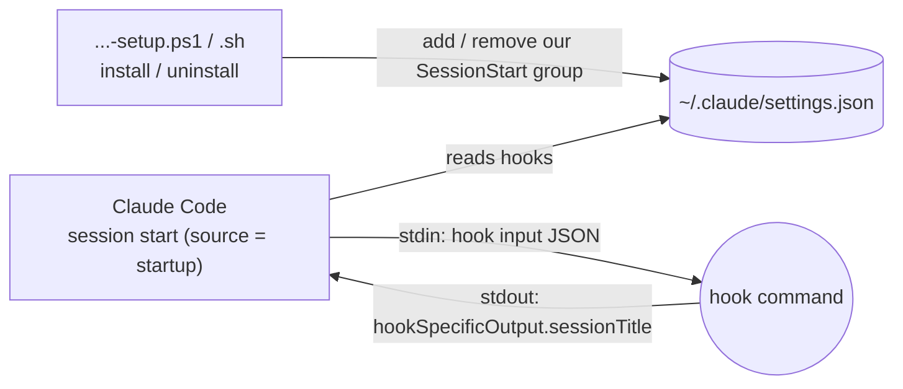
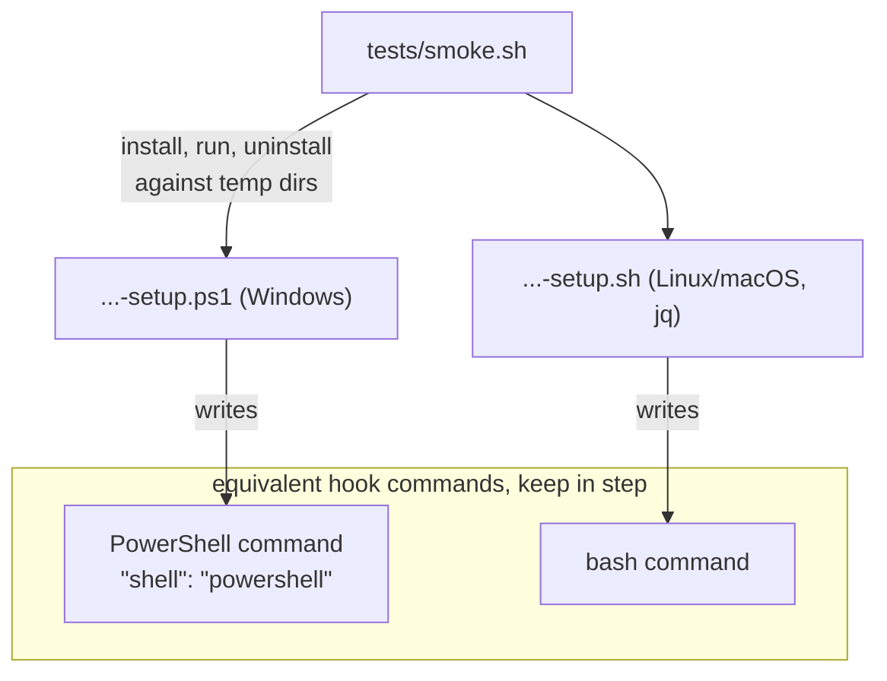
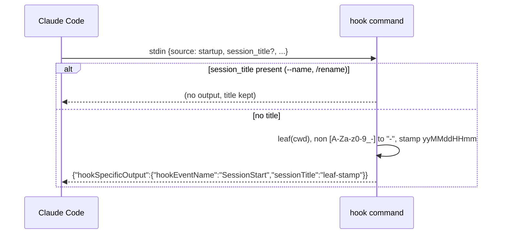
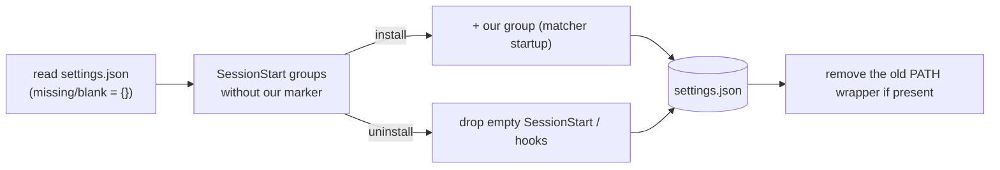

# session-name-date-prefixer — Architecture

A Claude Code `SessionStart` hook that titles each new session `<cwd leaf>-<yyMMddHHmm>` when the
user gave it no name, so session history is easy to browse. The setup scripts write the hook into
`settings.json` and remove it again.

## System context

Claude Code runs the hook when a session starts and reads the title from its output. Setup is the
only part that runs outside Claude Code.

## Components

Two hook commands, one per OS family, each written by its own setup script. A single command line
cannot be valid in both bash and PowerShell, and a hook with no `shell` field runs in PowerShell on
Windows machines without Git Bash.

## Key flow — title a new session

## Key flow — install and uninstall

Both find our group by the `session-name-date-prefixer` no-op at the start of its command, so a
user's own hooks are never touched.

## Key Decisions

### 2026-11-05 — A SessionStart hook replaces the PATH wrapper

**Status:** Accepted (supersedes 2026-07-02)
**Context:** Claude Code now lets a `SessionStart` hook set the title (`sessionTitle`, the same
effect as `/rename`), and passes `session_title` in the hook input when one is set. The wrapper's
reason for existing, "no hook fires before session naming", no longer holds, and a wrapper ahead
of the real binary on PATH is fragile.
**Decision:** The setup scripts write a `startup` hook into `settings.json`: a PowerShell command
with `"shell": "powershell"` on Windows and a bash command on Linux/macOS, because no single line
runs in both shells. The hook prints nothing when `session_title` is present. No `clear` matcher,
since Claude Code ignores `sessionTitle` there. Install and uninstall also remove the old wrapper.
**Consequences:** Nothing intercepts `claude` any more. The two commands must stay equivalent, the
PowerShell one must run in both 5.1 and pwsh, and setup must keep `SessionStart` a JSON array.
Whether Claude Code shows the title is checked live, not by the smoke test.

### 2026-07-02 — A PATH shim that wraps `claude`, not a hook or alias

**Status:** Superseded by 2026-11-05
**Context:** The goal is a default session name without asking the user to change how they invoke
`claude`. Options: a shell alias/function (per-shell, doesn't cover every launch context), a Claude
Code hook (no hook fires before session naming), or a wrapper binary on `PATH`.
**Decision:** Install a wrapper script named `claude` into a `LOCALAPPDATA`/local dir prepended to
the user `PATH`, so it intercepts every `claude` launch. It forwards all arguments verbatim and only
prepends `--name <cwd>-<yyMMddHHmm>` when both `--name` and `-n` are absent. It resolves the real
binary via `Get-Command claude -All`, skipping itself, to avoid infinite recursion.
**Consequences:** Works across all shells and launch contexts with no per-shell config. Pass-through
is sacred — every other argument is untouched. Correctness hinges on the shim being ahead of the real
binary and on the self-skip in resolution; uninstall must reverse the PATH edit. The `.ps1`/`.sh`
pair must stay behaviourally identical.
