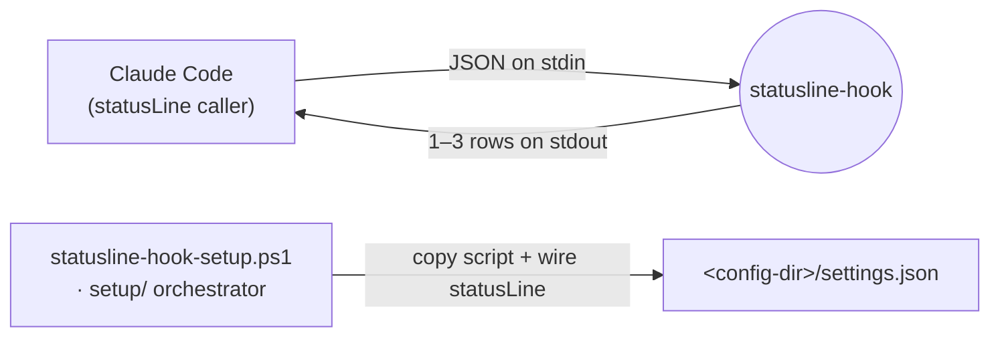
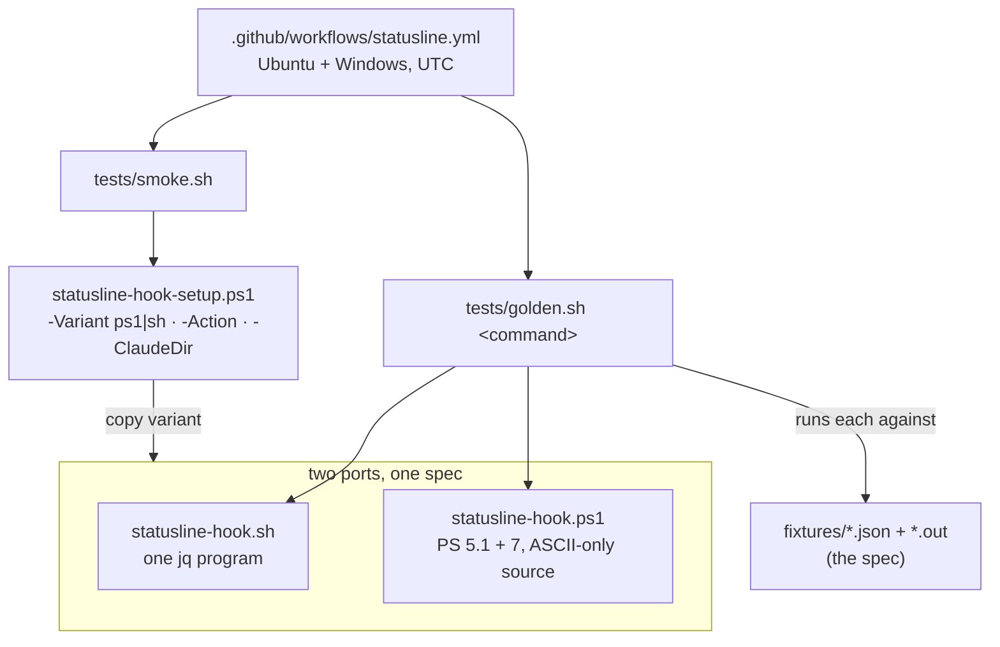
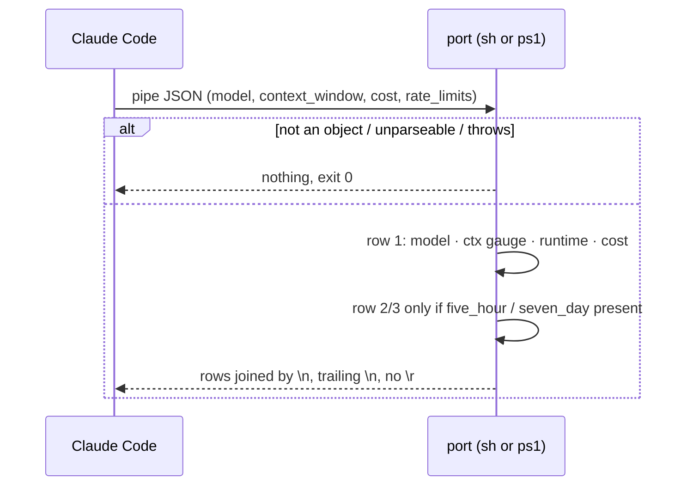

# statusline-hook — Architecture

A public Claude Code statusline (v0.1.0). Each turn it prints up to three aligned rows: model,
context gauge, runtime and cost, then 5-hour and 7-day rate-limit gauges with local reset times.
It ships as two single-file ports, bash + jq and PowerShell 5.1/7, held to identical output by
shared golden fixtures. It only prints the statusline: no export, no state.

## System context

## Components

## Key flow — one turn

## Key Decisions

### 2026-10-10 — Two shell ports held to golden fixtures, no packages

**Status:** Accepted (supersedes 2026-07-02 "Three shell-specific implementations")
**Context:** The hook was being turned into a public product. npm and PyPI distribution (TS and
Python ports) was planned and then rejected by the owner as overkill for a statusline. Keeping three
scripts in step by hand had been a standing cost.
**Decision:** Ship `statusline-hook.sh` (bash + jq) and `statusline-hook.ps1` (PowerShell 5.1 and
7). `fixtures/<case>.json` + `.out` (ESC written as `\e`) is the spec, and `tests/golden.sh
<command>` must pass for both ports. The Python port and its uv project were removed. The version
lives in `VERSION`, releases are the tag `slh-vX.Y.Z` with no release workflow, and users download
the script from the tag.
**Consequences:** Parity is enforced by CI, not by reviewer memory. Every behaviour change is a
fixture edit plus two script edits.

### 2026-10-10 — The statusline only prints the statusline

**Status:** Accepted (supersedes 2026-07-02 "JSONL export is opt-in" and "Hook self-locates its
config dir")
**Context:** The owner wants data export done by a separate tool.
**Decision:** Removed the JSONL export and `C4_STATUSLINE_EXPORT`. The hook writes no files and
keeps no state between turns.
**Consequences:** `usage-dashboard`'s live rate-limit panel gets no new data until a separate
exporter exists. Claude Code sends `rate_limits` only to the statusline command, so that exporter
must find another source or sit in the statusline command chain. Features that need history (a
rate-limit pace forecast) are deferred.

### 2026-10-10 — Three-row layout B with one colour scale

**Status:** Accepted
**Context:** The ~95-character single line got cut off in narrow panes and looked busy.
**Decision:**
- **Layout:** row 1 is `model [effort]   ctx <gauge> · runtime · $cost`. Rows 2 and 3 are the
  `5h`/`7d` gauges aligned under `ctx`, with `↺ HH:MM` / `↺ Ddd HH:MM` in system local time.
  Claude Code trims leading whitespace from each row, so the indent opens with U+2800 (Braille
  blank).
- **Gauges:** every gauge is 10 cells of `━`/`─` plus a percentage, green below 50, yellow below
  80, red otherwise.
- **Colour and weight:** colour is used only for state, everything else is dimmed, and the model is
  the bold cyan accent.
- **Rounding:** cost uses integer cents, `floor(usd*100+0.5)`, so the two ports agree. Weekday
  names come from a fixed English table.
- **Glyphs:** plain Unicode only, no Nerd Font.

**Consequences:** Rows stay under ~55 characters, so width adaptation via `COLUMNS` is unneeded for
now.

### 2026-10-10 — Byte-exact output across OSes

**Status:** Accepted
**Context:** The golden comparison is byte-exact, and Windows adds `\r` in several places.
**Decision:**
- The bash port pipes jq through `tr -d '\r'`. jq on Windows writes CRLF, and `jq -b` is missing
  from older jq.
- The PowerShell port writes with `[Console]::Out.Write`, uses UTF-8 without a BOM, and keeps an
  ASCII-only source.
- `.gitattributes` pins LF for `.sh`, `.json` and `.out`.
- The harness pins `TZ=UTC`. PowerShell ignores `TZ` on Windows, so a full local pass of the
  PowerShell port needs a UTC machine, and CI provides one.

**Consequences:** A CRLF or BOM regression shows up as a fixture failure rather than a broken
terminal.
